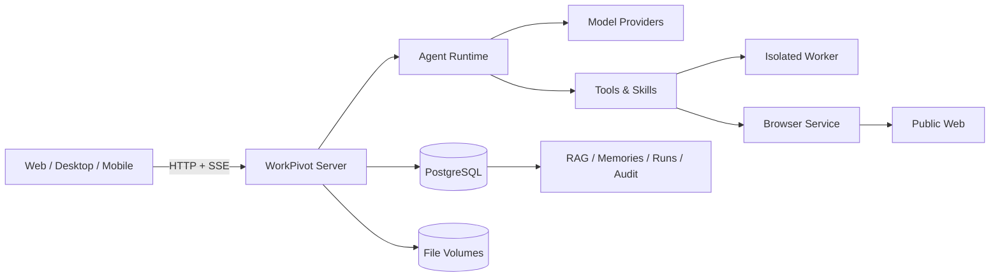

<div align="center">
  

  # WorkPivot

  **面向真实办公交付的私有化 AI 工作台**

  把自然语言任务变成可追踪、可恢复、可下载的 Word、Excel、PPT、PDF 与研究报告。

  [产品设计](docs/02-design/product/PRD-00-产品总纲.md) ·
  [系统架构](docs/02-design/architecture/系统总览.md) ·
  [快速部署](docs/04-operations/快速部署.md) ·
  [开发说明](code/README.md) ·
  [文档导航](docs/README.md)
</div>

> **项目状态**：`v0.3.0-rc.1`。当前聚焦单用户/小团队的私有化工作台，核心业务链路已可在 PostgreSQL 版本运行；正式生产所需的长期稳定性、第二设备验证和完整企业身份接入仍在推进。

## WorkPivot 是什么

WorkPivot 不是只返回聊天内容的问答界面。它把一次工作组织成带工作目录、运行记录、工具权限和成果版本的任务，让 AI 在明确边界内读取资料、调用技能、生成文件，并把每一步过程保留下来。

它适合需要处理敏感业务材料、希望模型和数据留在自有基础设施中的团队，例如投研、咨询、法务、财务、研究机构和内部知识工作团队。

## 核心能力

| 能力 | 当前实现 |
| --- | --- |
| 任务式工作台 | 项目、任务、流式过程、运行中断恢复、成果版本与下载 |
| 多模型接入 | OpenAI 兼容协议与 Anthropic 协议；供应商配置由受控账户管理 |
| Agent 工具链 | 文件读取、网页访问、共享浏览器、MCP、Skill 加载与隔离执行 |
| Office 与 PDF | 生成和修改 DOCX/XLSX/PPTX；安全 HTML 直接打印 PDF；可选 LibreOffice 转换 |
| 知识与引用 | 文档解析、分块、关键词/向量混合检索、版本有效性检查与原文引用 |
| 三层记忆 | 个人、项目、任务三层识别；无冲突新增自动保存，冲突逐条确认 |
| 技能与专家 | 私人 Skill 草稿、试运行、确认发布；专家规则与独立经验管理 |
| 自动化 | 对话创建计划、持久队列、定时执行、停止与恢复 |
| 安全与治理 | 用户隔离、任务级资源授权、写入审批、回收站、备份恢复与审计入口 |

## 为什么是 WorkPivot

### 1. 交付文件，而不是停在对话

任务与工作区绑定，生成结果进入版本化成果链路。文件可以预览、继续修改、恢复历史版本和下载，模型不能仅凭文字声称“已经生成”。

### 2. 私有化优先，模型选择不被单一厂商绑定

服务端、数据库、文件、浏览器和技能执行器均可部署在自有机器。模型侧支持 OpenAI 兼容接口和 Anthropic 协议，可接入公有云、Ollama、vLLM 或其他兼容服务。

### 3. 权限边界跟任务走

读取范围、文件版本、网页地址和写操作都绑定到本轮运行。长期记忆不能扩大工具权限，网页和文档中的指令也不能绕过用户授权。

### 4. 过程可恢复，副作用可审计

运行、对话事件、工具派发和成果都有持久化记录。服务中断后能够判断哪些工具已经执行，避免重放危险副作用；删除和备份采用可恢复流程。

### 5. 记忆有层级，也有纠错入口

系统区分个人、项目和任务事实。临时要求不会自动升级为长期偏好；无冲突的新事实自动保存，修改、合并和冲突保持逐条确认。

### 6. 适合中文办公交付

内置 Office 技能、中文字体、中文检索、PDF 生成和来源引用；同时保留插件化 Skill/MCP 扩展路径，方便把企业自己的流程沉淀为可审查能力。

## 系统概览



当前 PostgreSQL 运行链路采用“数据库保存权限、状态、版本和索引，文件卷保存原件与产物”的混合存储。详细组件、信任边界和数据流见[系统总览](docs/02-design/architecture/系统总览.md)。

## 快速开始

### 一键本地栈（推荐）

需要 Linux、WSL 或可运行 Docker 的 macOS 主机，并安装 Docker Compose、OpenSSL 和 curl。

```bash
git clone git@github.com:lichangbing/WorkPivot.git
cd WorkPivot
bash releases/deploy/install-local-stack.sh --auto-admin
```

安装器会准备数据库、服务端、浏览器、搜索、Worker、执行器镜像和内置技能。完成后打开：

```text
http://127.0.0.1:39990/
```

需要 Office → PDF 转换时追加：

```bash
bash releases/deploy/install-local-stack.sh --auto-admin --with-office-convert --rebuild
```

详细参数、升级和安全边界见[快速部署](docs/04-operations/快速部署.md)。

### 首次使用

1. 使用安装器输出或首次注册创建的管理员账户登录。
2. 在“设置 → 模型”中配置至少一个 OpenAI 兼容或 Anthropic 协议供应商。
3. 创建项目并进入任务，上传资料或描述工作目标。
4. 在输入区选择需要读取的文件、记忆层和工具授权范围。
5. 从右侧成果区查看版本、预览和下载文件。

不要提交 `.env`、`stack.env`、API Key、数据库口令或服务端主密钥。仓库中的环境变量示例只包含占位值。

## 技术栈

- Node.js 22、TypeScript、pnpm workspace
- React、Vite、Tailwind CSS
- PostgreSQL 16 + pgvector，数据库行级安全策略
- Docker Compose 私有化部署
- Playwright 浏览器服务、隔离 Worker、LibreOffice/Poppler 可选执行器
- OpenAI 兼容协议与 Anthropic 协议适配

## 仓库结构

```text
WorkPivot/
├── code/
│   ├── apps/                 # Web、Desktop、Mobile
│   ├── packages/core/        # Agent 循环、工具协议与共享运行能力
│   ├── packages/server/      # HTTP/SSE、数据库、技能、知识与执行编排
│   ├── packages/shared/      # 跨端共享类型
│   └── eval/                 # 自动化评测与回归用例
├── docs/
│   ├── 00-overview/          # 产品一页纸
│   ├── 01-research/          # 竞品、技术研究与结论
│   ├── 02-design/            # 主 PRD、架构、ADR、UI/UX
│   ├── 03-project/           # 状态、计划、验收与历史归档
│   └── 04-operations/        # 部署、升级与运维
├── releases/                 # 发布说明、部署编排和版本材料
└── scripts/                  # 仓库级辅助脚本
```

## 开发与检查

```bash
cd code
pnpm install
pnpm typecheck
pnpm lint
pnpm check:deps
pnpm check:licenses:strict
pnpm check:docs
pnpm eval
```

数据库和浏览器集成测试需要 Docker。完整命令、临时数据库约束与测试选择见[开发说明](code/README.md)和[评测说明](code/eval/README.md)。

## 文档导航

| 想了解 | 从这里开始 |
| --- | --- |
| 产品定位、用户、范围与验收指标 | [产品总纲 PRD](docs/02-design/product/PRD-00-产品总纲.md) |
| 模块行为与交互细节 | [PRD 分册](docs/02-design/product/README.md) |
| 系统组件、数据流、安全边界 | [系统总览](docs/02-design/architecture/系统总览.md) |
| 竞品格局与取舍 | [竞品总览](docs/01-research/competitors/README.md) |
| 当前完成度、限制和路线 | [项目状态](docs/03-project/STATUS.md) |
| 部署、备份和故障恢复 | [运维文档](docs/04-operations/README.md) |
| 历史里程碑与验收证据 | [项目历史](docs/03-project/HISTORY.md) |

文档按“先结论、后证据；先长期设计、后日期记录”的原则维护。完整分层与写作规范见[文档中心](docs/README.md)。

## 已知限制

- 当前版本是 RC，不宣称已达到无人值守生产标准。
- 企业微信/OIDC 身份接入、组织同步、多租户项目协作仍属于后续阶段。
- 复杂 Office 版式的视觉保真、扫描件 OCR 质量和超长任务稳定性仍需真实业务样本验收。
- 未配置浏览器、Worker 或 LibreOffice 时，相关工具会明确不可用，不会静默回退到宿主执行。
- 仓库目前未声明开源许可证；对外分发或商用前需由权利人补充许可文件。

## 贡献与安全

开发约束见 [AGENTS.md](AGENTS.md)。提交功能前应同时更新对应 PRD、架构/ADR、验收记录和运维说明；重要行为变化不能只改代码。

安全缺陷、凭据泄漏和私有数据处理问题不应附带真实业务数据公开提交。报告时请先对日志、配置和样本脱敏。
