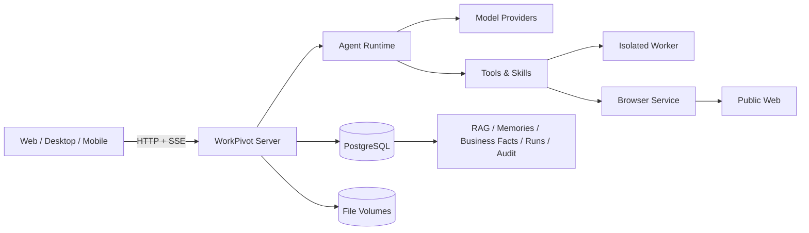

<div align="center">
  

  # WorkPivot

  **面向真实办公交付的私有化 AI 工作台**

  把自然语言任务变成可追踪、可恢复、可下载的 Word、Excel、PPT、PDF 与研究报告。

  [产品设计](docs/02-设计/产品/产品需求/产品需求-00-产品总纲.md) ·
  [系统架构](docs/02-设计/架构/系统总览.md) ·
  [快速部署](docs/04-运维/快速部署.md) ·
  [开发说明](code/README.md) ·
  [文档导航](docs/README.md)
</div>

> **项目状态**：`v0.3.0-rc.1` + 业务事实治理、项目共享与企业 OIDC 增量，schema v67。当前聚焦单用户/小团队的私有化工作台，核心业务链路已部署生产；真实企业身份源、长期稳定性、第二设备和共享知识文件仍在继续验收。

### 当前外部入口

- 用户端：<https://workpivot.lichb.cc.cd/>
- 管理端：<https://workpivot.lichb.cc.cd/admin>
- Android 下载：[WorkPivot-android-1.7.apk](https://115-191-1-188.sslip.io:80/downloads/WorkPivot-android-1.7.apk)
- Windows 下载：[WorkPivot-Windows-portable.zip](https://115-191-1-188.sslip.io:80/downloads/WorkPivot-Windows-portable.zip)
- 回退入口：<https://115-191-1-188.sslip.io:80/>

正式域名通过 Cloudflare Tunnel 对外提供标准 HTTPS，源站只连接本机
`127.0.0.1:8080`。下载客户端等大文件通过旧入口的直连 HTTPS 地址提供，
避免 Cloudflare 免费链路的大文件吞吐瓶颈。
Cloudflare 免费链路在部分大陆网络下可能首次连接较慢；遇到超时应重试，或临时使用回退入口。

当前体验实例开放自助注册，登录页直接提供“登录 / 注册”两个入口；新账号默认每天
10 次对话、200,000 Token、50 MB 上传和 1 个并发任务，按北京时间每天 12:00 刷新。
管理员创建的账户默认不限，可在后台“限额管理”单独配置。

Windows 便携客户端 `0.3.0-rc.3` 下载后解压，进入 `win-unpacked` 运行 `WorkPivot.exe`。
客户端内部使用 `https://115-191-1-188.sslip.io:80` 连接后台，服务器地址收在“高级服务器设置”
中；用户的正式网页入口仍为 `https://workpivot.lichb.cc.cd/`。该构建未做代码签名，
Windows SmartScreen 首次运行可能需要选择“更多信息 → 仍要运行”。

Windows ZIP SHA-256：`6d0e057ff8ed0a50fe2cf68091c01e601a025f1d82c774faca33170f98271294`。

Android `1.7`（versionCode 8）APK SHA-256：
`00768fcdc9759d82bdfe19e3445be5f7fce471b186209c0741155df0548f9ed6`。
该包使用 WorkPivot 独立内测签名，仅用于内部测试。

## WorkPivot 是什么

WorkPivot 不是只返回聊天内容的问答界面。它把一次工作组织成带工作目录、运行记录、工具权限和成果版本的任务，让 AI 在明确边界内读取资料、调用技能、生成文件，并把每一步过程保留下来。

它适合需要处理敏感业务材料、希望模型和数据留在自有基础设施中的团队，例如投研、咨询、法务、财务、研究机构和内部知识工作团队。

## 核心能力

| 能力 | 当前实现 |
| --- | --- |
| 任务式工作台 | 项目、任务、流式过程、运行中断恢复、成果版本与下载 |
| 多模型接入 | OpenAI 兼容协议与 Anthropic 协议；供应商配置由受控账户管理 |
| Agent 工具链 | 文件读取、网页访问、共享浏览器、MCP、Skill 加载与隔离执行 |
| Office 与 PDF | 生成和修改 DOCX/XLSX/PPTX；安全 HTML 直接打印 PDF；可选 LibreOffice 转换 |
| 知识与引用 | 文档解析候选、逐版本用户确认、选择性分块、关键词/向量混合检索、版本失效与原文引用 |
| 三层记忆 | 个人、项目、任务三层识别；每轮自动加载相关已确认记忆；无冲突新增自动保存，冲突逐条确认 |
| 业务事实 | 项目对象、事实/关系版本、证据、双时态查询、冲突确认、可逆实体合并和表格候选导入；支持项目成员共享事实 |
| 多端同步 | 项目/任务变化实时同步；同一任务的回复、工具过程和审批事件按持久序号恢复 |
| 技能与专家 | 私人 Skill 草稿、试运行、确认发布；专家规则与独立经验管理 |
| 自动化 | 对话创建计划、持久队列、定时执行、停止与恢复 |
| 安全与治理 | HTTPS、用户隔离、任务级资源授权、知识入库确认、单版本删除传播、来源待复核、注册策略、对话/Token/上传/并发限额、写入审批、回收站、备份恢复与审计入口 |

## 为什么是 WorkPivot

### 1. 交付文件，而不是停在对话

任务与工作区绑定，生成结果进入版本化成果链路。文件可以预览、继续修改、恢复历史版本和下载，模型不能仅凭文字声称“已经生成”。

### 2. 私有化优先，模型选择不被单一厂商绑定

服务端、数据库、文件、浏览器和技能执行器均可部署在自有机器。模型侧支持 OpenAI 兼容接口和 Anthropic 协议，可接入公有云、Ollama、vLLM 或其他兼容服务。

### 3. 权限边界跟任务走

读取范围、文件版本、网页地址和写操作都绑定到本轮运行。长期记忆不能扩大工具权限，网页和文档中的指令也不能绕过用户授权。

### 4. 过程可恢复，副作用可审计

运行、对话事件、工具派发和成果都有持久化记录。服务中断后能够判断哪些工具已经执行，避免重放危险副作用；删除和备份采用可恢复流程。

### 5. 记忆有层级，也有纠错入口

系统区分个人、项目和任务事实。临时要求不会自动升级为长期偏好；无冲突的新事实自动保存，修改、合并和冲突保持逐条确认。

### 6. 项目事实有版本，不靠重复聊天记录猜测

合同、预算、日期、交付物和对象关系以项目为边界保存。值更新进入同一事实链的新
revision，冲突确认前不会把旧值或候选值当作唯一答案；具体查询可回到原文、文件版本和
有效时间。

### 7. 适合中文办公交付

内置 Office 技能、中文字体、中文检索、PDF 生成和来源引用；同时保留插件化 Skill/MCP 扩展路径，方便把企业自己的流程沉淀为可审查能力。

## 系统概览



当前 PostgreSQL 运行链路采用“数据库保存权限、状态、版本和索引，文件卷保存原件与产物”的混合存储。详细组件、信任边界和数据流见[系统总览](docs/02-设计/架构/系统总览.md)。

## 快速开始

### 一键本地栈（推荐）

需要 Linux、WSL 或可运行 Docker 的 macOS 主机，并安装 Docker Compose、OpenSSL 和 curl。

```bash
git clone git@github.com:lichangbing/WorkPivot.git
cd WorkPivot
bash releases/deploy/install-local-stack.sh --auto-admin
```

安装器默认准备完整栈：数据库、服务端、浏览器、搜索、Worker、带 OCR/PDF/LibreOffice 的执行器、
PostgreSQL 对话存储和内置技能。完成后打开：

```text
http://127.0.0.1:39990/
```

仅需精简环境时显式使用：

```bash
bash releases/deploy/install-local-stack.sh --auto-admin --minimal
```

详细参数、升级和安全边界见[快速部署](docs/04-运维/快速部署.md)。

### 首次使用

1. 使用安装器输出或首次注册创建的管理员账户登录。
2. 在“设置 → 模型”中配置至少一个 OpenAI 兼容或 Anthropic 协议供应商。
3. 创建项目并进入任务，上传资料或描述工作目标。
4. 在输入区选择需要读取的文件、记忆层和工具授权范围。
5. 在“资料与知识”中逐版本勾选需要入库的片段；未确认内容不会进入项目知识检索。删除单个版本会同步撤销其知识索引并让失去唯一来源的记忆或业务事实进入待复核。
6. 从右侧成果区查看版本、预览和下载文件。
7. 从右侧“业务事实”查看项目对象、事实版本、证据和待确认冲突；可合并相似实体、从受支持表格生成候选，并由项目所有者管理只读/编辑成员。临时任务不会生成业务事实。

不要提交 `.env`、`stack.env`、API Key、数据库口令或服务端主密钥。仓库中的环境变量示例只包含占位值。

管理员在“管理后台 → 用户管理”中可以：

- 创建成员并设置角色；管理员创建的账户默认不限。
- 停用/启用账号、重置密码、撤销全部登录会话。
- 查看当前周期用量和最近登录时间。
- 在独立“限额管理”中控制自助注册默认值和每个用户的对话、Token、上传、并发限制。

后台另提供默认角色与专家模板、模型连接、企业身份、安全审计和运行监控。模型配置不再录入价格字段；安全审计以中文操作语义展示，不公开请求 ID；项目管理只在用户工作区进行。

## 技术栈

- Node.js 22、TypeScript、pnpm workspace
- React、Vite、Tailwind CSS
- PostgreSQL 16 + pgvector，数据库行级安全策略
- Docker Compose 私有化部署
- Playwright 浏览器服务、隔离 Worker、LibreOffice/Poppler 可选执行器
- OpenAI 兼容协议与 Anthropic 协议适配

## 仓库结构

```text
WorkPivot/
├── code/
│   ├── apps/                 # Web、Desktop、Mobile
│   ├── packages/core/        # Agent 循环、工具协议与共享运行能力
│   ├── packages/server/      # HTTP/SSE、数据库、技能、知识与执行编排
│   ├── packages/shared/      # 跨端共享类型
│   └── eval/                 # 自动化评测与回归用例
├── docs/
│   ├── 00-概览/              # 产品一页纸
│   ├── 01-研究/              # 横向格局、产品主卡、原始证据
│   ├── 02-设计/              # 产品需求、分层架构、架构决策、原型、界面规范
│   ├── 03-项目/              # 状态、计划、验证与部署历史
│   └── 04-运维/              # 部署、升级与运维
├── releases/                 # 发布说明、部署编排和版本材料
└── scripts/                  # 仓库级辅助脚本
```

## 开发与检查

```bash
cd code
pnpm install
pnpm typecheck
pnpm lint
pnpm check:deps
pnpm check:licenses:strict
pnpm check:docs
pnpm eval
```

数据库和浏览器集成测试需要 Docker。完整命令、临时数据库约束与测试选择见[开发说明](code/README.md)和[评测说明](code/eval/README.md)。

## 文档导航

| 想了解 | 从这里开始 |
| --- | --- |
| 产品定位、用户、范围与验收指标 | [产品总纲 PRD](docs/02-设计/产品/产品需求/产品需求-00-产品总纲.md) |
| 模块行为与交互细节 | [PRD 分册](docs/02-设计/产品/索引.md) |
| 系统组件、数据流、安全边界 | [系统总览](docs/02-设计/架构/系统总览.md) |
| 架构专题与历史归档 | [架构设计索引](docs/02-设计/架构/索引.md) |
| 竞品格局与取舍 | [竞品总览](docs/01-研究/竞品/索引.md) |
| 竞品原始证据 | [证据库](docs/01-研究/竞品/证据/索引.md) |
| 当前完成度、限制和路线 | [项目状态](docs/03-项目/当前状态.md) |
| 部署、备份和故障恢复 | [运维文档](docs/04-运维/索引.md) |
| 历史里程碑与验收证据 | [项目历史](docs/03-项目/历史.md) |

文档按“先结论、后证据；先长期设计、后日期记录”的原则维护。完整分层与写作规范见[文档中心](docs/README.md)。

## 已知限制

- 当前版本是 RC，不宣称已达到无人值守生产标准。
- OIDC 基础、管理员绑定和企业成员模型已实现；企业微信、组织自动同步和目标企业 IdP 仍需实际配置。
- 项目协作当前共享项目元数据和业务事实，不共享私人聊天、私人任务或个人记忆；共享知识文件和成员审批流仍待后续。
- 复杂 Office 版式的视觉保真、扫描件 OCR 质量和超长任务稳定性仍需真实业务样本验收。
- 未配置浏览器、Worker 或 LibreOffice 时，相关工具会明确不可用，不会静默回退到宿主执行。
- 业务事实已支持名称/别名候选、可逆合并拆回和 XLSX/DOCX/CSV 表格候选；向量候选、复杂扫描表格和项目概览仍待后续版本。
- 仓库目前未声明开源许可证；对外分发或商用前需由权利人补充许可文件。

## 贡献与安全

开发约束见 [AGENTS.md](AGENTS.md)。提交功能前应同时更新对应 PRD、架构/ADR、验收记录和运维说明；重要行为变化不能只改代码。

安全缺陷、凭据泄漏和私有数据处理问题不应附带真实业务数据公开提交。报告时请先对日志、配置和样本脱敏。
