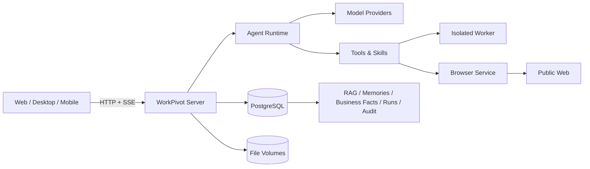

<div align="center">
  

  # WorkPivot

  **面向真实办公交付的私有化 AI 工作台**

  把自然语言任务变成可追踪、可恢复、可下载的 Word、Excel、PPT、PDF 与研究报告。

  [产品设计](docs/02-设计/产品/产品需求/产品需求-00-产品总纲.md) ·
  [系统架构](docs/02-设计/架构/系统总览.md) ·
  [接口设计](docs/02-设计/架构/接口/接口总览.md) ·
  [快速部署](docs/04-运维/快速部署.md) ·
  [开发说明](code/README.md) ·
  [文档导航](docs/README.md)
</div>

> **项目状态**：`v0.3.0-rc.6` 已发布到本地和正式服务器，schema v72。RC 技术门禁已完成：固定 Office 视觉集、真实模型 20+5、双客户端同步、故障恢复、15 分钟持续运行和 Keycloak OIDC 均已通过。RC.6 已补齐存活/就绪检查、结构化脱敏日志、Prometheus 指标、系统状态、备份状态、告警规则、安全审计覆盖和高危依赖修复；第二物理设备、24 小时真实负载与真实业务样本仍是创建 `v0.3.0` 正式标签前的外部条件。

### 当前外部入口

- 用户端：<https://workpivot.lichb.cc.cd/>
- 管理端：<https://workpivot.lichb.cc.cd/admin>
- Android 下载：[WorkPivot-android-1.7.apk](https://115-191-1-188.sslip.io:80/downloads/WorkPivot-android-1.7.apk)
- Windows 下载：[WorkPivot-Windows-0.3.0-rc.6-portable.zip](https://115-191-1-188.sslip.io:80/downloads/WorkPivot-Windows-0.3.0-rc.6-portable.zip)
- 回退入口：<https://115-191-1-188.sslip.io:80/>

正式域名通过 Cloudflare Tunnel 对外提供标准 HTTPS，源站只连接本机
`127.0.0.1:8080`。下载客户端等大文件通过旧入口的直连 HTTPS 地址提供，
避免 Cloudflare 免费链路的大文件吞吐瓶颈。
Cloudflare 免费链路在部分大陆网络下可能首次连接较慢；遇到超时应重试，或临时使用回退入口。

当前体验实例开放自助注册，登录页直接提供“登录 / 注册”两个入口；新账号默认每天
10 次对话、200,000 Token、50 MB 上传和 1 个并发任务，按北京时间每天 12:00 刷新。
管理员创建的账户默认不限，可在后台“限额管理”单独配置。

Windows 便携客户端 `0.3.0-rc.6` 下载后解压，进入 `win-unpacked` 运行 `WorkPivot.exe`。
客户端内部使用 `https://115-191-1-188.sslip.io:80` 连接后台，服务器地址收在“高级服务器设置”
中；用户的正式网页入口仍为 `https://workpivot.lichb.cc.cd/`。该构建未做代码签名，
Windows SmartScreen 首次运行可能需要选择“更多信息 → 仍要运行”。

Windows ZIP SHA-256：`c4d090298b85c77e24023eef63423cf6f735c17abc57e661391a4b34bf8252d6`。

Android `1.7`（versionCode 8）APK SHA-256：
`00768fcdc9759d82bdfe19e3445be5f7fce471b186209c0741155df0548f9ed6`。
该包使用 WorkPivot 独立内测签名，仅用于内部测试。RC.6 的 Android 源码已将目标版本标记为 `1.8` / versionCode 9，但本机缺少 Android SDK、JDK 和发布签名环境，尚未生成可安装 APK；下载入口继续提供经过验证的 1.7。

## WorkPivot 是什么

WorkPivot 不是只返回聊天内容的问答界面。它把一次工作组织成带工作目录、运行记录、工具权限和成果版本的任务，让 AI 在明确边界内读取资料、调用技能、生成文件，并把每一步过程保留下来。

它适合需要处理敏感业务材料、希望模型和数据留在自有基础设施中的团队，例如投研、咨询、法务、财务、研究机构和内部知识工作团队。

Web、桌面和移动端共用同一套 HTTP/SSE 协议。服务端是项目、任务、运行、审批、记忆、业务事实和成果版本的权威状态源；客户端不做第二套业务真相。完整接口分组、事件语义、幂等与错误恢复规则见[接口总览](docs/02-设计/架构/接口/接口总览.md)。

## 核心能力

| 能力 | 当前实现 |
| --- | --- |
| 任务式工作台 | 项目、任务、流式过程、运行中断恢复、成果版本、预览与下载；运行中可受控加入文件和记忆层；右侧统一“预览 / 文件 / 浏览器”工作区；预览只读且与 Agent 读取链路严格分离 |
| 多模型接入 | OpenAI 兼容协议与 Anthropic 协议；供应商配置由受控账户管理 |
| Agent 工具链 | 文件读取、网页访问、共享浏览器、MCP、Skill 加载与隔离执行 |
| Office 与 PDF | 生成和修改 DOCX/XLSX/PPTX；安全 HTML 直接打印 PDF；DOCX/XLSX/PPTX 按需转 PDF 只读预览，记录源/PDF/字体包/转换器哈希和文本层状态 |
| 知识与引用 | 文档解析候选、逐版本用户确认、选择性分块、关键词/向量混合检索、版本失效与原文引用 |
| 记忆与上下文 | 统一口径为用户、会话、项目、工作四类记忆；每轮按任务动态装配上下文。当前代码已落地个人/项目/任务记忆，工作项与会话记忆继续收敛 |
| 业务事实 | 项目对象、事实/关系版本、证据、双时态查询、冲突确认、可逆实体合并和表格候选导入；支持项目成员共享事实 |
| 多端同步 | 项目/任务变化实时同步；同一任务的回复、工具过程和审批事件按持久序号恢复 |
| 交互与恢复 | 澄清、计划、动作、成果验收持久化；每条请求区分已接收、处理中、等待、中断、失败与已交付；运行中相关消息重新规划，资源范围只增不减，并从安全步骤检查点继续 |
| 技能与专家 | 私人 Skill 草稿、试运行、确认发布；专家规则与独立经验管理 |
| 自动化 | 对话创建计划、持久队列、定时执行、停止与恢复 |
| 安全与治理 | HTTPS、用户隔离、任务级资源授权、知识入库确认、单版本删除传播、来源待复核、注册策略、对话/Token/上传/并发限额、写入审批、回收站、备份恢复与审计入口 |

## 版本与开发路线

WorkPivot 使用“候选版 → 单服务器正式版 → 多服务器治理版 → 企业稳定版”的发布路线。RC 只做发布阻断修复和验收，不继续堆叠业务功能；正式补丁只修缺陷、安全问题和兼容性。

| 版本 | 定位 | 计划重点 |
| --- | --- | --- |
| `v0.3.0-rc.6` | 正式发布门禁 | 正式服务器升级、客户端制品、双物理设备、24 小时运行、真实业务样本、备份恢复、健康/就绪、基础指标、告警规则、审计覆盖和只读系统状态 |
| `v0.3.0` | 单服务器正式版 | Web/Windows 正式支持，Android 作为正式支持的 Beta 客户端；单机 Compose、单数据库、本地持久卷 |
| `v0.3.x` | 正式补丁 | 只处理缺陷、安全更新、兼容性和部署问题 |
| `v0.4.0` | 服务端管理与多服务器版 | 服务端管理面、多 API/Scheduler/Worker/Browser、节点联动、对象存储、跨实例锁与事件、高可用基础、滚动发布和多机安全检查 |
| `v0.5.0` | 安全与可观测治理版 | 告警中心、SLO、不可变审计归档、配置发布、作业管理、备份恢复管理、第三方代码审计和渗透测试 |
| `v0.6.0` | 企业容灾与规模版 | 多故障域、数据库自动故障转移、跨区域备份、容量调度、Kubernetes/KEDA 按需评估和灾难恢复演练 |
| `v1.0.0` | 稳定企业版 | API/插件兼容承诺、支持矩阵、SLA 边界、完整安全证据和多个真实客户形态验收 |

完整发布门禁、版本边界、多服务器拓扑、安全审核节奏和监控审计归属见[公开发布与平台治理路线图](docs/03-项目/计划/公开发布与平台治理路线图-20261104.md)。

## 为什么是 WorkPivot

### 1. 交付文件，而不是停在对话

任务与工作区绑定，生成结果进入版本化成果链路。文件可以预览、继续修改、恢复历史版本和下载，模型不能仅凭文字声称“已经生成”。

### 2. 私有化优先，模型选择不被单一厂商绑定

服务端、数据库、文件、浏览器和技能执行器均可部署在自有机器。模型侧支持 OpenAI 兼容接口和 Anthropic 协议，可接入公有云、Ollama、vLLM 或其他兼容服务。

### 3. 权限边界跟任务走

读取范围、文件版本、网页地址和写操作都绑定到本轮运行。长期记忆不能扩大工具权限，网页和文档中的指令也不能绕过用户授权。

### 4. 过程可恢复，副作用可审计

运行、对话事件、工具派发和成果都有持久化记录。服务中断后能够判断哪些工具已经执行，避免重放危险副作用；删除和备份采用可恢复流程。

### 5. 记忆与上下文分离，重要内容有纠错入口

上下文是每轮实际发给模型的最小充分内容；记忆是持久化保存、可按需召回的用户、会话、项目和来源数据。临时要求不会自动升级为长期偏好，业务事实、记忆摘要和原始证据不会混为一个无限增长的 Prompt。

### 6. 项目事实有版本，不靠重复聊天记录猜测

合同、预算、日期、交付物和对象关系以项目为边界保存。值更新进入同一事实链的新
revision，冲突确认前不会把旧值或候选值当作唯一答案；具体查询可回到原文、文件版本和
有效时间。

### 7. 适合中文办公交付

内置 Office 技能、中文字体、中文检索、PDF 生成和来源引用；同时保留插件化 Skill/MCP 扩展路径，方便把企业自己的流程沉淀为可审查能力。

## 系统概览



当前 PostgreSQL 运行链路采用“数据库保存权限、状态、版本和索引，文件卷保存原件与产物”的混合存储。详细组件、信任边界和数据流见[系统总览](docs/02-设计/架构/系统总览.md)。

## 快速开始

### 一键本地栈（推荐）

需要 Linux、WSL 或可运行 Docker 的 macOS 主机，并安装 Docker Compose、OpenSSL 和 curl。

```bash
git clone git@github.com:lichangbing/WorkPivot.git
cd WorkPivot
bash releases/deploy/install-local-stack.sh --auto-admin
```

安装器默认准备完整栈：数据库、服务端、浏览器、搜索、Worker、带 OCR/PDF/LibreOffice 的执行器、
PostgreSQL 对话存储和内置技能。完成后打开：

```text
http://127.0.0.1:39990/
```

仅需精简环境时显式使用：

```bash
bash releases/deploy/install-local-stack.sh --auto-admin --minimal
```

详细参数、升级和安全边界见[快速部署](docs/04-运维/快速部署.md)。

### 首次使用

1. 使用安装器输出或首次注册创建的管理员账户登录。
2. 在“设置 → 模型”中配置至少一个 OpenAI 兼容或 Anthropic 协议供应商。
3. 创建项目并进入任务，上传资料或描述工作目标。
4. 在输入区选择需要读取的文件、记忆层和工具授权范围。
5. 在“资料与知识”中逐版本勾选需要入库的片段；未确认内容不会进入项目知识检索。删除单个版本会同步撤销其知识索引并让失去唯一来源的记忆或业务事实进入待复核。
6. 从右侧统一工作区切换“预览 / 文件 / 浏览器”：文件点击后直接预览，Agent 打开网页时自动切到共享浏览器；任务级页签和当前版本会被记忆。
7. 从右侧“业务事实”查看项目对象、事实版本、证据和待确认冲突；可合并相似实体、从受支持表格生成候选，并由项目所有者管理只读/编辑成员。临时任务不会生成业务事实。

不要提交 `.env`、`stack.env`、API Key、数据库口令或服务端主密钥。仓库中的环境变量示例只包含占位值。

管理员在“管理后台 → 用户管理”中可以：

- 创建成员并设置角色；管理员创建的账户默认不限。
- 停用/启用账号、重置密码、撤销全部登录会话。
- 查看当前周期用量和最近登录时间。
- 在独立“限额管理”中控制自助注册默认值和每个用户的对话、Token、上传、并发限制。

后台另提供默认角色与专家模板、模型连接、企业身份、安全审计和运行监控。模型配置不再录入价格字段；安全审计以中文操作语义展示，不公开请求 ID；项目管理只在用户工作区进行。

数据库会话中的澄清、计划审批、动作授权和成果验收使用同一套持久化交互协议：同一运行只显示一个阻塞项，计划可修改，高风险动作无法永久豁免，拒绝原因会回传 Agent，等待状态可在 Web、桌面和手机之间恢复。

任务运行时仍可发送补充、纠正或后续请求。系统在模型流结束或工具批次检查点后判断相关性：相关内容更新当前上下文并触发重新规划；无关内容进入后续队列，当前运行完成后自动作为下一轮执行。Web、桌面和手机同步显示，可撤销未执行要求。服务重启后会继续领取已完成任务遗留的后续队列。中断恢复沿用数据库检查点和文件链路检查点，未闭合工具调用会标记为结果未知，不会盲目重放。

## 技术栈

- Node.js 22、TypeScript、pnpm workspace
- React、Vite、Tailwind CSS
- PostgreSQL 16 + pgvector，数据库行级安全策略
- Docker Compose 私有化部署
- Playwright 浏览器服务、隔离 Worker、LibreOffice/Poppler 可选执行器
- OpenAI 兼容协议与 Anthropic 协议适配

## 仓库结构

```text
WorkPivot/
├── code/
│   ├── apps/                 # Web、Desktop、Mobile
│   ├── packages/core/        # Agent 循环、工具协议与共享运行能力
│   ├── packages/server/      # HTTP/SSE、数据库、技能、知识与执行编排
│   ├── packages/shared/      # 跨端共享类型
│   └── eval/                 # 自动化评测与回归用例
├── docs/
│   ├── 00-概览/              # 产品一页纸
│   ├── 01-研究/              # 横向格局、产品主卡、原始证据
│   ├── 02-设计/              # 产品需求、分层架构、架构决策、原型、界面规范
│   ├── 03-项目/              # 状态、计划、验证与部署历史
│   └── 04-运维/              # 部署、升级与运维
├── releases/                 # 发布说明、部署编排和版本材料
└── scripts/                  # 仓库级辅助脚本
```

## 开发与检查

```bash
cd code
pnpm install
pnpm typecheck
pnpm lint
pnpm check:deps
pnpm check:licenses:strict
pnpm check:docs
pnpm eval
```

数据库和浏览器集成测试需要 Docker。完整命令、临时数据库约束与测试选择见[开发说明](code/README.md)和[评测说明](code/eval/README.md)。

## 文档导航

| 想了解 | 从这里开始 |
| --- | --- |
| 产品定位、用户、范围与验收指标 | [产品总纲 PRD](docs/02-设计/产品/产品需求/产品需求-00-产品总纲.md) |
| 对外产品、记忆与上下文口径 | [产品白皮书](docs/00-概览/产品白皮书.md) |
| 模块行为与交互细节 | [PRD 分册](docs/02-设计/产品/索引.md) |
| 系统组件、数据流、安全边界 | [系统总览](docs/02-设计/架构/系统总览.md) |
| 接口分组、SSE 事件、幂等和错误恢复 | [接口总览](docs/02-设计/架构/接口/接口总览.md) |
| 文档预览、结构化读取和 RO-1～RO-6 计划 | [文档预览与编辑开发计划](docs/03-项目/计划/文档预览与编辑开发计划-20261101.md) |
| 架构专题与历史归档 | [架构设计索引](docs/02-设计/架构/索引.md) |
| 竞品格局与取舍 | [竞品总览](docs/01-研究/竞品/索引.md) |
| 竞品原始证据 | [证据库](docs/01-研究/竞品/证据/索引.md) |
| 当前完成度、限制和路线 | [项目状态](docs/03-项目/当前状态.md) |
| 正式发布、多服务器与平台治理计划 | [公开发布与平台治理路线图](docs/03-项目/计划/公开发布与平台治理路线图-20261104.md) |
| 客户端、浏览器和部署支持范围 | [发布支持矩阵](docs/02-设计/架构/交付/发布支持矩阵.md) |
| 部署、备份和故障恢复 | [运维文档](docs/04-运维/索引.md) |
| 历史里程碑与验收证据 | [项目历史](docs/03-项目/历史.md) |

文档按“先结论、后证据；先长期设计、后日期记录”的原则维护。完整分层与写作规范见[文档中心](docs/README.md)。

## 已知限制

- 当前版本是 RC，不宣称已达到无人值守生产标准。
- OIDC 基础、管理员绑定和企业成员模型已实现；企业微信、组织自动同步和目标企业 IdP 仍需实际配置。
- 项目协作当前共享项目元数据和业务事实，不共享私人聊天、私人任务或个人记忆；共享知识文件和成员审批流仍待后续。
- 只读预览已覆盖 PDF、图片、Markdown、文本、HTML 和 CSV；DOCX/XLSX/PPTX 依赖隔离执行器中的 LibreOffice 转 PDF。派生预览不能作为读取或知识入库源，扫描 PDF 会标记无原生文本层；复杂版式的视觉保真仍需真实业务样本验收。
- 未配置浏览器、Worker 或 LibreOffice 时，相关工具会明确不可用，不会静默回退到宿主执行。
- 业务事实已支持名称/别名候选、可逆合并拆回和 XLSX/DOCX/CSV 表格候选；向量候选、复杂扫描表格和项目概览仍待后续版本。
- 仓库目前未声明开源许可证；对外分发或商用前需由权利人补充许可文件。

## 贡献与安全

开发约束见 [AGENTS.md](AGENTS.md)。提交功能前应同时更新对应 PRD、架构/ADR、验收记录和运维说明；重要行为变化不能只改代码。

安全缺陷、凭据泄漏和私有数据处理问题不应附带真实业务数据公开提交。报告时请先对日志、配置和样本脱敏。
