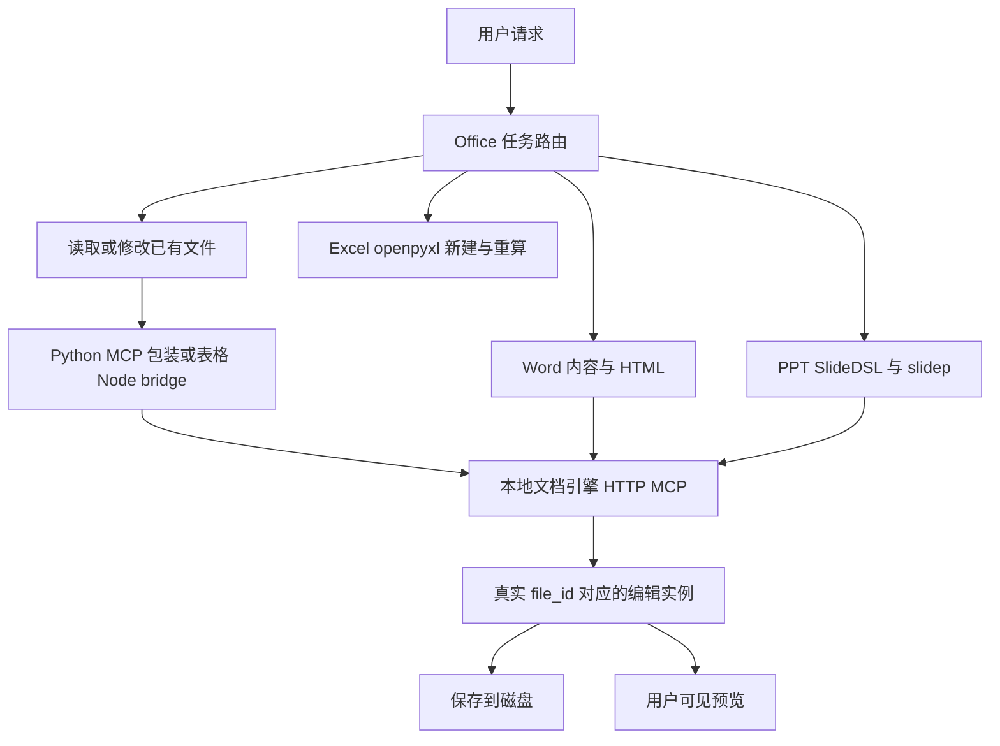

# WorkBuddy Office 文件处理静态分析

日期：2026-10-17。样本：本机 WorkBuddy 5.8.3。范围：Word、Excel、PPT 的读取、既有文件修改与新文件生成。本次使用 REA 分析安装产物中的 JavaScript，并逐项核对发布的技能、Python 包装脚本与 Node 实现；未启动目标程序、执行目标脚本、调用本地编辑服务或提交测试文档。

核心结论：WorkBuddy 按任务和文件类型分流。既有文档的对象级编辑主要由腾讯本地文档引擎承担；Word 新建采用 Markdown→HTML→文档引擎，Excel 新建采用 openpyxl→公式重算，PPT 新建采用 SlideDSL→slidep→文档引擎提交修订并保存。不能概括为“全部用 Python 处理 Office”，也不能从技能说明推导出所有路径已经运行成功。

同日深入复核已补充 [Word 实际解析与原生边界](office-word-20261017.md)、[Excel 实际读取与 Worker 编辑链](office-excel-20261017.md)、[PPT 生成器与修订提交链](office-ppt-20261017.md)。PPT 底层路径和 Word 抽取依赖缺口已据实际代码修正；本报告仍是流程总览，不能代替原生引擎反编译结果。

继续研究见 [原生 Office 引擎分析](office-native-20261017.md)：便携 Ghidra/JDK 环境已补齐，三种内嵌空白模板已验证；原生完整自动分析在提高至 30 分钟启动预算后仍超时，没有成功的函数 dossier。PPT 专项已补充实际 protobuf wire 编码、版本读取和保存失败边界。

## 1. 样本与证据边界

安装根目录为 `C:\Users\lichb\AppData\Local\Programs\WorkBuddy`。下文路径缩写：

- `U`：安装根目录下 `resources\app.asar.unpacked`。
- `B`：`U\resources\plugins\workbuddy-builtin`。
- `D`：`B\builtin-plugins\workbuddy-docx`。
- `E`：`B\builtin-plugins\workbuddy-sheetagent`。
- `P`：`B\builtin-plugins\workbuddy-pptx\skills\workbuddy-pptx`。
- `T`：`U\node_modules\@tencent\tencent-docs-ai-engine`。

当前 `resources\app.asar` 的包元数据版本为 **5.8.3**，文件大小 96,544,269 字节，SHA-256 为 `3e50fcb5b060deba4f1ea9a8c293cf955bf12d7e52d971985de914350afd9077`。10 月 14 日报告记录的 5.7.7 是历史样本，不应混用。引擎 Node 包版本为 `0.2.196-wb`，SDK 版本清单为 `0.0.0.499`；这些不是同一个版本号。

证据分为三层：**实际代码**证明包装、请求、计算或保存逻辑存在；**发布技能约定**说明 Agent 应如何选路和执行；**分析推断**用于提出 WorkPivot 建议。技能不是服务端约束，也不证明模型必然遵守。原生 `editor_sdk.exe` 内部导入导出实现、运行中的工具 schema、保真度和依赖可用性未在本次确认。

## 2. 九类任务的处理方式

| 文件 | 读取 | 修改既有文件 | 生成新文件 |
|---|---|---|---|
| Word | 编辑器查询正文结构、查找、大纲、表格及属性；重排版另有 docx2html 抽取 | 本地 SDK 的 `doc_*` 工具，按真实文档实例修改并保存 | 内容 Markdown→排版 HTML→`create_doc/open_file/doc_insert_html_content/save_file` |
| Excel | 小范围 SDK 查询；复杂数据读取交 sheet-agent；生成参考材料另走内容抽取 | 确定操作用 `sheet_*`；复杂操作通过 sheet-agent 的原子工具或受限 JS Worker | 主代理编写 openpyxl 脚本→重算公式与缓存检查→AIGC 元数据 |
| PPT | `slidep inspect` 经引擎 keyframe→逐页 Markdown；视觉问题截图；特殊对象补 SDK 查询 | 本地 SDK 的 `slide_*`，修改与用户预览共用实例 | 故事与设计文件→逐页 SlideDSL→slidep 构造 revision→引擎提交并保存→布局及可用时的视觉检查 |

“给原 Excel 新增工作表”属于修改原工作簿；只把源表作为只读参考、另存到新路径才属于新建。PPT 内容任务统一优先专用技能，不能因通用编辑技能也列出 slide API 就绕过专用流程。依据：`B\skills\workbuddy-office-routing\SKILL.md:51–79,102–126`。

## 3. 共用的本地文档引擎

`B\skills\workbuddy-local-office-edit\edsdk.py:20–30,56–129` 是轻量客户端，不是 Office 文件解析器：默认查找 39099–39108 端口，支持显式端口和 token，绕开代理；向 `http://127.0.0.1:<port>/mcp` 发送 JSON-RPC，用 `tools/list` 发现工具，用 `tools/call` 执行。401、HTTP、超时与 RPC 错误有显式处理。真正的对象操作在上游引擎。

`T\lib\common\editor-sdk-process-launcher.js` 实际使用 `child_process.spawn` 启动本地二进制。`tencent-docs-service.js:658–685,954–978,1143` 附近实现启动复用、失败清理、端口和健康等待；销毁路径先终止再强制结束。该包包含 Windows 原生 `bin\win32-x64\editor_sdk.exe`，其内部未反编译。

**会话一致性是关键。** 技能要求 `present_files` 打开用户可见编辑器，再从 `get_pool_status` 取得对应实例的 `file_id`；随意重新 `open_file` 可能创建与预览脱节的新实例。修改后保存并重新读取，通常保留用户正在看的编辑会话。依据：通用编辑技能 `SKILL.md:81–102`、PPT `references/edit-existing.md:35–68`。后续 [Word 修改运行实证](word-edit-runtime-20261017.md)确认后台 open_file 可返回并接受路径形式 file_id；“必须 UUID、路径必然不可用”不能作为底层硬约束。

宿主界面另有直接保存入口：`tencent-docs-service.js:770–804` 的 `saveEditor` POST `/localapi/save`，关闭用 `/localapi/editor/close`（825 附近）。因此 AI 工具调用与界面保存入口可以不同，不能声称界面每次都调用 MCP `save_file`。

## 4. Word

同日 [Word 新建运行实证](word-create-runtime-20261017.md) 确认短文例子命中 brief-compose：主代理直接写 HTML，再执行转换脚本，没有完整三阶段子代理流程。下面的 full_pipeline 是常规长文路径，不能概括所有新建请求。

### 4.1 读取与定位

`B\skills\workbuddy-local-office-edit\doc.md:16–50` 约定位置采用 **UTF-16 code unit**，范围为 `[begin,end)`，不是字节数或段落序号。读取工具摘要包括 `doc_find`、`doc_get_outline`、`doc_resolve_document_structure`、`doc_get_images`、段落/文字/节属性与批注；表格通过 `doc_list_tables/doc_get_table_info` 取得稳定 table_id 和 cells。

插入或删除会使旧位置失效，要求重新查询；批量替换优先 `doc_find_and_replace`，必须使用旧坐标时从后往前处理。它把文件转换为可操作的文档对象，再由 Agent 定位编辑，而非直接字符串替换整个 DOCX 压缩包。

重排版还有单独抽取入口：`D\skills\format-extract\run.py:86–134,339–383` 检查 Node≥18，要求调用同目录 bundled `dist/cli.cjs`，用于产出 HTML、图片与 `format_artifact.json`（来源及哈希等）。这是 Python 调度 Node docx2html，不是 Python 本身完成转换；脚本明确不走临时 npx 下载。深入复核在当前安装包、ASAR 清单及当前插件缓存未找到所需 CLI，不能认定该路径已经可用。该抽取契约也不保证原 OOXML 全部对象往返保留。

### 4.2 既有文件修改

小范围、位置明确的改字、样式、表格或图片修改走 `doc_*` 对象工具，包括 `doc_replace_text`、`doc_find_and_replace`、`doc_find_and_set` 和图片替换等。工具具体参数以引擎实时 schema 为准。需要保留原文件复杂结构时，这与“抽出内容再生成整份文档”应视为不同能力。

### 4.3 新建与整体重排版

`D\skills\tdoc-orchestrator\SKILL.md:46–66` 把流程拆为：S1 内容、S2 HTML 排版、S3 DOCX 转换。从零新建使用 `full_pipeline`，整体美化使用 `beautify_only`。doc-writer 产出 Markdown；doc-formatter 结合设计 token 和模板生成完整 HTML；doc-converter 交给本地引擎生成最终 DOCX。

`D\skills\html-to-doc\scripts\convert_doc.py:193–254` 的实际调用链为：

1. `create_doc` 指定交付路径，取得创建结果。
2. `open_file(wait=true)` 激活会话，使用返回的 live ID。
3. `doc_insert_html_content(idx=0,html_text=...)` 导入完整 HTML。
4. 尝试通过 localapi 设置 AIGC 自定义属性；失败只告警。
5. `save_file(file_id,file_path)` 保存。
6. finally 清理内部创建/转换会话；按选项运行产物校验。

内部转换会话清理后再预览最终文件，与交互编辑“不关闭用户正在看的实例”不是同一阶段。S3 失败按技能应报错，不直接用 python-docx 替换此流程。

### 4.4 校验与不一致

`agents/doc-converter.md:60–63,102–104,216–217` 明确默认携带 **`--no-preflight --no-verify`**。涉及页眉页脚、页码或封面时强制预检，但不等于所有产物都做出门校验。`verify_output.py` 即使启用，主要检查 DOCX ZIP 内 XML、目录域和结构，不能代替真实 Word 页面渲染验收。脚本也可能先保存、再在校验阶段失败，不能据此推断原子发布。

路由文件用 `beauty_only`，编排技能用 `beautify_only`，存在命名不一致。应把它记录为发布说明之间的差异，不能在未运行前断言必然造成故障。

## 5. Excel

后续 [Excel 生成运行实证](excel-create-runtime-20261017.md) 确认本机新建路径实际使用 openpyxl 与 LibreOffice 重算；原拟求和范围与实际粘贴输入有变化，报告按实际输入区分归因，尚未验证已有表格读改。

继续运行测试已补齐 [读取与核算](excel-read-runtime-20261017.md)、[局部修改与修复](excel-edit-runtime-20261017.md)：核算实际委派 sheet-agent，定位到 Windows 路径校验问题；确定性修改直接走本地编辑器，最终公式正确，但经历两次重算超时和 Agent XML 修补。上述生成轮“尚未验证”的状态已由后续专项更新，不能把最终成功概括为原生保存一次即通过。

### 5.1 读取与确定性编辑

少量、明确范围的任务走共用 SDK。`B\skills\workbuddy-local-office-edit\sheet.md:19–66,126` 起列出单元格读取、范围写值、图表、透视、公式一致性检查等工具。写值是覆盖而非插入，不自动清超链接；新增先插入维度，结构变动后重新读取，操作图表/透视/合并前查询状态。这些大多是模型操作纪律，未证明服务端会阻止错误覆盖。

### 5.2 复杂表格任务

复杂清洗、聚合、跨表、公式、图表等走 sheet-agent。`E\agents\sheet-agent.md` 只给其一组表格读取/写入/搜索/脚本工具。`E\mcp\server.mjs` 实际把原子操作转给 `upstream.callJsonTool`，并提供 `read_table`、`resolve_local_excel`、`run_command` 等较高层能力；默认上游 `127.0.0.1:39099/mcp`，本地 bridge 默认 `127.0.0.1:39800/mcp`，另含 cloud_agent 分支。

受限脚本经 Node Worker、共享内存消息和 `node:vm` 操作 SpreadsheetApp/Sheet/Range/Utility；默认执行限时 120 秒、消息负载 8 MiB。`worker.mjs` 移除 process、Buffer、require 等入口，禁字符串代码生成与 wasm，动态 import 抛错。存在实际代码约束，不能只说靠提示词；但完整隔离能力未验证，不能称为已证明安全的强沙箱。

压缩文件定位采用 **0-based UTF-16 字符偏移**：server 的原子适配 @369183、Worker 创建 @499560、过滤 @502068、run_command @502721、resolve_local_excel @507223、上游配置 @556928；worker 的 createContext @89102、runInContext @89414。偏移仅适用于本报告哈希样本。

### 5.3 保存边界

`E\hooks\hooks.json` 注册 SubagentStop 自动保存。`save-on-subagent-stop.mjs:114–210` 查询池、对 dirty 实例最多重试三次保存，错误写日志且最终可以 exit 0。值得关注的是它扫描池中**所有 dirty 编辑器**，并未严格限定为当前子代理的文件。退出成功不等于每个文件保存成功；并发编辑与用户可见失败反馈仍需动态验证。

路由要求主代理传 live file_id，不让子代理自行解析；sheetagent 技能交接字段未明确列 ID，子代理说明又允许 `resolve_local_excel`。这些说明存在协调差异，不应写成完全统一的强制协议。

### 5.4 新建 XLSX

`E\skills\workbuddy-sheet-generation\SKILL.md:28,65–73,110–218` 要求主代理编写 openpyxl `build.py`，在独立新路径生成 XLSX；同名文件加时间戳，`.stem.ref/` 保留脚本和素材。公式写为公式字符串，随后 `recalc.py` 重算、检查缓存错误，再写 AIGC 元数据。

参考材料通过 `scripts/extract.py` 抽内容：XLSX 用 openpyxl read_only，分别读取公式和缓存值；XLS 用 xlrd；CSV/TSV 读行列。**每张表最多前 200 行 × 40 列**（478–479、531–839），有截断提示和无缓存公式警告。这条生成素材路径不能替代完整大表分析，也不保留完整样式/图表对象。缺依赖可能按需安装，离线环境不能假设可用。

`scripts/recalc.py:690–908` 优先 LibreOffice，失败再用已安装的 formulas 引擎；有外链缓存风险可拒绝重算，多值/动态数组不能完整回填时不能视为完成。写公式缓存使用 OOXML 更新与临时文件替换；JSON status/errors 比退出码更能说明结果。formulas 的安装需要显式 allow_install，与素材抽取的自动安装策略不同。重算和扫错不等于视觉验收或复杂公式与 Excel 完全等价。

## 6. PPT

### 6.1 读取

`P\references\understand.md:7–39` 默认 `slidep inspect`，输出目录中的 `slides.md` 按页提供文字、表格、图表数据及形状坐标；涉及图片、连线或空间关系再 `slidep screenshot`。备注、批注、章节、动画、母版、主题等 Markdown 未覆盖的信息才补 `slide_get_*`。

从材料生成另有 markitdown 文字抽取和图片提取。`scripts/doc_image_extractor.py:155–188` 实际用 python-pptx 遍历图片 blob，这证明它用于图片提取，不能证明它是主生成器。`scripts/pptx2image.py:84–107` 走 LibreOffice→PDF→pdftoppm→PNG，依赖是否已就绪尚未确认。

### 6.2 修改

`P\references\edit-existing.md:9–68` 要求先查 schema，页/形状索引从 0 开始，坐标单位 pt；复用用户可见实例，调用 `slide_*` 后保存。`scripts/edsdk.py:20–95,143–208` 是实际 HTTP MCP 包装。工具摘要包括页、文字、图片、表格、图表、分组、备注、动画、主题、母版以及最近 AI 编辑与撤销；清单不是已运行确认的接口或持久化承诺。

### 6.3 生成

`P\references\create-from-scratch.md:14–44,125–167` 定义独立项目目录：`STORY.md`、`DESIGN.md`、assets、逐页 `.slide`、目标 PPTX。模型写 **受限 SlideDSL**，不是 React；`slidep create` 建文件，`upsert-dsl` 插入或替换页面，`lint` 检查语法/溢出，`--visual` 尝试截图视觉检查。先写入再检查，通过后进入下一页。生成后改稿要求转 SDK，不继续 DSL 重建，避免覆盖用户后续编辑。

视觉模型环境、截图或调用失败时，会退化布局检查并给 `visual-unavailable`；因此成功状态不能单独证明视觉验收通过。

初轮只查安装目录和 ASAR 未找到 slidep，深入复核已在 `.workbuddy\binaries\node\versions\22.22.2-6\node_modules\@tencent\slidep` 找到实际 **6.6.1** 包，Windows shim 指向该入口。原始 JS 显示 DSL 经布局和 mutation 编码为 Base64 revision，调用 `/localapi/commitrevision(base_version)` 再 `/localapi/save`；inspect 也是从引擎 keyframe 获取文档结构。它并非独立直接写 OOXML，最终序列化仍在引擎边界之后。另一个私有插件 setup.js 中的 3.3.0 仅是历史兜底常量，不能当作实际包版本。完整路径、身份和 REA 资源限制见 [PPT 深入复核](office-ppt-20261017.md)。

## 7. 对 WorkPivot 的建议

以下为研发建议，不代表已加入实现或验收：

| 优先考虑的能力 | 本次证据对应的问题 | 建议验收方式 |
|---|---|---|
| 分开读取、保留结构编辑和新建 | 重建文件与对象级修改的保真要求不同 | 用含复杂表格、图片、批注的样本验证修改范围 |
| 编辑与预览共用真实文件会话 | fresh-open 可能让修改与 UI 脱节 | 编辑后界面与磁盘读回一致 |
| 明确保存和失败状态 | 自动保存 hook 可记录失败但 exit 0 | 文件占用、保存失败、并发编辑有明确反馈 |
| 抽取完整性说明 | 表格素材 200×40 截断 | 超限文件显示截断范围，分析不能冒充完整 |
| 公式重算与缓存验证 | 只写公式不保证显示结果正确 | 数值、缓存、公式错误及不支持公式分别验收 |
| 分别记录结构、布局、视觉检查 | Word 默认跳校验，PPT 可视觉降级 | 输出每层是否执行及失败原因 |
| 可控的依赖与文件操作 | 安装、宏、外链、覆盖有不同风险 | 离线缺依赖可解释，原文件保护可检查 |

当前阶段不必复制三套复杂编排或自研原生编辑器。先围绕已确认业务选择必要的读/改/生成路径，建立文件会话、保存结果和质量检查的最小闭环；只有实际场景需要保真交互编辑时，再评估编辑器集成。具体库选型仍需结合 WorkPivot 代码和官方资料另行评审。

## 8. REA 覆盖与证据登记

REA 对 `T\lib\common` 的 JavaScript 静态分析覆盖 12 个文件、106,789 文本字节，12 个 JS 均解析，8,496 个 AST 节点、163 个 findings；选择目录的 inventory 覆盖完整，不代表整个安装包分析完整。语义图状态仍为 unknown，存在 1,820 个 unknowns，动态属性和外部依赖关系不一定可解析。

- 父 Evidence：`ev_530e11a9a4e4d5120ba6aa160e566461cad6c4b1ce365c77d2167faf65e5b261`。
- 目录 artifact SHA-256：`a0ade6345678402437a97bbdac8b33a43349a0a1bfc2269fd5de42e50c5df51d`。
- 模块分页 Evidence：`ev_46c25a5363971264f752c97966854416d3fae4691b52dd5b8f14dc34bc4b5fb0`，offset 0、limit 2，定位 tencent-docs-service 与 routing-prompt；此页只覆盖 125 个模块/资产节点中的 2 个。

上述 ID 用于同会话留存追溯，不是仓库内可独立重放的导出文件。报告同时保留路径、行号/偏移与文件哈希，支持后续核对原样本；安装更新后应重新计算。

完整关键文件哈希见同目录 [Office 静态证据清单](office-evidence-20261017.json)。未附带专有目标源码，清单只存身份信息。后续若需确认真实执行路径、格式保真和页面效果，应另以非敏感样本文档开展受控运行验证。

## 9. 同日受控运行后的结论

以下更新只覆盖用户已执行的非敏感基础样本。REA 提供的是被动页面快照；具体命令及子代理行为来自对应测试时间窗的会话记录，结果由文件 XML、公式缓存和哈希独立核对，不是完整的调用级网络捕获。

| 能力 | 已观察路径与结果 | 专项 |
|---|---|---|
| Word 新建 | brief-compose 写 HTML→转换脚本→DOCX；内容/表格正确，预检和内置 verify 被跳过 | [生成](word-create-runtime-20261017.md) |
| Word 读取 | 复用实例→文档结构/表格查询；原文件哈希未变 | [读取](word-read-runtime-20261017.md) |
| Word 修改 | 查找替换/表格单元格修改→保存；副本内容正确，源文件未变，部分格式 XML 重写 | [修改](word-edit-runtime-20261017.md) |
| Excel 新建 | openpyxl→LibreOffice→公式及缓存核对；最终符合实际收到的输入 | [生成](excel-create-runtime-20261017.md) |
| Excel 核算读取 | sheet-agent→read_table/get_cell_ranges；识别合计遗漏，原文件未变；路径解析存在 Windows 兼容性缺陷 | [读取](excel-read-runtime-20261017.md) |
| Excel 修改 | 本地单元格工具→保存→重算失败→公式 XML 修补→LibreOffice 成功；最终 70/20/90，其他测试文件未变 | [修改与修复](excel-edit-runtime-20261017.md) |
| PPT | 已有实际 slidep 代码静态证据；本轮没有执行 PPT 运行样本 | [静态深入](office-ppt-20261017.md) |

可以据此说明和独立实现上层路由、工具包装、对象定位、保存/重算及结果验证流程。仍不能称完整复现腾讯原生编辑器：其 HTML/DOCX/XLSX 导入、排版、公式引擎和导出算法未完整反编译；复杂格式保真、并发、撤销和故障恢复也未覆盖。研究建议不等于 WorkPivot 已实现或已确认的新需求。
