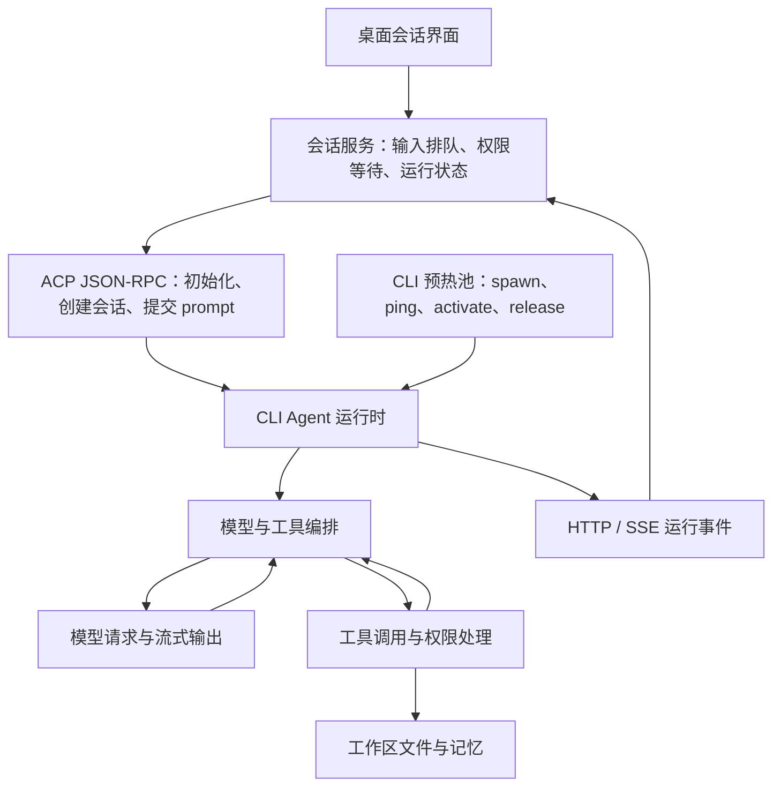

# WorkBuddy Agent 运行与项目记忆复核（REA，2026-10-14）

> 分析对象：`C:\Users\lichb\AppData\Local\Programs\WorkBuddy` 安装产物，以及 `E:\workspace\中新融创项目` 的项目记忆。使用 REA 静态分析与打包代码人工追踪；未启动目标程序、发起模型请求、修改目标配置或执行目标代码。本文补充而非覆盖 2026-08-27 的历史版本记录。

专项：[Agent 内核与记忆触发](runtime-20261014.md)、[项目记忆实证](local-memory-20261014.md)。

## 1. 结论

WorkBuddy 的 Agent 能力不是 Electron 界面直接调用一次模型 API：当前安装产物包含桌面应用服务、会话状态与权限管理、可预热的 CLI 子进程，以及 CLI 内的模型/工具编排。桌面端通过 ACP 的 JSON-RPC 方法提交会话任务，流式接收运行事件；CLI 负责具体模型与工具循环。该拓扑来自静态实现，不等同于本机每条路径都已运行。

项目记忆是可读 Markdown：一份长期文件和 43 份日期日志，共 690,908 字节。项目目录没有全局用户记忆那种 RAW_JSON 字段，也不能凭这些文件证明已启用向量检索、专职记忆选择器或并发租约。

本次要明确区分三类证据：安装代码表明“存在实现路径”；项目文件表明“留下了持久化结果”；只有运行追踪才能证明某个会话实际使用该路径。本次取得前两类，未主动执行第三类。

## 2. 版本和样本身份

| 样本 | 本次观察 |
|---|---|
| `resources/app.asar/package.json` | `version: 5.7.7`，包元数据版本 |
| 安装根 `version` 文件 | `37.10.3-24`，字段语义未核实，不当作桌面版本 |
| `app.asar.unpacked/cli/package.json` | `@genie/agent-cli`，内部 `version: 0.0.0`，不能据此推算对外 CLI 版本 |
| `resources/app.asar` | 213,178,357 字节；SHA-256 `f3131a61636935a3cc83f23134656654b0ba4b227b0ddb04f7f4dbd7efa5517d` |
| CLI 主文件 | `codebuddy-headless.js` 11,938,885 字节；`codebuddy-lite-wb.mjs` 8,567,703 字节 |

历史报告中的 5.3.14 / 2.115.0 / 283 MB 都是历史样本信息，不自动更新为本次值，也不宣称本次运行进程的版本已核实。

## 3. 从桌面到 Agent 的调用路径

这是静态证据归纳图，不是捕获到的运行进程图。CLI 的内部循环细节见专项报告。

### 3.1 运行时入口与环境隔离

`main/server.js` 的 CLI 路径解析包含 `cli/bin/codebuddy`、`cli/dist/codebuddy-lite-wb.mjs` 和 `cli/dist/codebuddy-headless.js`，并在内置入口不可用时考虑 `CODEBUDDY_CODE_PATH`。存在入口优先级和回退，不应只盯住某一个 bundle 就认为覆盖全部运行代码。

`main/cli-process-env.js` 显式给 CLI 配置 `ELECTRON_RUN_AS_NODE=1`、`CODEBUDDY_DISABLE_IDE=1`、`SERVER__HOST=127.0.0.1`、`SERVER__PORT=0`；其环境构造函数先过滤部分继承的 Node/Electron/CodeBuddy 配置，再合并指定环境。这支持“独立本地 CLI 服务”的设计判断，不证明隔离等同于 OS 沙箱。

`main/bootstrap-daemon-in-main-process.js` 与 `main/daemon-app-server-entry.js` 分别存在 in-main 初始化和独立 daemon 启动入口，因此不能把“守护服务必然独立进程”写为无条件事实。实际采用何种入口需要启动配置或运行证据。

### 3.2 CLI 预热池

`main/cli-prewarm-pool.js` 包含完整的预热、领取、激活和释放逻辑：

1. `start` 在 `poolSize > 0` 时启动多个预热进程；实际池大小由依赖配置提供，本次未验证当前配置值。
2. 子进程使用 `[cliPath, --prewarm, --prewarm-id, id]`，`detached: true`、`windowsHide: true`、stderr 管道；不把真实用户任务作为预热命令。
3. `tryAcquire` 只领取 idle 条目，拒绝不认识的会话环境键，比较受管环境是否与待激活会话匹配，避免复用错误环境。
4. 通过本地 socket 的 `ping` 和 `activate` 消息检查健康与激活，成功后保存会话 ID、PID、ACP endpoint，并建立按会话查找的映射。
5. 激活后返回幂等 release；释放会移除映射并终止该 child，而不是把所有使用过的会话无条件重新放回 idle 池。
6. 包含闲置 TTL、异常退出补充、stderr 尾部记录、退避和激活 watchdog；预热失效不应等同于模型任务正常完成。

因此它是减少 CLI 冷启动开销的进程生命周期优化，不能据此称为“多个 Agent 同时讨论”。Agent teams 另有环境开关与专家类型判断，默认值不能代替实际会话启用证据。

### 3.3 ACP 会话与流式通信

`main/conversations.js` 中的 bootstrap 请求明确包含：

- `initialize`：协议版本和客户端能力。
- `session/new`：sessionId、cwd、mcpServers。
- 按需设置模型、模式和配置选项。
- `session/prompt`：提交 prompt；`session/steer`、`session/cancel`：引导和取消；另有回滚、工具委派和 checkpoint 扩展方法。

HTTP 传输代码使用 POST 发送 JSON-RPC、GET 接收 `text/event-stream`，包含 `Acp-Connection-Id`、`Last-Event-ID`、重连退避和心跳超时。代码的背压默认参数为 highWaterMark 100、lowWaterMark 50、pauseTimeout 5 秒；这是函数默认值，不是本机实测性能。

### 3.4 会话状态和输入并发

同一文件的 `sendPrompt` 不是直接透传：包含重复重发抑制、专家/模式切换期间的拒绝、忙碌时排队，以及手动 compact 的时间线处理。状态机区分 planning、working、pending 权限等待、finalizing、错误、断线恢复等。

CLI phase 到桌面状态的映射中，`preparing/model_requesting` 对应 planning，`model_streaming/tool_executing` 对应 working；finalization 仍保持 turn 活跃。由此可见“正在请求模型”“工具执行中”“等待审批”“完成”是不同状态，不宜用一个 loading 标志表达。

权限请求处理保存工具调用 ID、输入、可选批准结果，再由用户响应解决 pending。静态存在审批代码不证明每个工具、每种模式都必须人工批准；具体策略需沿权限配置继续核实。

## 4. 项目记忆如何与运行原理衔接

项目文件实证确认 `.workbuddy/memory/MEMORY.md` 保存长期约束、素材地图、产物索引和工具经验；日期文件保存多段任务记录。长期记忆 21,073 字节，最大日期日志 134,879 字节，因此“每次全量读取全部日志”既不能从文件结构推出，也不应当作推荐方案。

CLI 专项将读取提示、主 Agent 文件工具写入、STOP hook 后台抽取分别检查。即使代码有自动记忆能力，也不能宣称该目录的 44 个文件全部由它生成：本次没有会话审计和文件历史来逐次归因。

### 4.1 已找到直接连接指定项目目录的桌面注入链

`main/tar.js` 的 MemoryCollector（压缩类名 `Db`，字符偏移约 753,800）与 CLI 内建自动记忆不是同一条路径：

1. `collect` 使用 `options.cwd || process.cwd()`，加 `WORKBUDDY_DATA_FOLDER_NAME`（默认 `.workbuddy`），再加 `memory`，形成工作区记忆目录。因而在 cwd 为指定项目、未覆盖文件夹名时，直接命中本次 44 文件所在位置。
2. quick 模式清空记忆相关模板变量；其他模式受 `disableLocalSkillsMemory` 控制。其读取函数 `js`（136,078）仅在配置严格为布尔 true 时禁用，本次没有读取真实运行配置来证明是否开启。
3. 开启时 `getWorkingMemoryContent`（754,479）同步读取 `MEMORY.md`，trim 后用 `<working_memory_content>` 包裹，赋给 `WorkingMemoryContent`。
4. collector 列表在 770,215 附近构造 `new Db(...)`。内置 `workbuddy-prompt.tpl:20-21` 和 `workbuddy-craft-code-prompt.tpl:20-21` 使用 `WorkbuddyMemory_1` / `WorkingMemoryContent`；专家模板第 5–6 行也使用这些变量。这里同时取得 collector 和消费模板两端证据，不是只按变量名猜测。

读取上限常量 `Tb=1e4`，即 **10,000 JavaScript UTF-16 code units**。超限时只注入前 10,000 个单位，并附要求：先完整读取、合并去重、就地整理长期文件，再继续任务。这是对 Agent 的维护指令，collector 自己没有在此直接改写文件。

本项目 MEMORY.md 实测 **10,308 个 UTF-16 单位**（UTF-8 21,073 字节；trim 不改变超限结论），因此在上述路径启用且使用该 cwd 时会命中截断分支。不能据此断言某个历史会话实际已经截断或完成整理。

### 4.2 日期日志读取、写入与过期整理规则

同文件 `Ob` 模板（758,190 附近）把记忆按云端、用户级本地、工作区三层说明：

- 云端画像为只读缓存；跨会话检索另经 `conversation_search`。这属于所见模板说明，本次未请求远端工具验证其排名算法。
- 用户级本地 `MEMORY.md` 为跨项目显式规则，读取另有 4,000 字符上限。
- 工作区日期日志按需从最近记录找上下文，没有历史依赖时可以跳过；不能把“日期日志存在”理解为全部自动注入。
- 完成文档、代码、修复或重要技术选择后，指示 Agent 使用 Edit 立即追加日期日志；项目惯例与偏好还应更新长期文件。append-only 是行为指令，未在此发现文件格式强制追加机制。
- 模板要求将超过 30 天的日期日志按主题提炼到 MEMORY.md 后删除旧文件。实际项目仍保留 7 月、8 月文件，说明不能将提示词要求写成已可靠执行的自动保留期任务，也不能据此替用户清理文件。

模板宣称 workspace MEMORY 的会话限额是 3,000 chars，而 collector 实际截断常量为 10,000，**声明与读取实现不一致**。报告以可追踪的读取实现为准，保留两者差异，不强行统一成一个数字。CLI 的 200 行 / 25,000 字节或 legacy 40,000 字符规则属于其他路径，不能混算。

项目记忆报告给出 44 个文件的字节数、行数和 SHA-256，可用于后续比较变化；没有复制业务正文、凭据和完整交付文件名。

## 5. REA 证据与覆盖限制

### 5.1 全包分析

REA 首次拒绝 ASAR：unpacked `cli/bin/native/win32-x64/job-object.node` 的声明哈希与实际字节矛盾。以 `integrity_policy=record-and-continue` 继续后，记录了多处相似矛盾，涉及原生模块和少量包元数据。签名或安装处理是可能原因，但本次没有证据确定原因，也不直接判定恶意篡改。

全包分析保留证据 `ev_ca9cfa15a1a8fe32aea1284de509adfc05c5ca303225f59cbba04fa940999905`；摘要投影为 `ev_d1c6664ef617ef52e225d6cfd922bc2a5194c5763a2d80ec799ba6f66265244d`。统计：10,935 个相关文件，读取 252,934,746 字节文本，22 个已解析 JavaScript 文件，885 个 findings。因 worker 内存和 45 秒分析限时中断，application 与 semantic 覆盖均不完整。不能把“未发现”解释为全包没有该功能。

### 5.2 聚焦分析

从 ASAR 按 header offset 静态读取七个指定成员，原样复制到仓库外分析目录，再交 REA 分析；不执行 bundle、不运行解包 npm 包。集合含 package.json 和六个桌面生命周期模块，缺失的外部依赖会保留为 unresolved，不用伪造文件补齐。

聚焦集合父证据 `ev_860cef5fcb526293874e777fbe2d295f8d991cccc2cd3903c97783b814d608a7`；摘要投影 `ev_b33d6d3f117638c74f6a5898230f6224ca62bfbd55dba14bb7e81a359c0b425f`。集合 SHA-256 `4d729e501ae52042b4d3fbcdfaf6ddd2b9d047a9ec8a802648bab7927cdb69e1`。七文件 inventory 完成，6 个 JavaScript 文件解析成功，115 个 findings；semantic 总状态仍为 unknown，5,450 个 semantic unknowns，不宣称完整调用图。

Evidence ID 为当前 REA 会话引用，跨会话不保证可解析；下列哈希、定位表和本报告才是仓库内可持久复核入口。全文包和完整图未入库，避免提交大型第三方代码与分析缓存。

### 5.3 关键定位表

路径相对于 `resources/app.asar`；偏移为 UTF-8 解码后的零基 Python 字符索引，**不是文件字节偏移**，可按符号复查。

| 文件 | 字符偏移 / 符号 | 支持的观察 |
|---|---|---|
| `main/cli-process-env.js` | 51 / `ELECTRON_RUN_AS_NODE` | CLI 基础环境 |
| `main/cli-prewarm-pool.js` | 3659 / `tryAcquire` | 领取与环境一致性检查 |
| 同上 | 10878 / `spawn` | 预热子进程参数 |
| 同上 | 14193 / `cmd:activate` 附近 | 本地激活协议与 watchdog |
| 同上 | 9984 / `releaseActivatedEntry` | 移除映射并终止 child |
| `main/server.js` | 2437753 / `codebuddy-headless` 附近 | CLI 入口解析与回退 |
| 同上 | 1604100 / `--port` 附近 | `--serve` 本地服务参数构造 |
| `main/conversations.js` | 98602 / `session/new` | bootstrap 携带 cwd、MCP |
| 同上 | 107913 / `session/prompt` | ACP 方法枚举 |
| 同上 | 75537 / `highWaterMark` | 流式背压参数 |
| 同上 | 78933 / `Last-Event-ID` | 流式重连与连接标识 |
| 同上 | 476014 / `async sendPrompt` | 排队、重复抑制和模式切换保护 |
| 同上 | 295645 / `PHASE_PLANNING` | 会话阶段枚举与状态机 |
| `main/tar.js` | 136078 / `function js` | `disableLocalSkillsMemory` 配置判断 |
| 同上 | 754169–754479 / MemoryCollector | 工作区路径、quick 跳过、读取与模板变量 |
| 同上 | 758190 / `Workspace Memory` | 日期日志追加与长期维护提示 |
| 同上 | 770215 / `new Db` | collector 注册 |

| 成员 | SHA-256 |
|---|---|
| `main/cli-prewarm-pool.js` | `f501592ec395d0a160b5b97e5c32aba0d058c4b5d796a7771985e23e07d86d0b` |
| `main/cli-process-env.js` | `dc18020d8a70727a8af4e58a83df11de64906f048d8125d9dbeb40efd9e84c06` |
| `main/conversations.js` | `10c31573f43c6d48cd2334dd00a83e6932f30bee55134ae54d42a10778488e98` |
| `main/server.js` | `ea34950748468888c7b7a7467364f562abb5e91ded104455c5761bbf5e6ddab7` |
| `main/bootstrap-daemon-in-main-process.js` | `5520aea157b6ab801cb38e106884b6826fdf82a77a95f583f4f27223a3a8caaf` |
| `main/daemon-app-server-entry.js` | `233ce248d652694a57fc7724b27f5a6c673dfda66ca9e3772a780a4d50bd269e` |
| `main/tar.js` | `faaf8242cf7b5157e45d4b16bd80833f3b6e216021f8934928f851454601d91b` |

## 6. 历史结论需要收紧的地方

- 依赖清单只能证明 SDK 被打包；当前 CLI 的实际 Runner 调用由专项报告单独追踪。
- OpenClaw 风格文件和配置证明格式相似，不能独立证明源代码血缘或整个记忆系统直接基于 OpenClaw。
- `memorySelector` 配置不等于项目 Markdown 每次都经该代理检索；全局画像与项目记忆应分别分析。
- 全局轮询 lease 不等于项目 Markdown 的写锁；必须有具体调用或审计才能证明并发保护。
- 历史“全部明文”“唯一 SQLite”等陈述限于当时样本。本次仅确认目标项目 Markdown 可直接读取；当前桌面代码存在 credential-protection 初始化路径，不能把旧结论无条件推广至新版本。
- 竞品设计是参考证据，不自动构成 WorkPivot 的开发决定。

## 7. 覆盖检查与下一步边界

| 问题 | 本次状态 |
|---|---|
| 当前安装产物身份 | 已记录 package 元数据、文件大小及哈希 |
| 桌面到 CLI 的入口、预热、协议、状态 | 静态路径已回答；实际启用配置未运行验证 |
| CLI 模型/工具循环、压缩、取消、子代理 | 见 Agent 专项；按证据区分已追踪与动态加载缺口 |
| 项目记忆位置、规模、结构、内容类别 | 已回答，44 文件快照 |
| 项目记忆读取/写入设计 | 见 CLI 专项；具体历史会话使用情况未知 |
| 44 文件的作者、触发原因、云同步与并发行为 | 未逐次归因；无运行审计证据 |
| 原生沙箱强度、服务端模型路由及动态插件内部逻辑 | 不在本次完整验证覆盖内 |

后续若需要确认“某次对话究竟读了哪些记忆”，应选择可控测试会话记录文件工具调用、注入内容长度与写入前后差异；不要以静态实现代替运行验证。本次仅完成调查和文档更新，不修改 WorkPivot 业务代码、不提交或部署。
