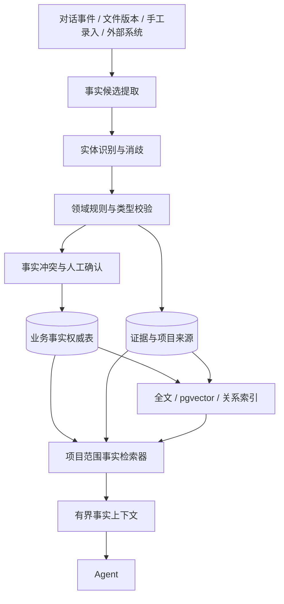

# 架构设计：业务事实模型与项目检索

| 项 | 值 |
| --- | --- |
| 状态 | 🔄 已实现，待远程部署验收 |
| 负责人 | 开发代理 |
| 最近更新 | 2026-10-28 |
| 关联 PRD | [PRD-00 产品总纲](../product/PRD-00-产品总纲.md)、[PRD-05 记忆管理](../product/PRD-05-记忆管理.md) |
| 关联 ADR | [ADR-003 PostgreSQL 与文件混合存储](../decisions/ADR-003-PostgreSQL与文件混合存储.md) |

## 1. 背景与问题

WorkPivot 当前有三类容易混淆的信息：

1. 原始对话、文件和工具事件；
2. 个人、项目、任务三层记忆；
3. 项目资料中的结构化表格、指标和事实。

现有对话逻辑上按任务归档，任务通过可空的 `project_id` 归属项目。对话轮次和事件都绑定
`task_id`，因此可以通过任务反查项目；但它们没有直接保存 `project_id`，也没有按项目物理分区。
当前 RLS 主要按用户隔离，完整的项目成员权限仍是为后续协作预留。

现有 `memories` 主要适合偏好、工作要求和简短项目背景，不适合承载以下业务对象：

- 公司、产品、客户、供应商；
- 合同、采购订单、生产订单；
- 项目干系人、里程碑、风险、决策；
- 金额、数量、日期、单位、统计口径；
- 实体之间的多跳关系；
- 同一属性的历史修订和当前有效值。

如果继续把这些内容写成扁平文本，容易出现：

- 同名公司或合同跨项目串用；
- “预算 100 万”和“预算 200 万”同时被召回；
- 模型把疑问、推测或旧原话当成当前事实；
- 不能按历史时点查询；
- 不能可靠执行金额、日期和聚合计算；
- 事实被删除后，派生摘要和向量索引仍残留。

因此需要把“交互记忆”和“业务事实”分开。“业务事实”是项目内可校验、可追溯、可修订的
对象与事实集合，不是大模型，也不是一段不可解释的摘要。

## 2. 目标与非目标

### 目标

- 以项目作为业务事实的强制隔离边界，同名对象和编号不跨项目冲突。
- 建立稳定业务对象 ID，支持别名、外部标识、实体消歧和可逆合并。
- 区分候选事实、当前有效事实、冲突事实、被替代事实和已遗忘事实。
- 每条事实保存类型化值、有效时间、来源、证据、revision 和抽取规则版本。
- 支持当前值、历史值和“系统当时知道什么”的时序查询。
- 业务查询优先使用 PostgreSQL 精确条件和关系查询，向量只负责候选发现。
- 在现有 PostgreSQL、pgvector、文件卷和后台作业上增量实现，不引入新的主数据库。
- Web、桌面、手机和 Agent 使用同一套项目范围与事实检索接口。
- 删除、撤权、合并和替代能够传播到检索索引、概览和运行上下文。

### 非目标

- 首版不引入 Neo4j、FalkorDB、独立向量数据库或消息队列。
- 首版不实现跨项目自动共享、组织级主数据或跨租户知识图谱。
- 首版不让模型生成并直接执行任意 SQL。
- 首版不自动把全部历史对话回填成业务事实。
- 首版不让 LLM 完成金额、日期、聚合或单位换算。
- 首版不读取 ERP/CRM/合同系统；只预留标准连接器接口。
- 首版不替代现有三层记忆；两者职责不同。

## 3. 设计决策

### 3.1 业务事实与交互记忆分开

| 内容 | 所属系统 | 示例 |
| --- | --- | --- |
| 交互记忆 | 现有 `memories` / `memory_suggestions` | “报告先给结论”“本项目使用万元” |
| 业务事实 | 新增业务事实模型 | “合同 HT-001 当前金额为 200 万” |
| 原始证据 | 对话事件、文件版本、外部来源记录 | 补充协议原文、用户确认语句 |
| 派生知识 | Observation、项目概览 | “项目预算较年初增加 100 万” |

`memories` 继续保持三层作用域和现有确认流。业务事实使用独立表、独立检索工具和独立管理页面。
二者可以互相引用，但不能互相覆盖。

### 3.2 项目是强制隔离边界

- `business_object`、`business_fact_series`、`business_fact_revision`、关系、证据和向量索引都强制包含
  `project_id`。
- `project_id` 由服务端从任务或项目路由解析，不能采用模型传入值。
- 项目内唯一键包含 `project_id`；不同项目可以使用相同合同编号、公司名称和实体 ID。
- 业务事实暂不写入没有项目的临时任务。
- 跨项目共享属于后续独立能力，必须经过显式授权，不能通过全局向量搜索隐式发生。

### 3.3 PostgreSQL 是唯一权威存储

- PostgreSQL 保存对象、事实、关系、证据、状态、版本、权限与审计。
- pgvector、全文索引和图邻接查询都是从 PostgreSQL 数据生成的检索能力。
- 任何索引必须可以删除并从权威表重建。
- 首版不承担多数据库双写一致性。

### 3.4 稳定核心 + 领域扩展

所有领域共享同一事实外壳：

- 作用域、状态、revision、时间、来源、置信度和确认方式；
- 对象类型、关系类型、值类型和领域模型版本。

领域差异通过类型化字段和 JSONB 表达：

- 金额、币种、数量、日期、单位使用强类型或独立字段；
- 合同特殊条款、项目背景等使用 JSONB；
- 每种事实类型由 JSON Schema/应用规则校验。

不采用无边界的单一 `content text`，也不采用没有约束的纯 EAV。

## 4. 术语

| 术语 | 定义 |
| --- | --- |
| Fact Model | 领域模型定义，规定对象类型、属性、关系、值类型和约束 |
| Object | 已消歧的规范业务对象，例如某家公司、某份合同 |
| Mention | 原文中提到的名称或编号，尚未确认指向哪个对象 |
| Alias | 对象的简称、曾用名、英文名或内部代号 |
| Identifier | 社会信用代码、合同编号、SKU、员工号等外部标识 |
| Fact | 对象某个属性的版本化陈述 |
| Relation | 两个对象之间带类型、状态和有效期的关系 |
| Evidence | 事实或关系的原文、文件版本或外部来源证据 |
| Current Fact View | 指定时点有效、未被冲突阻塞的当前事实集合 |
| Fact Epoch | 项目业务事实的单调版本，用于缓存和索引一致性 |
| Derived Knowledge | 从已确认事实推导的概览、Observation 或计算结果 |

## 5. 总体架构



主路径：

```text
项目授权
  → 原文/资料进入
  → 提取 Mention 与候选事实
  → 实体消歧
  → 领域校验
  → 无冲突发布 / 冲突逐条确认
  → 形成当前事实视图
  → 更新派生索引
  → Agent 按项目检索有界事实快照
```

## 6. 数据模型

精确 DDL 在实现阶段随 schema 迁移提交。以下为逻辑模型和强制不变量。

### 6.1 领域模型

`business_fact_model`

| 字段 | 含义 |
| --- | --- |
| `id` | 模型 ID |
| `model_key` | 如 `project.delivery`、`company.operations` |
| `version` | 模型版本 |
| `schema_json` | 对象、属性、关系和值定义 |
| `status` | draft / active / retired |
| `created_at` | 创建时间 |

每个项目通过 `project_fact_profile` 启用模型和配置模板。模型升级不修改历史事实的
`model_id`/`model_version`。

### 6.2 业务对象

`business_object`

| 字段 | 含义 |
| --- | --- |
| `id` | 规范对象 ID |
| `owner_user_id` | 创建者，权限不能只依赖此字段 |
| `project_id` | 强制项目 ID |
| `model_id` / `model_version` | 使用的领域模型 |
| `object_type` | company / contract / project / milestone 等 |
| `canonical_name` | 当前正式名称 |
| `status` | active / merged / forgotten |
| `merged_into_id` | 逻辑合并目标 |
| `valid_from` / `valid_to` | 对象作为业务身份的有效期 |
| `created_at` / `updated_at` | 系统时间 |

不变量：

- `project_id` 非空且引用有效项目。
- 被合并对象不能作为新事实主体；查询必须解析到 canonical object。
- 对象拆分必须保留原合并 ID 和历史来源。

### 6.3 标识与别名

`business_object_identifier`

```text
id, project_id, object_id, namespace, identifier_type,
identifier_value, source, confidence, valid_from, valid_to
```

同一项目内业务主键唯一，例如：

```text
UNIQUE(project_id, namespace, identifier_type, identifier_value)
```

`business_object_alias`

```text
id, project_id, object_id, alias, normalized_alias,
source, confidence, valid_from, valid_to
```

别名和标识同样有来源、有效期和 revision，不能只覆盖当前名称。

### 6.4 业务事实身份与值版本

事实身份和值版本分开。`business_fact_series` 表示“同一主体、属性、维度和口径下的一条
逻辑事实”；`business_fact_revision` 表示该事实的一次不可变值版本。把金额从 100 万改为
200 万，是向同一 series 增加新 revision，不是创建两条无关记忆。

`business_fact_series`

| 字段 | 含义 |
| --- | --- |
| `id` | 稳定逻辑事实 ID |
| `owner_user_id` | 数据归属用户 |
| `project_id` | 强制项目 ID |
| `subject_object_id` | 事实主体 |
| `predicate` | 属性，如 `contract.amount.total` |
| `dimensions_json` | 期间、场景、审计口径等维度 |
| `dimension_key` | 规范化维度键，用于生成稳定 `series_key` |
| `series_key` | 项目内稳定逻辑键；由主体、字段和规范化维度确定性生成 |
| `status` | active / conflicted / forgotten |
| `current_revision_id` | 当前已确认 revision；存在阻断性冲突时为空 |
| `created_at` / `updated_at` | 系统时间 |

`business_fact_revision`

| 字段 | 含义 |
| --- | --- |
| `id` | 事实版本 ID |
| `project_id` | 强制项目 ID |
| `series_id` | 所属稳定逻辑事实 |
| `revision` | 从 1 开始单调递增的版本号 |
| `value_type` | number / text / date / boolean / object / json |
| `value_text` | 文本值 |
| `value_number` | `numeric` 数值 |
| `value_date` | 日期/时间值 |
| `value_boolean` | 布尔值 |
| `value_object_id` | 对象引用 |
| `value_json` | 领域扩展值 |
| `unit` / `currency` | 单位和币种 |
| `status` | candidate / active / superseded / rejected / stale |
| `authority` | external / user / manual / auto / derived |
| `confidence` | 0–1 置信度 |
| `valid_from` / `valid_to` | 该值在业务世界中的有效区间 |
| `recorded_at` / `retired_at` | 系统记录和退出时间 |
| `supersedes_revision_id` | 被本版本替代的上一值版本 |
| `model_id` / `model_version` | 校验使用的模型 |
| `extractor_version` | 调用方/抽取规则版本 |
| `created_by` | 用户或系统来源 |

不变量：

- `project_id`、`subject_object_id`、`predicate`、`series_key` 非空。
- `subject_object_id` 属于同一项目。
- `UNIQUE(project_id, series_key)` 保证逻辑事实稳定，不能靠文本模糊去重临时合并。
- `UNIQUE(project_id, series_id, revision)` 保证版本号不重复。
- 最多一个 active revision 对应同一 series，且 `current_revision_id` 必须指向它。
- revision 创建后其值、维度、来源和有效时间不可修改；纠错通过新 revision 和
  `supersedes_revision_id` 表达。
- 金额和数量必须使用 `numeric`，不得用浮点数。
- 同一主体的不同维度可以并存，但维度集合必须由领域模型定义并规范化排序。

### 6.5 业务关系

`business_relation_series` / `business_relation_revision`

```text
series: id, owner_user_id, project_id, subject_object_id, relation_type,
        object_object_id, dimensions_json, relation_key, status,
        current_revision_id
revision: id, project_id, series_id, status, authority, confidence,
          valid_from, valid_to, recorded_at, retired_at, revision,
          supersedes_revision_id, model_id, model_version
```

关系两端必须在同一项目。关系也要经过状态、冲突、证据和版本处理，不能以字符串直接塞进对象正文。
关系的成立和撤销同样使用稳定 series 与不可变 revision，避免“解除合作后旧关系仍被召回”。

### 6.6 证据

`business_fact_evidence`

```text
id, owner_user_id, project_id, subject_kind, subject_id,
source_kind, source_event_id, source_document_version_id,
external_source_id, quote, quote_start, quote_end,
source_hash, observed_at, created_at
```

`subject_kind` 为 fact 或 relation。事实至少绑定一条有效证据；外部业务系统同步的事实必须绑定
来源系统和版本。

### 6.7 实体候选与消歧

`business_object_mention`

```text
id, owner_user_id, project_id, source_event_id,
surface_text, normalized_text, expected_object_type,
context_text, candidate_object_ids, resolution_status,
resolution_score, decision_reason, model_id, model_version, created_at
```

`business_entity_merge`

```text
id, owner_user_id, project_id, source_object_id,
target_object_id, reason, evidence, status,
operator_id, created_at, reversed_at
```

消歧状态：

- `match`：确定同一对象；
- `provisional`：暂定关联，不能发布关键事实；
- `review`：等待人工选择；
- `distinct`：明确不是同一对象；
- `unresolved`：未解决，禁止进入正式事实。

### 6.8 冲突与确认

`business_fact_conflict`

```text
id, owner_user_id, project_id, series_id,
current_revision_id, candidate_revision_id, conflict_type,
reason, status, revision, created_at, resolved_at, resolved_by
```

`business_fact_review`

用于实体合并、低置信度事实、关系冲突和来源失效复核，一次只展示一项。

### 6.9 项目版本与作业

- `business_fact_epoch(project_id, revision)`：项目事实单调版本，用于检索快照和缓存失效。
- `business_fact_job`：提取、消歧、索引、概览刷新作业；复用租约、重试和幂等机制。
- `business_fact_embedding`：事实/对象 revision 的派生向量，记录 revision、模型、维度和内容哈希。
- `business_fact_overview`：后续从当前事实生成的紧凑项目概览。

## 7. 事实生命周期

```text
extracted
   ↓
candidate
   ├─ 无冲突且规则允许 → active
   ├─ 冲突 → conflicted → 用户确认 → active
   ├─ 被拒绝 → rejected
   └─ 来源失效 → stale

active
   ├─ 新版本确认 → superseded
   └─ 遗忘 → forgotten
```

金额更新示例：

```text
同一 series，旧 revision：预算 100 万，status=active
同一 series，新候选 revision：预算 200 万，status=candidate，存在冲突

用户确认后，同一事务内：
  旧 revision status=superseded，valid_to=确认时间
  新 revision status=active，valid_from=确认时间，supersedes_revision_id=旧 revision
  series current_revision_id=新 revision
  项目 business_fact_epoch + 1
```

存在未确认冲突时：

- 普通自动事实快照不返回该 `series_key` 的旧值或新值；
- 返回一条冲突提示；
- 用户显式查历史时可以看到双方、证据和状态；
- 用户拒绝新候选后，旧 active 事实继续作为当前值。

## 8. 实体消歧

候选生成顺序：

1. 同一项目中的精确外部标识；
2. 精确规范名、别名和对象类型；
3. 上下文属性：所属公司、部门、项目、地址、日期；
4. 关系邻域重叠；
5. trigram/向量相似；
6. 最后才用 LLM 对少量疑难候选做解释。

自动决策边界：

| 证据 | 默认动作 |
| --- | --- |
| 唯一外部标识完全一致，无冲突 | 自动 match |
| 规范名、别名、类型、上下文均高置信匹配 | 可自动 match |
| 多个候选接近或名称常见 | review |
| 外部标识冲突 | distinct / 禁止合并 |
| 无可靠候选 | 新建 provisional 对象或 unresolved |
| LLM 单独判断 | 不触发自动合并 |

实体合并为逻辑合并，保留原 ID、别名、证据和事实。所有合并可撤销，并支持拆分。

## 9. 项目隔离与权限

### 9.1 当前实现

- 项目有 `owner_user_id`；
- 任务可有可空的 `project_id`；
- 对话轮次和事件通过 `task_id` 关联；
- 项目、任务和会话均启用用户 RLS；
- `project_members` 已建表，但当前业务仍以个人项目为主。

结论：当前对话是“通过任务逻辑归入项目”，不是物理按项目分区或独立数据库。

### 9.2 新业务事实规则

- 所有业务对象、事实、关系、证据和向量必须有 `project_id`。
- 临时任务（`project_id IS NULL`）不生成业务事实。
- 服务端从任务所属项目解析范围；模型不能指定任意项目。
- 应用层先校验 actor 和项目成员身份，数据库 RLS 再强制项目过滤。
- 复合外键/触发器保证事实主体、关系两端和证据属于同一项目。
- 跨项目查找使用全局向量或关系图默认禁止。
- 删除项目时，事实、关系、证据、向量、冲突、作业和概览一起失效并清理。

### 9.3 RLS 目标

当前单用户项目可继续使用所有者策略。开放项目协作前改为：

```text
actor 是项目有效 member
AND project 未删除
AND 事实/对象属于该项目
```

管理员默认只能查看运行状态和计数，不能读取私人项目事实正文。

## 10. 业务事实检索

### 10.1 查询入口

Agent 工具：

- `find_business_object(query, objectType?)`
- `search_business_facts(query, filters?, asOf?, mode?)`
- `trace_business_relations(objectId, relationTypes?, maxDepth?)`
- `read_business_fact(factId)`
- `read_fact_evidence(factId)`
- `explain_fact_history(factId)`
- `calculate_business_fact(...)`：只允许白名单指标和确定性计算

### 10.2 查询计划

| 用户问题 | 主路径 |
| --- | --- |
| 合同 HT-001 当前金额 | 编号精确匹配 → 当前事实 |
| 列出金额超过 100 万的合同 | 结构化过滤 → SQL |
| 供应商影响哪些产品和合同 | 关系递归 CTE |
| 2026 年 3 月适用哪一版合同 | valid-time 查询 |
| 当时系统知道什么 | recorded-time 查询 |
| 类似客户流失风险 | 向量候选 → 项目/状态/来源回表过滤 |
| 为什么预算改成 200 万 | 当前事实 → supersedes 链 → 证据 |

### 10.3 硬过滤与排序

排序前强制执行：

```text
actor/project 权限
project_id 一致
对象已消歧
status=active（或查询指定历史状态）
valid time / recorded time 条件
来源未删除或撤权
无未确认冲突阻塞
```

排序只作用于已经合规的候选，可综合：

- 对象/属性精确匹配；
- 数值、日期和维度条件；
- 全文与向量相关度；
- 关系距离；
- 来源权威等级；
- confidence；
- 新鲜度。

### 10.4 检索结果

返回结构化 `FactContext`：

```text
objects[]
facts[]
relations[]
conflicts[]
evidence[]
unresolvedEntities[]
asOf / knownAt
projectFactEpoch
queryPlan
budgetUsage
```

初始默认预算建议：

- 最多 20 个对象；
- 最多 12 条当前事实；
- 最多 20 条关系；
- 图遍历最多 2 跳；
- 证据摘录每条约 500 字；
- 总事实上下文约 6000 字；
- 超时即跳过事实增强，聊天主流程继续。

### 10.5 自动上下文与按需工具

- 任务开始时只自动加载项目事实概览和与任务描述直接匹配的高置信事实。
- 当前消息每轮自动召回有严格预算的当前事实。
- 复杂多跳、历史、精确计算由工具显式调用。
- 冲突未解决、实体未消歧或来源失效的内容不进入自动上下文。
- 原始对话仍作为历史/证据工具读取，不作为默认业务事实来源。

## 11. 索引与存储

首版：

```text
PostgreSQL 主表
  + B-tree 复合索引
  + JSONB GIN
  + 全文索引
  + pgvector
  + 关系递归 CTE
```

核心索引：

```text
business_object(project_id, object_type, status)
object_alias(project_id, normalized_alias) + trigram
object_identifier(project_id, namespace, identifier_type, identifier_value)
business_fact_series(project_id, subject_object_id, predicate, status)
business_fact_series unique(project_id, series_key)
business_fact_revision partial unique(project_id, series_id) WHERE status = 'active'
business_relation_series(project_id, subject_object_id, relation_type, status)
business_relation_series(project_id, object_object_id, relation_type, status)
business_fact_evidence(project_id, subject_kind, subject_id)
```

文件卷按项目目录组织：

```text
/data/files/projects/<projectId>/...
```

暂不按项目拆数据库或 schema。数据量达到明显阈值后，可先按 `project_id` 做 PostgreSQL 分区，
再评估外置图/向量索引。

## 12. 安全与隐私

- 原文中的命令与提示词均是不可信数据，不能扩大工具或项目权限。
- 模型只提交候选，不能直接设置 active、revision、source 或 project。
- 项目范围由服务端身份和任务上下文解析。
- 业务事实检索在 SQL、缓存、向量和关系遍历每一层都带 `project_id`。
- 缓存 key 包含 actor、project、项目事实 epoch 和查询参数。
- 日志只记录计数、状态、耗时和 ID，不记录金额、合同正文、私人对象名称或证据原文。
- 删除来源后，依赖事实立即退出当前召回；是否硬删除正文取决于“遗忘记忆/删除来源/彻底清除”的选择。
- 管理员不能读取或代确认其他用户私人项目事实。

## 13. 失败、恢复与一致性

- 提取、消歧、索引和概览全部通过持久作业执行，使用租约、幂等键、重试和取消。
- 业务事务不持有模型调用。
- 事实状态转换和 `fact_epoch` 在同一数据库事务提交。
- 派生索引失败不阻止事实保存；由 outbox 重试，检索可临时降级到 SQL/全文。
- 检索快照返回 `projectFactEpoch`；运行中事实 epoch 变化时重新读取或明确提示。
- 实体合并失败整体回滚；成功后仍可拆分。
- 项目删除先让权限和检索立即失效，再异步清理索引、向量和文件。
- 备份同时覆盖数据库、项目文件和必要的加密材料；恢复后重建派生索引。

## 14. 管理界面

项目设置增加“业务事实”入口：

- 领域模型与启用状态；
- 对象列表、搜索、别名和外部标识；
- 当前事实；
- 历史事实与 as-of 查询；
- 关系浏览；
- 冲突/实体合并逐条确认；
- 原文证据和来源版本；
- 抽取作业与索引状态；
- 遗忘来源、重构概览和重新索引。

确认流遵循现有规则：

- 无冲突新增可按领域策略自动保存；
- 修改、替代、合并、实体合并和冲突逐条确认；
- 关闭页面、超时和新消息都不等于确认；
- 一次只显示一个待确认项。

## 15. 领域模型落地

首版建议先做两个模型，但实现顺序可以不同：

### `project.delivery`

- Project、Stakeholder、Milestone、Task、Deliverable、Risk、Decision；
- 关系：owns、assigned_to、depends_on、blocks、produces、approves、affects；
- 验证项目、任务、里程碑和成果之间的关联。

### `company.operations`

- Company、Product、Customer、Supplier、Contract、PurchaseOrder、ProductionOrder；
- 关系：sells、purchases、supplies、covers、produces、fulfills；
- 金额、数量、币种、期间和合同修订使用强类型事实。

每个模型需要独立测试，不能因为共用底座就默认领域规则相同。

## 16. 实施阶段

### 阶段 A：项目级事实底座

- 新增 schema，但不迁移旧记忆；
- 对象、标识、别名、事实、关系、证据；
- 项目 RLS、复合归属约束、当前事实视图；
- 手工录入和只读管理界面；
- 当前值/历史值查询。

### 阶段 B：证据与实体消歧

- Mention、候选、merge、review；
- 外部标识优先匹配；
- 可逆合并；
- 来源失效；
- `project.delivery` 模型。

### 阶段 C：事实检索与 Agent 接入

- 查询路由器；
- 全文/关系检索；
- 有界 FactContext；
- `find/search/trace/read/evidence/history` 工具；
- 冲突阻断和 Token/超时降级。

### 阶段 D：语义与自动化

- pgvector 索引；
- 异步候选提取；
- 项目概览/Observation；
- `company.operations` 模型；
- 外部系统连接器接口。

### 当前实现进度

- 阶段 A 已实现：项目 profile、业务对象、标识、别名、事实 series/revision、关系
  series/revision、证据、冲突、项目 epoch、管理 API 和 Web/手机列表。
- 阶段 B 的基础已实现：精确外部标识、名称、别名解析，项目内候选冲突和人工选择；
  可逆实体合并、向量候选和文件表格批量导入仍属后续阶段。
- 阶段 C 已实现：`search_business_facts`、`read_business_fact`、
  `trace_business_relations`、有界自动上下文、确认冲突阻断和临时任务拒绝。
- 阶段 D 的异步对话提取已实现无冲突新增和冲突候选；pgvector、项目概览、
  `company.operations` 专用评测和外部连接器尚未完成。

## 17. 验收

| 场景 | 预期 |
| --- | --- |
| 两个项目都有合同 HT-001 | 两个独立对象，ID、事实、证据和检索结果不混用 |
| 预算从 100 万改为 200 万 | 新候选进入冲突；确认后旧值 superseded，新值 active |
| 查询当前预算 | 只返回 active；未解决冲突不返回“唯一答案” |
| 查询 2026-03 预算 | 返回该有效区间的事实 |
| 同名张伟有两个 | 返回候选/等待选择，不自动合并 |
| 合并错误实体 | 事实可追溯，合并可撤销/拆分 |
| 删除事实来源 | 关联事实退出自动召回并进入复核 |
| 用户尝试读取其他项目 | 404/403；向量和关系查询零召回 |
| 临时任务要求保存业务事实 | 明确拒绝，不生成无项目事实 |
| “合同金额加总” | SQL/计算工具执行，模型只解释结果 |
| 项目删除 | 对象、事实、关系、证据、向量、队列和概览清理 |
| Web/手机/桌面 | 使用相同项目范围和 FactContext |

## 18. 已确认边界

以下 6 项已于 2026-10-28 按推荐值确认，并成为本版实现约束：

1. **项目隔离级别**：首版业务对象、事实、关系全部项目私有，不支持跨项目自动共享。
2. **无项目任务**：不生成业务事实。
3. **冲突未确认**：自动检索隐藏该 `series_key`，显示“存在待确认更新”；历史查询仍可查看双方。
4. **业务事实与交互记忆**：业务事实独立建模，现有 `memories` 继续管理偏好和任务要求。
5. **首个领域模型**：默认启用 `project.delivery`，同时提供 `company.operations` 配置；专用规则评测后续继续补强。
6. **历史导入**：首版不自动把旧对话批量转为业务事实，只允许明确选择来源后重建。

## 19. 已知限制

- 当前项目协作尚未启用；首版项目权限仍以所有者为主。
- 领域模型、抽取规则和实体消歧的质量需要真实中文业务资料评测。
- PostgreSQL 关系遍历适合首版 1–2 跳查询，大规模图分析需后续压测。
- pgvector 在狭窄项目过滤下可能损失召回，需要评估过滤后补查或项目分区。
- 业务事实不是绝对真相；它表示系统在当前来源、模型规则和人工确认下认定的有效事实。

## 20. 变更记录

| 日期 | 版本 | 变化 |
| --- | --- | --- |
| 2026-10-28 | 0.3 | schema v63 与代码实现：项目对象、事实/关系版本、证据、冲突、后台提取、Agent 检索和 Web/手机管理 |
| 2026-10-28 | 0.2 | 按既有架构统一命名；拆分稳定事实 series 与不可变 value revision，关系采用同一模式 |
| 2026-10-28 | 0.1 | 初版评审稿：项目级业务对象、事实、关系、证据、消歧、检索与迁移边界 |
