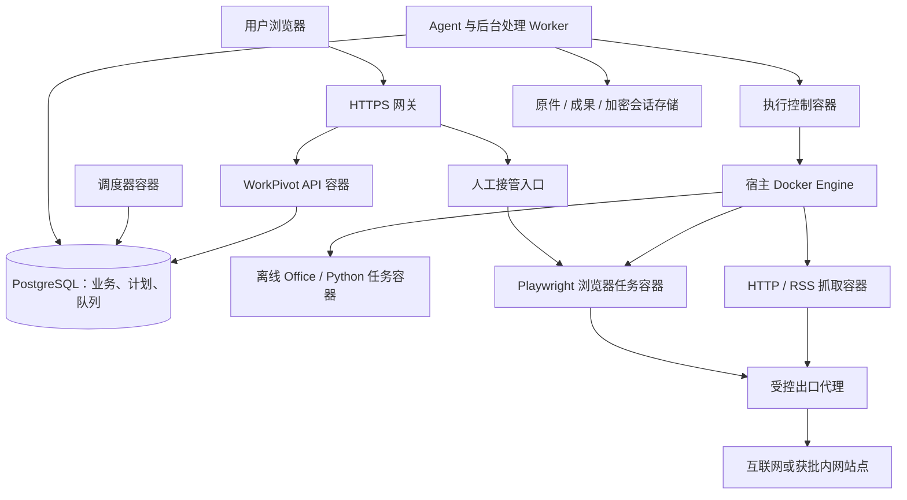

# 容器部署与定时采集调度方案

日期：2026-10-16。状态：设计与计划，尚未实现或部署。开发状态、顺序和排期统一维护在[主计划](单用户正式发布补强方案.md)，本文件只记录技术与产品设计。

同日最新更新：对话搭建私人Skill及基础定时任务已被用户提前至当前单用户版最高优先级，见[SK/ST设计](对话搭建Skill与基础定时任务.md)。基础计划、队列、离线执行和确认界面由ST先交付，CN下一版本复用并增加全容器、联网、登录与多用户采集公平性。

## 1. 用户已确认的范围

- 当前单用户版SK/ST及原八项完成后，作为下一版本实施容器、联网及登录增强；基础定时能力已提前，不重复实现。
- 后台服务统一使用容器部署，首期采用单机 Docker Engine + Compose，不要求 Kubernetes。
- 支持公开网页、API/RSS、需要登录的互联网网站，以及管理员批准的内网 OA/ERP/报表系统。
- 登录遇到密码、验证码、MFA 或会话过期时，允许用户在 WorkPivot 中人工接管浏览器，再恢复任务。
- 服务器数量与 CPU/内存暂不确定，先设计可调整的保守资源档位，实施前做部署预检和压测。

首版采集只读取网页和下载授权资料，不包含自动发布、发消息、下单或修改 OA/ERP 业务数据。通知默认站内结果列表和待处理提醒；外部邮件、Webhook、即时消息另行明确接收方和授权。不自动抓取用户的全部聊天或将采集结果写成个人记忆。

## 2. 现有实现与缺口

| 现状 | 设计要求 |
|---|---|
| `schedules.ts` 为旧文件注册表、进程内扫描和本机 HTTP 调用 | 新增 PostgreSQL 持久计划及执行记录，不能接旧存储冒充数据库版定时任务 |
| 数据库运行入口把记忆/解析/索引循环放在 API 进程 | 将后台循环逐项移入独立 worker，先确保单一领取者和租约，再移除原循环 |
| `skill-worker.mjs` 为宿主服务，最多两个活动请求，临时容器禁止联网 | 保留离线执行档位；新增受控 HTTP 与浏览器档位，不能直接给现有脚本开放全网 |
| 旧 `docker-compose.execution.yml` 给业务容器挂载 Docker socket | 新部署入口禁止该组合；只有专用执行控制容器可访问 Docker，业务容器不具备此权限 |
| 当前 Dockerfile 默认进入旧服务端入口 | 下一版本提供明确的数据库 API、调度器、worker 启动命令及统一版本清单，不依赖旧默认入口 |
| MCP 每次调用建立并关闭协议会话，结果是 JSON 文本 | 定时采集优先固定 Playwright 脚本；通用 MCP 需另补会话绑定和图片处理，不能直接作为本功能完成依据 |
| 文件和产物已有原子发布、版本及用户隔离 | 复用这些边界；采集原文、截图、下载文件和报告都归属创建者及指定项目 |

不移植旧 JSON 定时任务，不混用旧执行模式。迁移是当前 PostgreSQL schema 的增量升级，保留现有业务数据。

## 3. 部署拓扑与信任边界

Compose 管理常驻服务；执行控制服务管理短生命周期任务容器。Docker daemon 仍由宿主操作系统管理，但不再要求在宿主另起 Node.js 业务 worker。控制服务是受信任的高权限组件，不将它视为普通无权限应用容器。

- 仅 HTTPS 网关公开端口。数据库、队列、执行接口、浏览器调试端口和 VNC 端口不对公网开放。
- API、调度器、业务 worker 均不挂载 Docker socket；不赋予 `BYPASSRLS`、数据库管理员账号或宿主目录访问。
- 只有执行控制容器持有 Docker socket；即使只读挂载 socket 也不表示 Docker 操作是只读。使用独立服务凭据与内部控制网络，只接受固定执行协议。
- 执行请求包含服务器签发的 assignment、job/attempt/fence、已发布 Skill 版本、输入文件标识和预设资源/网络档位；不接受用户或模型提供的镜像名、宿主路径、Docker 参数、网络名或权限标志。
- 任务容器无数据库凭据、主密钥、Docker socket；默认非 root、只读根文件系统、限制 capabilities、禁止提权，并设置 CPU、内存、进程数、临时磁盘和运行时长。
- 不使用宿主网络或宿主 IPC 解决浏览器兼容问题。浏览器镜像按匹配的 Playwright 版本固定摘要，使用专用用户、合适的 seccomp 和受限共享内存；实施时以真实 Chromium 启动验收为准。

### 容器内控制 Docker 的文件路径问题

不能把执行控制容器内的 `/tmp/job` 当成宿主同名目录传给 Docker。首版采用每次执行独立的具名临时卷：可信初始化步骤写入校验后的输入，任务只挂载自己的输入卷和工作卷；输入只读，输出按允许清单回收。禁止把全部用户的文件卷直接交给任务容器。

固定 Skill 资源可以按版本缓存，但只允许可信发布器写入。收集输出时拒绝路径穿越、链接、特殊文件和超限内容；成果由业务 worker 再次验证 owner、任务、版本和 fence 后原子发布。控制器按实例及 job 标签清理自己的资源，不扫描删除其他业务容器。

## 4. 任务定义、队列与执行状态

### 数据与权限

| 记录 | 核心字段和约束 |
|---|---|
| `schedules` | owner、项目、名称、cron、IANA 时区、next_run_at、启停、revision、Skill 发布版本、输入模板、授权策略版本 |
| `schedule_runs` | schedule_id、scheduled_for、manual_request_id、revision 快照、当前状态、开始结束时间；定时唯一键为 `(schedule_id, scheduled_for)`，手动执行单独按 request_id 去重 |
| `job_steps` | run_id、阶段、依赖、输入/输出引用、attempt、lease、fence、错误分类、重试时间；不存浏览器 Cookie 或密码 |
| `worker_nodes` | 能力、容量、心跳和 draining；首版仅一个执行节点 |
| `resource_reservations` | 用户/全局/队列/站点/登录配置的占用及租约，领取与额度检查原子执行 |
| `browser_profiles` | owner、网站账号别名、状态、加密状态引用、revision、锁；私人登录状态不能共享 |
| `site_policies` | 管理员批准的来源、域名/IP/端口、重定向目的地、频率及下载限制；用户只能在授权范围内选择 |
| `capture_items` | owner、项目、稳定来源键、原文链接、抓取时间、内容哈希、正文/附件版本和增删改差异 |
| `notification_outbox` | owner、运行、事件类型、唯一键及站内投递状态；重试不重复提醒 |

上述表名为设计名称，不直接指定 schema 版本号，实施时按实际最新迁移版本追加。用户内容继续启用强制 RLS。调度角色只通过限定函数领取最小元数据，不直接读所有用户聊天、凭据或抓取正文；函数固定 search_path、撤销 PUBLIC 执行权，领取、心跳、取消、完成均校验 worker 与 fence。

### 队列组件选择

优先验证 pg-boss 作为 PostgreSQL 上的任务投递组件，复用其持久投递、延迟与失败管理；业务状态仍以 `schedule_runs/job_steps` 为准。队列只携带不透明运行/步骤标识，不放正文或密钥。不引入 Redis，不建立第二套业务状态数据库。

队列POC在提前实施的ST-02阶段先完成，CN-01复核复用结果，必须证明：业务入队与提交事务一致、角色最小权限、取消与租约 fence、一致备份恢复，以及公平调度可控。pg-boss 的投递机制不能代替业务额度和外部副作用核对。若 POC 不满足这些条件，再在 ADR 中记录理由，选择现有 PostgreSQL 下的受限 `FOR UPDATE SKIP LOCKED` 领取实现；不同时维护两套生产队列。cron 优先用成熟解析库处理 IANA 时区和 DST，不继续扩写旧手工匹配器。

### 状态与恢复

`queued → running → succeeded / failed / cancelled`，另有 `retry_wait`、`waiting_login`、`waiting_approval`、`outcome_unknown`。HTTP、浏览器提取、模型整理、成果发布分为依赖步骤，后续步骤复用已完成结果，不因模型失败重复抓整个网站。

- 到期计划通过短事务生成运行并推进 next_run_at；重复调度器或重启不能重复入队。
- 手动“立即运行”也走相同队列、授权和资源限制。
- 心跳与租约按数据库时间计算。过期 worker 不能提交状态或成果；控制器还按 attempt/fence 拒绝旧执行请求。
- 已发出提交类请求而未收到结果时置为 `outcome_unknown`，不自动重跑。只读提取可以有限重试，但站点 GET 本身不被视为绝对无副作用保证。
- 取消先持久化意图，再终止相应容器；确认资源回收后完成状态转换。清理失败保持可追踪状态并阻止重新占用同一登录配置。
- API 重启不终止已领取的后台任务。worker 重启通过租约和步骤记录恢复；本机控制器重启先核对持久 assignment 与带标签的容器，禁止无差别清理全部实例。

## 5. 排期、并发与公平规则

| 行为 | 首版拟定默认值；管理员可调整 |
|---|---|
| 时区 | Asia/Shanghai；数据库保存 UTC，同时显示用户时区与计划/实际时间 |
| 周期 | 界面提供每日、每周、固定间隔；高级模式用校验后的 cron，默认最短 5 分钟 |
| 同计划重叠 | 禁止；忙时只合并保留一次后续执行，不积压每一个错过时刻 |
| 停机补跑 | 默认最近 24 小时窗口内最多补跑一次，可改为跳过；不回放全部历史触发 |
| 用户公平 | 按用户轮转领取；后台采集设独立队列与上限，保留聊天/系统任务的资源 |
| 初始容量 | 全局浏览器 1 个、同用户浏览器 1 个；HTTP 最多 2 个；同站点和同登录配置各 1 个；仍受总 CPU/内存预算约束 |
| 计划数量 | 暂定每用户最多 20 条启用计划，待队最多 10 条；不足时合并/延迟并展示原因，不静默丢弃 |
| 超时 | HTTP 步骤 60 秒；浏览器采集步骤 5 分钟；总运行含模型整理暂定 15 分钟；人工登录等待独立计算 |
| 失败 | 只读瞬时失败最多额外重试 2 次，退避并加入抖动；认证失败不循环重试；429 优先遵守 Retry-After |
| 站点频率 | 默认同来源请求至少间隔 2 秒，允许站点单独配置更低频率；整点运行可配置轻微错峰 |
| 删除/暂停 | 暂停阻止新触发，是否取消当前运行由界面明确选择；删除同时撤销后续执行和数据引用 |

这些是拟定产品默认值，不是服务器容量承诺；CPU/内存未知时不得按理论并发直接启动全部容器。部署预检需检查容器内限额是否实际生效、剩余内存、磁盘和 Docker 版本；资源不足时保持排队。浏览器初始档位估算为 1 CPU、约 1.5—2 GiB 内存，最终按含人工桌面的真实镜像压测调整；调度器同时计入正在等待人工登录的浏览器资源。

正式支持多用户时，全局和每用户配额必须跨 worker 原子生效。当前聊天尚未接入完整 K10 队列，先明确限制，不以新增抓取队列声称已完成所有 Agent 多用户并发能力。

## 6. 抓取 Skill 与网页访问

Skill 保存目标站点、分页和提取规则、稳定来源键、输出结构及所需登录配置引用。每次运行固定一个已审核发布版本，编辑 Skill 不改变在途运行；计划切换新版本前重新核对授权范围。

1. API/RSS 优先；静态页面使用 HTTP 和结构化解析；动态或登录页面使用 Playwright。
2. 固定网站使用确定性 TypeScript/Python 采集脚本，模型用于可选摘要和分类，不必每次探索页面。Playwright Python 同样可用，但首批服务接口保持 TypeScript。
3. 采集步骤输出标题、日期、正文、链接、抓取时间、来源位置及下载附件清单。用稳定来源键和规范化内容哈希做去重与变更比较；不要把“日期变化”一律当正文更新。
4. 抓取结果作为用户项目资料保存。进入知识库、生成报告及推送提醒按计划配置，不自动修改专家经验或个人记忆。
5. 单文件、单运行和用户总存储额度沿用文件系统限制；下载完成后按真实内容类型和大小校验，不依赖扩展名，禁止上传未完成文件或自动执行下载脚本。
6. 网页内容是资料而非指令；不能由网页文字修改网络授权、启用新的工具、索要密钥或指挥其他任务。

## 7. 登录网站和人工接管

首版通过 WorkPivot 中的“需要登录”卡片进入远端专用浏览器窗口。技术候选为有界面 Chromium + 虚拟显示 + noVNC，经现有 HTTPS 网关提供受认证 WebSocket；不连接用户日常 Chrome，不公开远程桌面或 CDP 端口。

流程：创建私人网站账号配置 → 打开专用浏览器 → 用户手动输入账号/密码/MFA → 选择是否保存会话 → 回到任务并点击“继续采集”。脚本检测过期后进入 `waiting_login`；站内提醒一次，登录成功重新领取步骤。验证码和 MFA 交给用户，不尝试绕过。WorkPivot 不要求用户把网站密码发给模型。

- 登录配置按 owner + 网站账号区分；同一配置最多一个活动浏览器或人工接管者。不同用户不得共用 Cookie、缓存或浏览器目录。
- 保存的是用户同意保留的加密浏览器状态，不保存明文密码；任务容器只在运行期间取得该配置的临时副本。Cookie 等仍属于可冒用账号的敏感资料，不下发给模型或写进日志。
- 登录期间暂停模型驱动操作及页面结构回传。只对拥有者开放短期、可撤销的接管授权；校验站点来源、WebSocket Origin 和登录会话，令牌不放 URL 或日志；断线可短期恢复，退出/撤权立即关闭。
- `waiting_login` 不占模型或通用 worker 槽，但保留中的浏览器必须继续计入内存/浏览器槽。拟定人工等待 20 分钟，超时保存已同意的状态后关闭容器；任务继续显示需要登录，用户返回时重新排队，避免无限占用资源。
- 第三方会话可能主动失效；持久配置不是永远免登录。首版验收至少覆盖实际目标系统的 Cookie/localStorage、MFA 和会话过期；需要特殊证书、设备绑定或不兼容存储的站点按实际结果列兼容范围。
- 删除登录配置撤销引用该配置的未完成运行，清理加密状态与临时卷；备份恢复、遗忘清单和数据导出必须覆盖新表及会话资料。个人导出默认不含登录状态。

## 8. 互联网与内网访问策略

用户已确认内网访问必须经管理员批准。设计采用独立出口代理和宿主防火墙配合：任务网络只到获准代理，不与数据库、API 管理口、Docker 控制网络直接连通；代理再访问互联网或管理员批准的内网目标。不能只依靠浏览器 URL 检查或 Playwright MCP 域名参数控制边界。

策略绑定任务、用户、Skill 版本和网站配置，明确允许的协议、FQDN/IP、端口、路径范围和登录跳转目的地。内网授权精确到服务，不因一个 OA 地址获批就放开整个私网网段；SSO、静态资源及下载域名单独列入。禁止命中宿主控制端口、Docker API、数据库和云元数据地址。

代理与网络层需覆盖 DNS 解析、重绑定、IPv4/IPv6、重定向、浏览器子资源和 WebSocket；未批准流量默认拒绝并给出可定位原因。若站点要求客户端证书或公司 VPN，使用管理员部署的受限出口配置或专用采集节点，不让用户上传任意代理/网络参数。目标网络是否可达在启用计划前测试。

## 9. 界面、运维与升级

用户端提供计划列表、下一次触发、排队原因、最近结果、立即运行、暂停、取消、历史版本及待登录提醒；详情显示计划触发与实际开始两个时间。创建计划时预览接下来三次触发，并核对网站范围、登录配置、Skill 版本、保存/知识库/摘要规则。

管理员只查看任务数量、耗时、资源、失败分类和站点授权；默认不读取私人网页正文、账号密码、Cookie 或个人记忆。运营指标包含队列最老等待、每用户占用、任务超时、容器清理失败、站点 429、磁盘和模型用量。

统一 Compose 入口区分接入、控制、数据库和出口网络，持久数据卷与临时卷分开管理。备份使用现有停写/锁定/联合校验流程，追加计划、队列和加密会话存储；恢复默认暂停定时计划、撤销接管令牌、废弃旧租约，不自动重跑历史动作。单机部署明确保留宿主单点限制。

Kubernetes 仅保留后续执行接口：提交、查询、取消、状态回报；多机前先解决原件/成果/加密会话的跨节点访问、受控网络和数据库连接预算，不仅替换容器启动命令。不预先实现集群或自动扩缩。

## 10. 实施顺序与验收

统一排期见主计划的下一版本 N1—N6；本文件不另开并行排期。

| 编号 | 交付 | 依赖 | 验收重点 |
|---|---|---|---|
| CN-01 | 现状盘点、复核ST队列/cron及ADR、协议与容量预检 | 当前单用户版SK/ST及原八项完成 | 事务一致、最小权限、固定执行参数；核对目标硬件 |
| CN-02 | 容器化控制服务、独立临时卷、执行档位、受控出口 | CN-01 | 业务容器无 socket；输入隔离；停止/超时/回收；内网越界拒绝 |
| CN-03 | PostgreSQL 计划/队列/租约、限额、公平及站点锁 | CN-01/02 | 双调度器去重、同计划不重叠、重启补跑一次、用户公平、旧 fence 拒绝 |
| CN-04 | HTTP/RSS/Playwright Skill、原文和成果链路 | CN-02/03 | 公开/动态网页采集、去重、变更版本和模型失败不重复抓取 |
| CN-05 | 私人登录配置、人工接管、加密会话生命周期 | CN-02/03/04 | 真正登录网站及内网 SSO；MFA、过期、断线、撤权、同账号串行和跨用户零泄漏 |
| CN-06 | 用户计划界面、站内通知、管理监控 | CN-03/04/05 | 触发时间预览、状态一致、取消/恢复和提醒幂等 |
| CN-07 | 容器全栈升级、联合备份恢复、故障和压力验收 | CN-01至06 | API/调度器/worker/Docker 重启、数据库短断、资源耗尽、越界及遗忘回放 |

压力验收从同用户 10/50 个到期计划、多个用户同时到期开始，记录队列等待和资源；此数字是测试负载而非可承诺容量。审批与人工登录等待不能导致无限扩容或占用所有交互资源。发布需完成至少一个真实互联网登录站点和一个获批内网站点的端到端验收；目标地址、账号和实际硬件在开发前补充，密钥只通过受保护配置提供。

当前尚未确定实际目标站点、部署硬件和安装版本；这些是实施输入，不阻碍本轮设计归档。实施阶段明确验证后再锁定依赖版本和容量，不能将本设计记为功能已实现。

## 11. 官方依据

- [Docker Compose 生产部署](https://docs.docker.com/compose/how-tos/production/)：单机常驻服务管理。
- [Docker Engine 安全](https://docs.docker.com/engine/security/)：控制 daemon 的高权限与参数边界。
- [Docker 资源限制](https://docs.docker.com/engine/containers/resource_constraints/)：内存、CPU 等限制需显式配置。
- [PostgreSQL 16 SELECT](https://www.postgresql.org/docs/16/sql-select.html)：短事务、行锁与 SKIP LOCKED。
- [pg-boss](https://github.com/timgit/pg-boss)：现有事务投递、持久队列及失败管理候选，需项目权限 POC。
- [cron-parser](https://github.com/harrisiirak/cron-parser)：时区与 cron 解析候选。
- [Playwright Docker](https://playwright.dev/docs/docker)、[登录状态](https://playwright.dev/docs/auth)：浏览器镜像、运行环境及敏感会话管理。
- [noVNC](https://github.com/novnc/noVNC)：浏览器内远程桌面候选，认证和访问控制由 WorkPivot 网关提供。
- [Playwright MCP](https://github.com/microsoft/playwright-mcp)：通用工具扩展备选，不替代网络隔离和采集业务调度。
