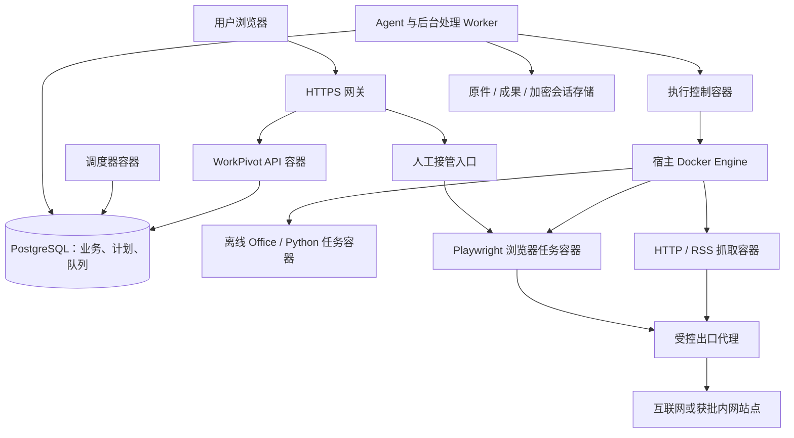

# 容器部署与定时采集调度方案

日期：2026-10-16。状态：设计与计划，尚未实现或部署。开发状态、顺序和排期统一维护在[主计划](单用户正式发布补强方案.md)，本文件只记录技术与产品设计。

同日最新更新：对话搭建私人Skill及基础定时任务已被用户提前至当前单用户版最高优先级，见[SK/ST设计](对话搭建Skill与基础定时任务.md)。基础计划、队列、离线执行和确认界面由ST先交付，CN下一版本复用并增加全容器、联网、登录与多用户采集公平性。

## 1. 用户已确认的范围

- 当前单用户版SK/ST及原八项完成后，作为下一版本实施容器、联网及登录增强；基础定时能力已提前，不重复实现。
- 后台服务统一使用容器部署，首期采用单机 Docker Engine + Compose，不要求 Kubernetes。
- 支持公开网页、API/RSS、需要登录的互联网网站，以及管理员批准的内网 OA/ERP/报表系统。
- 登录遇到密码、验证码、MFA 或会话过期时，允许用户在 WorkPivot 中人工接管浏览器，再恢复任务。
- 服务器数量与 CPU/内存暂不确定，先设计可调整的保守资源档位，实施前做部署预检和压测。

首版采集只读取网页和下载授权资料，不包含自动发布、发消息、下单或修改 OA/ERP 业务数据。通知默认站内结果列表和待处理提醒；外部邮件、Webhook、即时消息另行明确接收方和授权。不自动抓取用户的全部聊天或将采集结果写成个人记忆。

## 2. 现有实现与缺口

| 现状 | 设计要求 |
|---|---|
| `schedules.ts` 为旧文件注册表、进程内扫描和本机 HTTP 调用 | 新增 PostgreSQL 持久计划及执行记录，不能接旧存储冒充数据库版定时任务 |
| 数据库运行入口把记忆/解析/索引循环放在 API 进程 | 将后台循环逐项移入独立 worker，先确保单一领取者和租约，再移除原循环 |
| `skill-worker.mjs` 为宿主服务，最多两个活动请求，临时容器禁止联网 | 保留离线执行档位；新增受控 HTTP 与浏览器档位，不能直接给现有脚本开放全网 |
| 旧 `docker-compose.execution.yml` 给业务容器挂载 Docker socket | 新部署入口禁止该组合；只有专用执行控制容器可访问 Docker，业务容器不具备此权限 |
| 当前 Dockerfile 默认进入旧服务端入口 | 下一版本提供明确的数据库 API、调度器、worker 启动命令及统一版本清单，不依赖旧默认入口 |
| MCP 每次调用建立并关闭协议会话，结果是 JSON 文本 | 定时采集优先固定 Playwright 脚本；通用 MCP 需另补会话绑定和图片处理，不能直接作为本功能完成依据 |
| 文件和产物已有原子发布、版本及用户隔离 | 复用这些边界；采集原文、截图、下载文件和报告都归属创建者及指定项目 |

不移植旧 JSON 定时任务，不混用旧执行模式。迁移是当前 PostgreSQL schema 的增量升级，保留现有业务数据。

## 3. 部署拓扑与信任边界

Compose 管理常驻服务；执行控制服务管理短生命周期任务容器。Docker daemon 仍由宿主操作系统管理，但不再要求在宿主另起 Node.js 业务 worker。控制服务是受信任的高权限组件，不将它视为普通无权限应用容器。

- 仅 HTTPS 网关公开端口。数据库、队列、执行接口、浏览器调试端口和 VNC 端口不对公网开放。
- API、调度器、业务 worker 均不挂载 Docker socket；不赋予 `BYPASSRLS`、数据库管理员账号或宿主目录访问。
- 只有执行控制容器持有 Docker socket；即使只读挂载 socket 也不表示 Docker 操作是只读。使用独立服务凭据与内部控制网络，只接受固定执行协议。
- 执行请求包含服务器签发的 assignment、job/attempt/fence、已发布 Skill 版本、输入文件标识和预设资源/网络档位；不接受用户或模型提供的镜像名、宿主路径、Docker 参数、网络名或权限标志。
- 任务容器无数据库凭据、主密钥、Docker socket；默认非 root、只读根文件系统、限制 capabilities、禁止提权，并设置 CPU、内存、进程数、临时磁盘和运行时长。
- 不使用宿主网络或宿主 IPC 解决浏览器兼容问题。浏览器镜像按匹配的 Playwright 版本固定摘要，使用专用用户、合适的 seccomp 和受限共享内存；实施时以真实 Chromium 启动验收为准。

### 容器内控制 Docker 的文件路径问题

不能把执行控制容器内的 `/tmp/job` 当成宿主同名目录传给 Docker。首版采用每次执行独立的具名临时卷：可信初始化步骤写入校验后的输入，任务只挂载自己的输入卷和工作卷；输入只读，输出按允许清单回收。禁止把全部用户的文件卷直接交给任务容器。

固定 Skill 资源可以按版本缓存，但只允许可信发布器写入。收集输出时拒绝路径穿越、链接、特殊文件和超限内容；成果由业务 worker 再次验证 owner、任务、版本和 fence 后原子发布。控制器按实例及 job 标签清理自己的资源，不扫描删除其他业务容器。

## 4. 任务定义、队列与执行状态

### 数据与权限

| 记录 | 核心字段和约束 |
|---|---|
| `schedules` | owner、项目、名称、cron、IANA 时区、next_run_at、启停、revision、Skill 发布版本、输入模板、授权策略版本 |
| `schedule_runs` | schedule_id、scheduled_for、manual_request_id、revision 快照、当前状态、开始结束时间；定时唯一键为 `(schedule_id, scheduled_for)`，手动执行单独按 request_id 去重 |
| `job_steps` | run_id、阶段、依赖、输入/输出引用、attempt、lease、fence、错误分类、重试时间；不存浏览器 Cookie 或密码 |
| `worker_nodes` | 能力、容量、心跳和 draining；首版仅一个执行节点 |
| `resource_reservations` | 用户/全局/队列/站点/登录配置的占用及租约，领取与额度检查原子执行 |
| `browser_profiles` | owner、网站账号别名、状态、加密状态引用、revision、锁；私人登录状态不能共享 |
| `site_policies` | 管理员批准的来源、域名/IP/端口、重定向目的地、频率及下载限制；用户只能在授权范围内选择 |
| `capture_items` | owner、项目、稳定来源键、原文链接、抓取时间、内容哈希、正文/附件版本和增删改差异 |
| `notification_outbox` | owner、运行、事件类型、唯一键及站内投递状态；重试不重复提醒 |

上述表名为设计名称，不直接指定 schema 版本号，实施时按实际最新迁移版本追加。用户内容继续启用强制 RLS。调度角色只通过限定函数领取最小元数据，不直接读所有用户聊天、凭据或抓取正文；函数固定 search_path、撤销 PUBLIC 执行权，领取、心跳、取消、完成均校验 worker 与 fence。

### 队列组件选择

优先验证 pg-boss 作为 PostgreSQL 上的任务投递组件，复用其持久投递、延迟与失败管理；业务状态仍以 `schedule_runs/job_steps` 为准。队列只携带不透明运行/步骤标识，不放正文或密钥。不引入 Redis，不建立第二套业务状态数据库。

队列POC在提前实施的ST-02阶段先完成，CN-01复核复用结果，必须证明：业务入队与提交事务一致、角色最小权限、取消与租约 fence、一致备份恢复，以及公平调度可控。pg-boss 的投递机制不能代替业务额度和外部副作用核对。若 POC 不满足这些条件，再在 ADR 中记录理由，选择现有 PostgreSQL 下的受限 `FOR UPDATE SKIP LOCKED` 领取实现；不同时维护两套生产队列。cron 优先用成熟解析库处理 IANA 时区和 DST，不继续扩写旧手工匹配器。

### 状态与恢复

`queued → running → succeeded / failed / cancelled`，另有 `retry_wait`、`waiting_login`、`waiting_approval`、`outcome_unknown`。HTTP、浏览器提取、模型整理、成果发布分为依赖步骤，后续步骤复用已完成结果，不因模型失败重复抓整个网站。

- 到期计划通过短事务生成运行并推进 next_run_at；重复调度器或重启不能重复入队。
- 手动“立即运行”也走相同队列、授权和资源限制。
- 心跳与租约按数据库时间计算。过期 worker 不能提交状态或成果；控制器还按 attempt/fence 拒绝旧执行请求。
- 已发出提交类请求而未收到结果时置为 `outcome_unknown`，不自动重跑。只读提取可以有限重试，但站点 GET 本身不被视为绝对无副作用保证。
- 取消先持久化意图，再终止相应容器；确认资源回收后完成状态转换。清理失败保持可追踪状态并阻止重新占用同一登录配置。
- API 重启不终止已领取的后台任务。worker 重启通过租约和步骤记录恢复；本机控制器重启先核对持久 assignment 与带标签的容器，禁止无差别清理全部实例。

## 5. 排期、并发与公平规则

| 行为 | 首版拟定默认值；管理员可调整 |
|---|---|
| 时区 | Asia/Shanghai；数据库保存 UTC，同时显示用户时区与计划/实际时间 |
| 周期 | 界面提供每日、每周、固定间隔；高级模式用校验后的 cron，默认最短 5 分钟 |
| 同计划重叠 | 禁止；忙时只合并保留一次后续执行，不积压每一个错过时刻 |
| 停机补跑 | 默认最近 24 小时窗口内最多补跑一次，可改为跳过；不回放全部历史触发 |
| 用户公平 | 按用户轮转领取；后台采集设独立队列与上限，保留聊天/系统任务的资源 |
| 初始容量 | 全局浏览器 1 个、同用户浏览器 1 个；HTTP 最多 2 个；同站点和同登录配置各 1 个；仍受总 CPU/内存预算约束 |
| 计划数量 | 暂定每用户最多 20 条启用计划，待队最多 10 条；不足时合并/延迟并展示原因，不静默丢弃 |
| 超时 | HTTP 步骤 60 秒；浏览器采集步骤 5 分钟；总运行含模型整理暂定 15 分钟；人工登录等待独立计算 |
| 失败 | 只读瞬时失败最多额外重试 2 次，退避并加入抖动；认证失败不循环重试；429 优先遵守 Retry-After |
| 站点频率 | 默认同来源请求至少间隔 2 秒，允许站点单独配置更低频率；整点运行可配置轻微错峰 |
| 删除/暂停 | 暂停阻止新触发，是否取消当前运行由界面明确选择；删除同时撤销后续执行和数据引用 |

这些是拟定产品默认值，不是服务器容量承诺；CPU/内存未知时不得按理论并发直接启动全部容器。部署预检需检查容器内限额是否实际生效、剩余内存、磁盘和 Docker 版本；资源不足时保持排队。浏览器初始档位估算为 1 CPU、约 1.5—2 GiB 内存，最终按含人工桌面的真实镜像压测调整；调度器同时计入正在等待人工登录的浏览器资源。

正式支持多用户时，全局和每用户配额必须跨 worker 原子生效。当前聊天尚未接入完整 K10 队列，先明确限制，不以新增抓取队列声称已完成所有 Agent 多用户并发能力。

## 6. 抓取 Skill 与网页访问

Skill 保存目标站点、分页和提取规则、稳定来源键、输出结构及所需登录配置引用。每次运行固定一个已审核发布版本，编辑 Skill 不改变在途运行；计划切换新版本前重新核对授权范围。

1. API/RSS 优先；静态页面使用 HTTP 和结构化解析；动态或登录页面使用 Playwright。
2. 固定网站使用确定性 TypeScript/Python 采集脚本，模型用于可选摘要和分类，不必每次探索页面。Playwright Python 同样可用，但首批服务接口保持 TypeScript。
3. 采集步骤输出标题、日期、正文、链接、抓取时间、来源位置及下载附件清单。用稳定来源键和规范化内容哈希做去重与变更比较；不要把“日期变化”一律当正文更新。
4. 抓取结果作为用户项目资料保存。进入知识库、生成报告及推送提醒按计划配置，不自动修改专家经验或个人记忆。
5. 单文件、单运行和用户总存储额度沿用文件系统限制；下载完成后按真实内容类型和大小校验，不依赖扩展名，禁止上传未完成文件或自动执行下载脚本。
6. 网页内容是资料而非指令；不能由网页文字修改网络授权、启用新的工具、索要密钥或指挥其他任务。

## 7. 登录网站和人工接管

首版通过 WorkPivot 中的“需要登录”卡片进入远端专用浏览器窗口。技术候选为有界面 Chromium + 虚拟显示 + noVNC，经现有 HTTPS 网关提供受认证 WebSocket；不连接用户日常 Chrome，不公开远程桌面或 CDP 端口。

流程：创建私人网站账号配置 → 打开专用浏览器 → 用户手动输入账号/密码/MFA → 选择是否保存会话 → 回到任务并点击“继续采集”。脚本检测过期后进入 `waiting_login`；站内提醒一次，登录成功重新领取步骤。验证码和 MFA 交给用户，不尝试绕过。WorkPivot 不要求用户把网站密码发给模型。

- 登录配置按 owner + 网站账号区分；同一配置最多一个活动浏览器或人工接管者。不同用户不得共用 Cookie、缓存或浏览器目录。
- 保存的是用户同意保留的加密浏览器状态，不保存明文密码；任务容器只在运行期间取得该配置的临时副本。Cookie 等仍属于可冒用账号的敏感资料，不下发给模型或写进日志。
- 登录期间暂停模型驱动操作及页面结构回传。只对拥有者开放短期、可撤销的接管授权；校验站点来源、WebSocket Origin 和登录会话，令牌不放 URL 或日志；断线可短期恢复，退出/撤权立即关闭。
- `waiting_login` 不占模型或通用 worker 槽，但保留中的浏览器必须继续计入内存/浏览器槽。拟定人工等待 20 分钟，超时保存已同意的状态后关闭容器；任务继续显示需要登录，用户返回时重新排队，避免无限占用资源。
- 第三方会话可能主动失效；持久配置不是永远免登录。首版验收至少覆盖实际目标系统的 Cookie/localStorage、MFA 和会话过期；需要特殊证书、设备绑定或不兼容存储的站点按实际结果列兼容范围。
- 删除登录配置撤销引用该配置的未完成运行，清理加密状态与临时卷；备份恢复、遗忘清单和数据导出必须覆盖新表及会话资料。个人导出默认不含登录状态。

## 8. 互联网与内网访问策略

用户已确认内网访问必须经管理员批准。设计采用独立出口代理和宿主防火墙配合：任务网络只到获准代理，不与数据库、API 管理口、Docker 控制网络直接连通；代理再访问互联网或管理员批准的内网目标。不能只依靠浏览器 URL 检查或 Playwright MCP 域名参数控制边界。

策略绑定任务、用户、Skill 版本和网站配置，明确允许的协议、FQDN/IP、端口、路径范围和登录跳转目的地。内网授权精确到服务，不因一个 OA 地址获批就放开整个私网网段；SSO、静态资源及下载域名单独列入。禁止命中宿主控制端口、Docker API、数据库和云元数据地址。

代理与网络层需覆盖 DNS 解析、重绑定、IPv4/IPv6、重定向、浏览器子资源和 WebSocket；未批准流量默认拒绝并给出可定位原因。若站点要求客户端证书或公司 VPN，使用管理员部署的受限出口配置或专用采集节点，不让用户上传任意代理/网络参数。目标网络是否可达在启用计划前测试。

## 9. 界面、运维与升级

用户端提供计划列表、下一次触发、排队原因、最近结果、立即运行、暂停、取消、历史版本及待登录提醒；详情显示计划触发与实际开始两个时间。创建计划时预览接下来三次触发，并核对网站范围、登录配置、Skill 版本、保存/知识库/摘要规则。

管理员只查看任务数量、耗时、资源、失败分类和站点授权；默认不读取私人网页正文、账号密码、Cookie 或个人记忆。运营指标包含队列最老等待、每用户占用、任务超时、容器清理失败、站点 429、磁盘和模型用量。

统一 Compose 入口区分接入、控制、数据库和出口网络，持久数据卷与临时卷分开管理。备份使用现有停写/锁定/联合校验流程，追加计划、队列和加密会话存储；恢复默认暂停定时计划、撤销接管令牌、废弃旧租约，不自动重跑历史动作。单机部署明确保留宿主单点限制。

Kubernetes 仅保留后续执行接口：提交、查询、取消、状态回报；多机前先解决原件/成果/加密会话的跨节点访问、受控网络和数据库连接预算，不仅替换容器启动命令。不预先实现集群或自动扩缩。

## 10. 实施顺序与验收

统一排期见主计划的下一版本 N1—N6；本文件不另开并行排期。

| 编号 | 交付 | 依赖 | 验收重点 |
|---|---|---|---|
| CN-01 | 现状盘点、复核ST队列/cron及ADR、协议与容量预检 | 当前单用户版SK/ST及原八项完成 | 事务一致、最小权限、固定执行参数；核对目标硬件 |
| CN-02 | 容器化控制服务、独立临时卷、执行档位、受控出口 | CN-01 | 业务容器无 socket；输入隔离；停止/超时/回收；内网越界拒绝 |
| CN-03 | PostgreSQL 计划/队列/租约、限额、公平及站点锁 | CN-01/02 | 双调度器去重、同计划不重叠、重启补跑一次、用户公平、旧 fence 拒绝 |
| CN-04 | HTTP/RSS/Playwright Skill、原文和成果链路 | CN-02/03 | 公开/动态网页采集、去重、变更版本和模型失败不重复抓取 |
| CN-05 | 私人登录配置、人工接管、加密会话生命周期 | CN-02/03/04 | 真正登录网站及内网 SSO；MFA、过期、断线、撤权、同账号串行和跨用户零泄漏 |
| CN-06 | 用户计划界面、站内通知、管理监控 | CN-03/04/05 | 触发时间预览、状态一致、取消/恢复和提醒幂等 |
| CN-07 | 容器全栈升级、联合备份恢复、故障和压力验收 | CN-01至06 | API/调度器/worker/Docker 重启、数据库短断、资源耗尽、越界及遗忘回放 |

压力验收从同用户 10/50 个到期计划、多个用户同时到期开始，记录队列等待和资源；此数字是测试负载而非可承诺容量。审批与人工登录等待不能导致无限扩容或占用所有交互资源。发布需完成至少一个真实互联网登录站点和一个获批内网站点的端到端验收；目标地址、账号和实际硬件在开发前补充，密钥只通过受保护配置提供。

当前尚未确定实际目标站点、部署硬件和安装版本；这些是实施输入，不阻碍本轮设计归档。实施阶段明确验证后再锁定依赖版本和容量，不能将本设计记为功能已实现。

## 11. 官方依据

- [Docker Compose 生产部署](https://docs.docker.com/compose/how-tos/production/)：单机常驻服务管理。
- [Docker Engine 安全](https://docs.docker.com/engine/security/)：控制 daemon 的高权限与参数边界。
- [Docker 资源限制](https://docs.docker.com/engine/containers/resource_constraints/)：内存、CPU 等限制需显式配置。
- [PostgreSQL 16 SELECT](https://www.postgresql.org/docs/16/sql-select.html)：短事务、行锁与 SKIP LOCKED。
- [pg-boss](https://github.com/timgit/pg-boss)：现有事务投递、持久队列及失败管理候选，需项目权限 POC。
- [cron-parser](https://github.com/harrisiirak/cron-parser)：时区与 cron 解析候选。
- [Playwright Docker](https://playwright.dev/docs/docker)、[登录状态](https://playwright.dev/docs/auth)：浏览器镜像、运行环境及敏感会话管理。
- [noVNC](https://github.com/novnc/noVNC)：浏览器内远程桌面候选，认证和访问控制由 WorkPivot 网关提供。
- [Playwright MCP](https://github.com/microsoft/playwright-mcp)：通用工具扩展备选，不替代网络隔离和采集业务调度。

## 2026-10-18 实施更新：复用队列与控制器容器

已有ST使用PostgreSQL持久automation_runs、事务入队、RLS、唯一索引、30秒租约及fence，cron已使用cron-parser。CN延续现有受限领取机制，不同时引入pg-boss第二套状态；这属于复用已验收实现，不宣称已完成原pg-boss候选POC。先保持全局一个后台槽，新增按用户最近started_at的持久轮转，用户内部保持FIFO；账号停用、过期租约、固定Skill与成果提交检查沿用。实际数据库51项专项通过，包含两个用户、积压队列及每轮重建调度器的公平验收。大量历史下的查询性能及多槽/站点资源预留仍待后续验证。

新增code/Dockerfile.controller与releases/deploy/compose.controller.yml。控制器为唯一Docker socket持有者，使用非root加socket组、只读根文件系统和专用内部网络，不发布控制器端口；API通过网络调用既有认证协议。控制器状态目录必须使用同一宿主绝对路径挂载，属主1000、权限700，不能把宿主路径映射成不同容器路径，否则Docker守护进程无法找到任务输入。WORKPIVOT_WORKER_STATE_DIR支持独立持久目录，拒绝相对路径、上级路径、控制符及Docker挂载分隔符。此能力仍按单机Linux交付，不承诺跨主机共享目录。

运行前准备专用内部网络、状态目录、socket组ID、独立密钥及固定执行镜像；API只配置内部controller:39990地址和相同密钥，绝不新增socket挂载。构建命令：在code目录执行docker build -f Dockerfile.controller -t workpivot-controller:<版本> .。首次启用前必须先停原同owner宿主Worker，不能两个实例共用owner/状态目录。恢复旧宿主方式前同样先停止容器控制器，保留状态供同实例回收。真实业务服务暂未切换。

本次只是CN-01/02/03的队列复用、公平和控制器基础，不包含独立调度服务、分步执行/重试、HTTP/RSS采集成果去重、站点锁、登录接管、内网策略、管理监控及CN全阶段验收。Docker socket仍有宿主高权限，非root/只读不会降低Docker API权限；必须按管理员部署边界保护，依据：https://docs.docker.com/engine/security/ 。

独立调度服务补充：code/scripts/automation-service.mts只启动后台调度，不创建公开HTTP服务；复用模型配置、用量、固定Skill、文件存储与权限检查。API设置WORKPIVOT_AUTOMATION_MODE=external后不再启动自动化计时器，默认embedded保持兼容。releases/deploy/compose.scheduler.yml复用与API相同版本镜像，挂载当前活动文件卷，并使用单独受保护配置提供受限数据库角色、加密主密钥和Worker地址；不得使用数据库超级用户或给调度服务挂载socket。部署必须叠加当前active.compose.json，避免回到旧库或旧文件卷。

本批容器控制器8项通过，含真实成果、认证、实际CPU/内存/断网/只读限制、控制器被杀后同实例重启回收。测试入口code/eval/container-controller.mjs使用随机owner和状态目录，仅在回环地址开放测试端口；正式Compose不发布端口。自动化专项53项通过，新增关闭API后独立调度进程消费队列、无模型配置明确失败及SIGTERM正常退出；成功模型执行沿用既有专项。以上不是多槽容量、真实站点登录、站点锁或全面CN验收。

### 2026-10-18：统一采集出口与站点请求配额

复用浏览器服务增加受服务令牌保护的 `POST /v1/fetch`。配置 `WORKPIVOT_BROWSER_URL/TOKEN` 后，API 与独立调度器的 `web_fetch` 均调用该出口；浏览器导航和子资源继续经同一个 SafeHttp 传输。没有引入第二套持久任务队列或数据库权限。出口失败不回退到调用方直连，旧服务缺少接口时明确提示先升级浏览器服务。

当前单实例出口固定限制：HTTP 传输总并发 2；同规范化主机并发 1，两次开始请求至少间隔 2 秒；HTTP/HTTPS 与末尾点归并为同一主机。不同子域名仍分别计数，不声称注册域名级配额。等待队列最多 64，等待包含在既有 HTTP 20 秒总超时内。冷却中的主机不占其他主机执行槽，同主机按到达顺序执行。启动时先冷却 2 秒，停止旧实例后重启不会因计时丢失立即突发；禁止双副本滚动并行运行。

完整 URL 授权、DNS 公网检查在申请配额前完成，每次重定向重新检查；限流不扩大授权。调用方断开、取消、页面关闭及服务关闭会取消等待或传输；只有传输结束才释放运行槽。未配置浏览器服务的独立开发模式保留进程内限流，不具备跨进程共享保证。容器部署必须让 API、调度器共用同一个出口地址和令牌，调度器 overlay 已加入浏览器外部网络。

实现使用 Node 22 已支持的 AbortSignal.any 和 Playwright 上下文路由；取消与路由生命周期依据：[Node 文档](https://nodejs.org/docs/latest-v22.x/api/globals.html#static-method-abortsignalanysignals)、[Playwright 路由说明](https://playwright.dev/docs/api/class-browsercontext#browser-context-route)。本次不新增第三方依赖。

验收：`pnpm eval:web-quota` 覆盖集中 HTTP 服务、两个调用方、真实 Chromium 与 HTTP 共享配额、同主机协议归并、默认 2 秒频率、排队上限、取消、错误释放、页面关闭、停服和不回退直连。现有 `pnpm eval:web-browser` 继续验证严格授权及共享页面。详细结果见 eval/README。

边界：这是 CN-03 的站点请求配额，不等于完整任务/租约配额；用户浏览器额度、登录配置锁、可配置额度、429 退避、多出口副本协调、RSS 去重与人工登录仍待完成。共享浏览器原有 4 个上下文及自动化 2 个浏览实例上限尚未改为上表拟定的用户额度。已有 20 秒 HTTP 超时仍有效，并未实现表中的 60 秒步骤配置。真实业务站点、内网与登录验收尚未执行。

### 2026-10-18：每用户启用计划与排队容量

落实既定首版默认值：每用户最多启用 20 个计划，最多 10 个 `queued` 运行，正在执行的运行不占排队额度；原有最多 100 个未删除计划的限制继续有效。启用、手动入队、定时入队都在同一个 PostgreSQL 用户事务锁下核对容量，并继续使用所有者 RLS。锁顺序为用户容量锁、计划行锁；额度不依赖进程内计数，多个 API/调度器实例共用同一数据库即可生效。没有增加数据库迁移或另一套队列。

满额处理：新启用返回 409 并保留设置，已启用计划可以继续编辑；手动试运行返回 409，不暗中重试；相同请求 ID 的成功手动入队仍可幂等查询。定时入队若容量已满，保留原 `next_at`，在计划卡片和详情显示“等待排队额度”。额度释放后按原时间顺序接纳，最多保留每计划一个排队项；`catchup=once` 补入原计划时间，`catchup=skip` 仍遵循既有超过 1 分钟即跳过的规则。接纳或跳过后清除容量提示，停用也清除该提示。这里不改变既有补跑窗口语义，不能视为已实现上表全部拟定排期规则。

已有超出 20 个启用计划或 10 个排队运行的数据不会被自动停用/删除，只限制新增容量。运行、取消与停用释放额度后继续接纳。管理值目前是固定首版常量，不提供管理员自定义额度。自动化页面显示本人已启用/排队数量与上限，沿用页面原有 5 秒刷新；旧后端未返回 capacity 时不显示该区域。

本项完成 CN-03 的用户计划/排队容量，仍不代表用户浏览器额度、内网访问、登录配置锁、管理员额度配置或多出口协调已经完成。部署时必须更新所有写入入口（API 和独立 scheduler）至同一版本；混用旧调度器会绕过新容量检查。回退旧版本会失去容量限制，已保存计划与运行仍可读取。

### 2026-10-18 管理闭环补充

上一节固定额度已扩展为每用户持久配置：默认20/10，管理员可在运行监控页调整至0—100，并通过确认、版本检查和同事务成功变更审计保障可追溯。所有入队入口读取同一额度表。等待原因不再写死“10次”，用户页面显示实际生效上限。CN 后续每项同步交付管理页面、权限和审计；采集去重需有采集历史/版本管理，登录配置需有撤销和访问审计。详细管理范围与限制见管理后台开发计划。

### 2026-10-18：采集正文版本与管理闭环（schema41）

本批沿用现有自动化计划、运行租约和完整URL授权，不增加独立调度器。网页工具成功返回后、模型继续整理前，在数据库事务内复核计划、运行租约与授权地址，保存有界解析正文；运行停止或租约过期不能写入。后续模型失败不回滚已成功采集的数据，页面同时展示运行状态，不能将采集成功解释为正式成果生成成功。

- 来源以计划和工具规范化请求摘要区分，忽略截图文件名；正文、标题、链接及截断/阻止提示组成版本摘要。相对上一版本不变则复用版本，变化则递增；A→B→A保留三次变化。不同计划不共享私人快照。
- 同一运行的重复 `web_fetch` 复用首次快照；下次运行重新访问网络。浏览器访问仍每次执行并留观察记录，不能用缓存替代页面动作。重复写入在数据库锁与唯一键下幂等，返回实际保存的正文。
- `capture_sources/versions/observations` 保存来源、正文版本和运行关联，强制RLS。列表每页50条，UUID游标在数据库内解析原始微秒时间，按时间和ID稳定分页。用户只能读取自己的未删除计划；查看正文在返回前同事务写入审计。
- 用户从自动化详情查看历史、选择正文并保留另一个版本对照；仅按文本渲染，不执行网页HTML。窄屏表格横向滚动。管理端“运行监控与用量”增加采集计数和分页审计，只返回标识、动作、操作人和时间，不提供私人地址、标题或正文。
- 快照随计划移入回收站隐藏，恢复后重新可读，但不自动恢复调度授权。满30天后手动永久删除计划才级联清理正文和观察记录。回收、恢复、永久删除均同事务记录采集审计；不可变审计元数据不级联删除。个人归档包括快照，个人清空保留审计。管理计数含回收站尚保留数据。

此批只保存网页工具已解析的有界文本，不是完整HTML、附件或截图原始存档；长正文可能截断，截断以外的变化不保证识别。没有逐字差异算法、跨运行失败重试缓存、RSS专用解析、登录接管或内网管理员授权。审计导出与保留清理仍属后续统一任务，当前没有自动清理审计。schema41尚未部署。

### 2026-10-18：HTTP有限重试与共享冷却（schema42，未部署）

本批补齐已确认重试策略中的明确HTTP临时失败：仅自动化 `web_fetch` 对429、502、503、504最多额外尝试2次；普通对话读取、Playwright页面动作、连接异常、认证/参数/解析错误不自动重放。重定向不重置重试预算，每次尝试重新校验DNS和已有完整URL授权。集中出口与无浏览器服务的兼容路径使用同一策略，集中出口不可用不回退直连。

退避为500ms、1000ms基数加0—249ms抖动，取服务端Retry-After和退避的较大值；服务端可返回秒数或HTTP日期，语义依据 [RFC 9110 §10.2.3](https://www.rfc-editor.org/rfc/rfc9110.html#name-retry-after)。保持现有单次调用20秒总预算，含排队、DNS、重定向及等待。服务端等待超过剩余预算时返回失败，不截短后提前访问；取消、关闭和超时退出。没有新增持久延迟作业，失败仍按原运行状态呈现，用户可手动再次运行或等待下次定时。

收到临时状态后，在释放站点执行槽之前公布共享冷却，同一集中出口的其他调用方遵守等待；其他站点可使用空闲槽。冷却仅存于单实例内存，重启后不能恢复长Retry-After，不等于多副本分布式协调。超长计时分段唤醒，避免Node计时器整数溢出导致立即重复请求。

schema42仅向采集观察和不可变审计追加 `retry_count`（0—2，历史记录默认0）。成功结果的HTTP重试次数在采集历史和管理员审计展示，与正文摘要分开，不因重试次数不同生成新正文版本。同次运行命中快照不再发请求，沿用其原采集计数。失败不创建伪成功快照，HTTP失败信息说明已重试次数，保留在既有运行失败链路；本批没有每一次尝试的独立持久审计或管理员修改退避参数的入口。

剩余：连接级瞬时错误分类与重试、持久分步恢复、跨运行模型失败复用、RSS、完整原始存档、登录接管与内网授权均未完成。

### 2026-10-18：RSS 2.0 / Atom有界订阅快照（schema42，未部署）

沿用web_fetch、已确认完整URL、集中出口、有限重试和采集版本，不新增调度器或放宽地址权限。自动化编辑页提示可填写订阅地址；执行技能可要求读取该地址并整理返回的feed条目。识别application/rss+xml、application/atom+xml及XML响应中的支持根元素，保留条目ID、标题、日期原文、摘要和链接；正文附带条目关联文本便于模型读取。RSS content:encoded优先于description，Atom支持文本、HTML与XHTML，解析相对链接及xml:base。未知扩展不作为核心字段，远程content/src和附件不会被访问。

依据：[RSS 2.0规范](https://www.rssboard.org/rss-specification)、[Atom RFC4287](https://www.rfc-editor.org/rfc/rfc4287.html)。使用项目既有传递依赖saxes 5.0.1并显式声明为直接依赖，固定版本而不自行实现XML语法；与HTML宽松DOM解析相比，它能拒绝不良构XML。其上游仓库已归档，后续需跟踪维护风险；本批不升级整个解析依赖链。DTD一律拒绝，不解析实体定义；最多2MiB输入、20000元素、64层深度；解析错误使用固定摘要，不回显源内容。摘要HTML由既有linkedom清理，不执行脚本。

最多40条、约24000字符正文，单条字段另有限制；超过任一保存边界会标记truncated，并保留来源总条目数。日期保持来源原文，不隐式推断时区；缺失字段保持空值。无效协议/带凭据链接不保留。缺少核心字段会显示未提供，解析不等于完整RSS/Atom规范验证。首批支持RSS 2.0和Atom 1.0，不支持RSS 1.0/RDF、分页自动发现或逐条增量订阅。

feed结构与正文同属于已有capture_versions.content，使用相同RLS、查看审计、回收站及备份路径，无新增schema迁移。来源请求未变且解析快照相同则跨运行复用版本；重复ID不被擅自合并。摘要上限之外的变化不保证被检测，整份快照不是文章原件。用户历史页按条目展示ID、原始日期、未访问链接及摘要；只输出文本，不渲染上游HTML或自动跳转。管理员继续只读取计数和采集审计元数据，没有条目正文读取权限。

使用方法：选择已加载且要求读取网页的Skill，在计划完整地址列表加入订阅URL，在执行要求中说明RSS/Atom整理需求；确认启用后由现有周期执行。若还要访问文章链接，必须逐个补充完整地址并重新确认。旧的纯XML正文快照保持可读；首次使用新解析器会产生结构化版本，无法从旧截断文本可靠反推条目。

### 2026-10-18：HTTP原始响应正文存档（schema43，未部署）

本批保存自动化web_fetch成功解析后的原始响应正文：HTTP传输解压后的字节，保持采集端2MiB上限，不是压缩线上报文，也不是包含图片、字体、附件的完整网页包。只保存媒体类型和正文，不保存Cookie、认证头或其他响应头。普通对话不自动存档；browser_visit仍是解析快照/可选截图，没有DOM原始存档。

集中服务的内部includeOriginal选项只能由执行器启用，模型工具参数不暴露该选项。原始字节经有界base64传到执行器，执行器保存后只把解析内容及版本标识返回模型；原文不进入模型上下文。旧采集服务若没有返回原始数据则明确失败，不伪称已存档。非成功HTTP响应、解析失败及授权已撤销的结果不创建存档；同次运行复用成功快照时不重复访问网络。

schema43为capture_versions追加original_body(bytea)、original_type、original_hash及完整性约束，沿用RLS与版本级联删除。每份最多2MiB，选择和已保存解析正文同一数据库事务，避免额外文件提交/回滚和孤立文件；其代价是增加数据库及备份容量。没有新增存储配额，管理员可查看份数和总字节（含回收站）；按计划清理，仍须满足30天保留规则。

版本摘要同时纳入原始字节哈希和媒体类型，解析内容相同但原始响应发生变化也会生成新版本。历史版本不回填原始内容，以免伪造历史。原始内容与解析快照、观察记录、新增/复用审计在同事务保存；后续模型失败仍保留已成功存档的数据。

用户从计划详情查看版本的存档大小、媒体类型、SHA-256并下载。下载校验计划可见性、用户归属及哈希，先写不可变download审计再返回；响应使用application/octet-stream、attachment、nosniff、no-store和sandbox CSP，固定bin文件名，不提供站内HTML预览。审计证明服务端读取并提供内容，不证明客户端完整收到。管理员只看计数、大小和下载元数据，不能下载私人正文。

计划回收后禁止读取/下载，恢复后重新可见，永久删除级联清理原始字节。个人归档沿用版本数据导出（JSON中的Buffer字节表示），联合备份使用pg_dump保存原始bytea，恢复仍需重新确认自动化。原始文件安全打开由下载者本地环境决定，服务不自动执行其中脚本。

剩余原始存档范围：浏览器DOM、网页子资源包、独立附件归档、解析失败原文诊断、跨运行恢复和完整站点验收尚未完成，不将本批称为整站归档。

### 2026-10-18：独立自动化浏览器DOM存档（schema44，未部署）

自动化browser_visit完成已确认的点击/滚动/等待后，复用生成解析正文的同一份page.content()结果保存DOM HTML。它是浏览器当时序列化的页面，不是服务器原始响应、图片附件包或可离线复现的整站。依据 [Playwright page.content()](https://playwright.dev/docs/api/class-page#page-content)。DOM最多2MiB，超限明确失败而不保存冒充完整的截断内容；解析文本仍执行原24000字符上限。未授权资源阻止次数及不完整提示保持在解析快照中。

内部includeOriginal仅允许已确认完整地址范围的独立浏览器，普通对话共享会话拒绝该选项；模型不能通过工具参数开启。DOM与解析正文同事务保存后，执行器剥离原始字段才返回模型。浏览器每次调用真实执行，不能因命中历史存档跳过点击；相同DOM和解析内容复用版本，但每次保留观察记录。页面变化产生新版本。

schema44增加original_kind枚举http/dom，历史记录默认http。HTTP旧版本摘要保持不变，DOM摘要另含类型，不能误认为HTTP原始响应。用户页明确显示“浏览器DOM快照”及其边界，管理员统计总存档数和其中DOM份数，不读取正文。下载沿用附件、哈希校验和不可变审计；回收、恢复、永久删除、个人归档和联合备份均沿用同一版本表。普通共享会话输入及未授权登录状态不进入此存档功能。

本批仍不覆盖iframe子文档、Shadow DOM完整状态、Canvas像素、子资源和附件包、持久登录配置、人工登录接管或内网服务授权；不能将DOM文件等同页面视觉/交互状态完整复现。其余CN阶段与全站管理审计仍未完成。

### 已授权资源包与附件（schema46，未部署）

自动化独立浏览器原始存档升级为JSON资源包，包含动作后DOM和实际经完整URL/DNS校验取得的响应：地址、状态、媒体类型、SHA-256及base64正文。最多100个响应且最终包不超过2MiB；超限明确失败，不伪造完整存档。保留被阻止地址供用户核对，不主动遍历链接、补抓未知子资源、执行离线内容或下载整站。尚在加载、隐藏、跨框架或未取得的状态不保证覆盖。

已授权且取得的附件响应可进入资源包，即使浏览器拒绝呈现附件；自动化web_fetch也可独立保存二进制附件，并明确只保存字节、没有解析/OCR/扫描。普通对话不启用此降级路径。资源包不保存Cookie或认证响应头，原始包不进入模型上下文；仍走私人版本、下载审计、回收站和备份路径。既有HTTP与DOM存档继续可下载，不回填。

用户历史明确区分资源包、旧DOM和HTTP，管理员DOM计数包括资源包。真实Chromium25项及真实执行器数据库55项合成验证通过；不替代实际业务网站验收。

## 2026-10-18 连续收尾最终实现（schema45—49，未部署）

1. 用户创建私人网页登录配置，列出完整地址并选择管理员内网授权；确认后启动隔离浏览器，通过截图、坐标、文本和有限按键人工登录。没有供模型执行的登录脚本接口。每个请求仍经集中安全出口，人工模式可GET/POST/OPTIONS，自动复用仅GET；不重试携带登录状态的请求。
2. 保存时浏览器返回有界Cookie/localStorage对象，服务验证格式与256KiB上限，使用现有AES-GCM密钥加密，密文绑定用户和配置。数据库与浏览器接口均不接受storageState文件路径。弹窗、IndexedDB、sessionStorage、硬件认证及复杂SSO需逐站评估。
3. 独立调度器取得配置租约后执行，只读工具不把状态放进模型参数。缺失/失效进入waiting_login并释放执行槽，用户保存后同一运行/任务重新入队；最长20分钟、取消/撤销/超时均有明确终态。人工和自动租约互斥，授权撤销与发布前复核继续生效。
4. 人工窗口最多20分钟，浏览器每5秒检查保活；创建有45秒宽限，后续授权续验30秒。API每5秒复核用户、配置和网络规则并续验，后台故障不会留下永久登录窗口。表单跳转导致截图表面暂不可用时仅有界重取截图，绝不重放输入/提交。
5. 内网规则绑定用户、完整URL与一个固定私网IP；仅HTTP/HTTPS及批准端口80/443/8080/8443，拒绝回环、链路本地、元数据地址和已知控制主机名。内网域名通过系统DNS解析，所有答案必须等于批准IP，连接固定IP；不送公网DoH。该规则不等于自动发现所有控制服务，部署仍需将业务网和控制网隔离。
6. 资源包记录动作后的DOM及已请求的授权响应字节、URL、类型、哈希，不含响应头或Cookie；最多100响应，原始总量及序列化包均受2MiB限制，超限失败。附件存原始字节，不宣称已OCR、病毒扫描或理解内容。不是整站离线复刻。
7. 独立请求审计页支持匿名/身份、状态、日期、稳定分页与JSONL导出。开始写入失败拒绝业务，结束缺失显示未确认；只存固定类别，不存URL、查询串、正文或凭据。默认保留，管理员预览并确认后仅清理至少30天的已结束请求；不可变清理记录与业务审计保留。

管理页面、权限、业务审计、联合备份与恢复均已随功能实现。工程验证采用隔离PostgreSQL、真实Chromium和合成网站/模型；详细结果见eval说明与统一开发计划。生产未更新，真实业务站点和第二设备未验收。任意工作流的崩溃后逐步重放仍不承诺；当前保留安全中断、显式重试、成功采集检查点与登录等待恢复。

### 2026-10-19 容器登录兼容性补正

[Playwright官方网络说明](https://playwright.dev/docs/network#redirects)指出3xx后续地址不保证重新触发路由。人工顶层登录因此不直接向Chromium交付3xx：可转GET的跳转先验证完整目标，再通过新的导航让安全出口重新校验；保留响应Cookie。需重发POST的307/308显示明确不支持，不能变成GET或自动重发凭据。未经授权的目标、子资源/iframe重定向仍受拒绝边界约束。宿主与最终受限浏览器镜像均完成合成登录复验，不代表所有SSO兼容。
