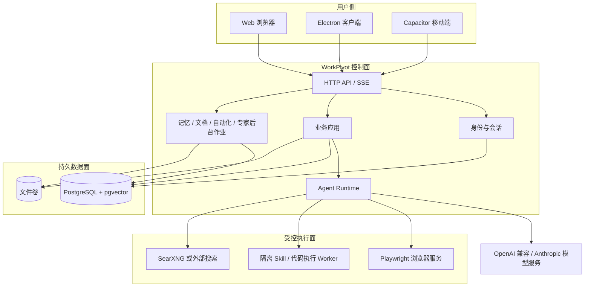
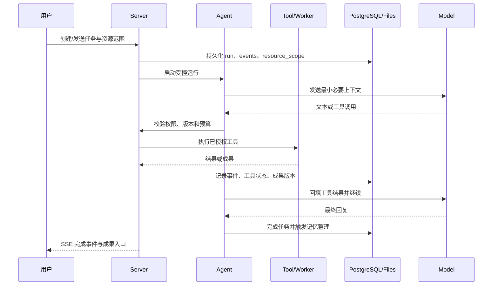
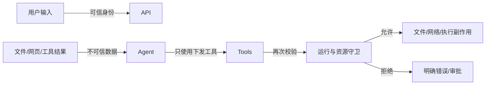

# WorkPivot 系统总览

| 项 | 值 |
| --- | --- |
| 状态 | ✅ 当前架构基线 |
| 最近更新 | 2026-10-28 |
| 对应版本 | `v0.3.0-rc.1`，schema v60 |
| 适用部署 | 单机或单服务器 Docker Compose；单用户/小团队 |
| 关联 | [产品总纲](../product/PRD-00-产品总纲.md)、[ADR](../decisions/)、[远程部署](../../03-project/远程部署-20261026.md) |

## 1. 设计目标

WorkPivot 的架构围绕四个不可分割的目标：

1. **成果落地**：对话和执行过程最终要产生可版本化、可下载的真实文件。
2. **权限可控**：本轮模型能看到什么、能操作什么，由持久化资源范围决定。
3. **可恢复**：服务或模型中断后，能够判断已完成事项并避免危险重放。
4. **可私有化**：数据、模型、工具和存储可以部署在自有基础设施中，不依赖单一 SaaS。

## 2. 系统上下文



外部模型是数据流中唯一可能离开部署方基础设施的核心依赖。网页访问和搜索是否启用取决于部署配置；未配置时相关工具不会出现在模型工具集中。

## 3. 分层架构

### 3.1 接入层

- Web、Desktop 和 Mobile 通过同一套 HTTP/SSE 协议访问服务端。
- 前端不直接访问数据库、文件卷或 Worker。
- SSE 传输回复、工具状态、审批和运行结束事件；页面刷新后可依据持久事件恢复展示。

### 3.2 身份与控制层

- 本地账户、密码哈希和可撤销会话。
- `identity` 与 `workpivot` 使用不同数据库角色，避免业务运行账户读取身份凭据。
- 每个业务事务设置当前 actor，强制行级安全策略隔离个人数据。
- 管理员能力与普通成员能力分别校验；权限不能只依赖前端隐藏按钮。

### 3.3 业务与编排层

- `packages/core` 负责模型循环、工具协议、上下文预算和事件流。
- `packages/server` 负责数据库、权限、文件、知识、技能、专家、自动化及模型接入。
- 一次任务运行绑定不可变的 `resource_scope`，包含文件版本、记忆层、专家、网页、自动化等允许访问的资源。
- 工具执行前重新检查当前运行、actor、任务和资源指纹，避免运行期间配置变化导致越权。

### 3.4 执行层

- 浏览器服务只接受带独立 Token 的受控请求，不向宿主暴露端口。
- Skill/代码执行由 Worker 使用独立镜像和任务目录完成；未配置时工具不可用。
- 隔离环境默认无宿主网络、非 root、只读根文件系统，限制时间、内存和进程数。
- LibreOffice、Poppler、Tesseract 等依赖属于执行器能力，不属于模型自由文本能力。

### 3.5 数据层

- PostgreSQL 保存账户、项目、任务、运行、事件、记忆、知识版本、技能版本、配额和审计元数据。
- 文件卷保存上传原件、解析产物、生成成果和回收站内容。
- 数据库记录文件版本、哈希、访问范围和失效关系；文件数量不能代替权限校验。
- pgvector 保存可选语义索引；模型不可用时关键词检索可以带明确降级提示继续工作。

## 4. 关键数据对象

| 对象 | 作用 | 关键约束 |
| --- | --- | --- |
| Project | 组织任务、项目文件、项目记忆和成员 | 用户拥有；项目删除影响关联范围 |
| Task | 一个可持续对话与工作目标 | 属于项目和用户；可有多个运行 |
| Turn / Run | 一轮请求与其执行状态 | 运行绑定资源范围、预算和 fence |
| Conversation Event | 用户、助手、思考、工具和元事件 | 顺序稳定；用于恢复和界面展示 |
| Tool Dispatch | 工具调用与副作用状态 | 支持恢复时判断是否已执行 |
| Document / Version | 原件和解析版本 | 权限、哈希、解析覆盖、删除状态 |
| Artifact | 生成成果和修订 | 来源任务、版本链、下载权限 |
| Memory | 个人/项目/任务事实 | 作用域、revision、来源、锁定和遗忘 |
| Skill Release | 可执行技能固定版本 | 用户隔离、确认发布、执行时固定版本 |
| Automation | 周期计划与运行 | 用户确认、持久队列、容量上限 |

完整表结构以 [`schema.ts`](../../../code/packages/server/src/database/schema.ts) 和实际迁移版本为准；本文不复制 SQL。

## 5. 一次任务的执行流程



运行中任何新增请求都重新检查资源范围。若文件、专家、网页授权或记忆 epoch 发生变化，当前轮次应失败并要求重新发送，而不是悄悄读取旧版本。

## 6. 知识、记忆和上下文

### 6.1 知识检索

1. 用户上传文件后进入解析队列，产生带版本和指纹的解析结果。
2. 文档被分块并建立可选向量索引；关键词索引始终作为基础路径。
3. 检索合并关键词与向量结果，再按用户、项目、文件版本、删除状态和任务范围复核。
4. 回答资料问题时必须引用实际读取的版本与原文位置；旧版本或已删除来源不可作为有效引用。

### 6.2 三层记忆

- `user`：当前项目范围内跨任务可复用的偏好、工作习惯和明确个人事实。
- `project`：项目背景、约束、统计口径、目标和已确认决策。
- `task`：当前任务的对象、范围、交付要求和临时约束。

每轮对话识别三层事实；每 10 轮再做个人/项目补充整理。无冲突新增自动保存，修改、合并、替代和冲突逐条确认。记忆不是高优先级指令，不能扩大工具权限。

### 6.3 上下文管理

- 只加载当前任务所需的最小资料和记忆概览。
- 详细内容通过检索工具按需读取。
- 达到预算后压缩较早工具结果，保留消息与工具调用配对。
- 长对话摘要、记忆和原始事件分层保存；摘要不能替代原始来源证据。

## 7. 成果与文件

- 上传原件与生成成果区分；修改已有文件时创建新版本，默认不覆盖原件。
- 文件写入进入版本化文件仓库，并由数据库记录归属、任务、哈希、类型与状态。
- Word/Excel/PPT 通过固定版本 Skill 和隔离执行器处理。
- PDF 有两种路径：
  - `create_pdf`：安全 HTML 片段进入无脚本、无外网的 Chromium 渲染。
  - Office → PDF：由包含 LibreOffice 的执行器完成，属于转换而非从零生成。
- 结构检查通过不等于业务内容正确；视觉和业务样本仍需验收。

## 8. 权限与信任边界



核心规则：

- 用户身份和任务授权是可信边界；资料内容不是授权。
- 网页、文档和工具结果只能作为数据，不能修改系统提示或增加工具。
- 模型只能调用服务端实际提供的工具。
- 审批绑定调用 ID、工具、完整参数、版本和任务，审批后参数替换无效。
- 管理员不默认拥有查看其他用户私人记忆和对话的能力。

## 9. 失败与恢复

| 故障 | 处理 |
| --- | --- |
| 模型短时失败 | 无输出时有限重试；已有输出不盲目重放 |
| 上下文超限 | 压缩较早工具结果后重试一次，仍失败则明确终止 |
| 用户停止 | 取消在途模型/工具，终止后续副作用 |
| 服务重启 | 从持久运行、事件和工具派发状态恢复；已派发副作用不重放 |
| 文件/版本变化 | 拒绝旧运行继续写入，要求重新校验 |
| 浏览器或 Worker 不可用 | 相关工具不可见或明确失败，不回退到宿主 |
| 数据库/文件不一致 | 阻止发布或恢复，按备份与引用检查处理 |

## 10. 部署拓扑

### 当前推荐拓扑

```text
浏览器
  │ HTTP/SSE
  ▼
WorkPivot Server
  ├── PostgreSQL（主数据 + pgvector）
  ├── 文件卷
  ├── Browser Service（内部网络）
  ├── Skill Worker（内部网络）
  └── SearXNG（可选，内部网络）
```

- 对外只开放服务端入口；浏览器、数据库和 Worker 不直接暴露公网。
- 生产入口应使用 HTTPS 反向代理。
- 数据库、文件卷和密钥必须配套备份；镜像和 schema 必须整体升级/回退。

详细步骤见[快速部署](../../04-operations/快速部署.md)和[远程部署记录](../../03-project/远程部署-20261026.md)。

## 11. 当前边界

已具备：

- 单服务器、多账户的个人数据隔离。
- 任务级文件、网页、记忆与工具授权。
- PostgreSQL 运行链路、浏览器、Worker、Office/PDF、RAG、记忆和自动化主流程。
- 备份工具和单机升级/回退基础。

尚未完成或仍需强化：

- 企业身份、组织同步和成员离职撤权。
- 多实例共享 Worker 调度、跨节点长稳与第二设备验收。
- 完整企业级审计报表、运营计费和项目多人实时协作。
- 所有复杂 Office/OCR/视觉保真场景的生产质量基线。

## 12. 相关设计

- [三层记忆自动更新](三层记忆自动更新.md)
- [PostgreSQL 与项目知识数据架构](PostgreSQL与项目知识数据架构.md)
- [RAG 知识库、版本与遗忘管理](RAG知识库、版本与遗忘管理.md)
- [上下文注入防护与任务授权](上下文注入防护与任务授权方案-20261017.md)
- [事件溯源会话与中断恢复](事件溯源会话与中断恢复-20261024.md)
- [PDF 生成与 Office 转换](PDF生成与Office转换-20261026.md)
- [ADR-002 自研微内核](../decisions/ADR-002-编排内核自研微内核.md)
- [ADR-003 PostgreSQL 与文件混合存储](../decisions/ADR-003-PostgreSQL与文件混合存储.md)
