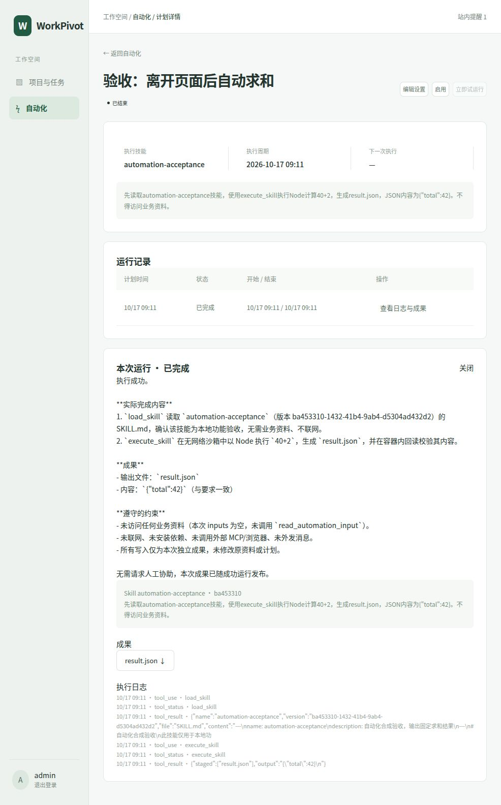
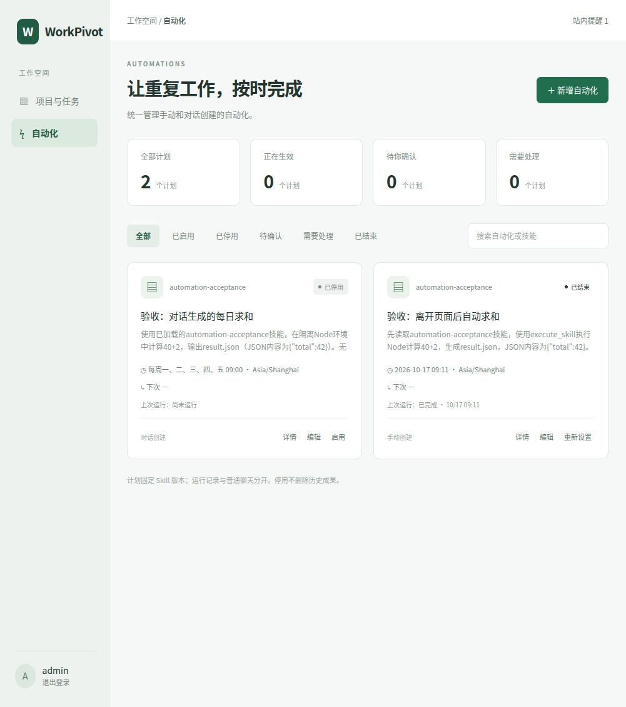

# 基础自动化交付与验收（2026-10-17）

## 交付范围

用户已确认独立页面原型。ST-01—04 按同一个计划交付：独立自动化卡片页、新增/编辑页、明确启用确认、持久后台排期、离线 Skill 执行、运行历史、成果下载、站内提醒。手动创建与对话创建统一管理，自动化运行不混入普通聊天任务列表。

- 页面入口：工作空间左侧「自动化」，本地地址 `http://127.0.0.1:39986/#automations`。
- 选择已加载的 Skill 并固定不可变发布版本；升级技能不会偷偷更换原计划版本。
- 输入支持无文件、固定文件版本、所选项目内按文件名规则匹配的最新上传资料。成果归属项目或独立自动化，每次运行单独保存，不覆盖原资料。
- 指定一次、每天、每周、固定间隔及五字段 Cron；时区、结束日期、接下来三次预览；最短周期五分钟。
- 编辑先保存草稿，原生效配置继续执行；只有确认窗口提交后切换。停用取消排队，当前执行默认继续；可在详情「停止本次」。
- 对话工具提供选项、列表、创建/修改草稿、暂停和停止具体运行、查询历史；没有模型可调用的启用工具。来源对话被撤销的草稿不能沿用旧确认。
- 异常不会伪报成功；模型失败、超时、执行器失联后不自动重放已开始的脚本。依赖失效标记「需要处理」，用户修复后重新确认。
- 恢复备份后计划停用、运行中断、旧授权撤销，备份之后删除的计划不复活。

## 实现与技术决策

数据库增量迁移 v29 新增 automations、automation_runs、automation_notices，全部采用创建者 RLS。tasks.origin 区分普通任务与自动化内部运行任务。不存在持久用户 Bearer Token 代运行；确认产生内部授权，运行保存配置、输入与版本快照。

Cron 使用固定依赖 [cron-parser 5.4.0](https://github.com/harrisiirak/cron-parser)，不自行实现表达式引擎。当前排队记录直接放在业务 PostgreSQL 表，与排期推进、确认修订和撤权同事务提交。pg-boss 属于候选通用队列，但本阶段只需要受 RLS 约束的离线 Skill 运行，不增加另一套队列 schema、权限和状态镜像；这是范围受限的领取实现，不是自建通用作业框架。下一版本多节点/网络队列仍需容量 POC，不能由本次测试推断可承载大量并行用户。

[PostgreSQL 会话 advisory lock](https://www.postgresql.org/docs/15/explicit-locking.html#ADVISORY-LOCKS) 提供单个全局后台槽。数据库唯一约束阻止重复计划时刻、重复请求及同计划重叠；领取与暂停统一先锁计划再锁运行。执行租约30秒、每5秒续期，栅栏拒绝迟到完成。服务每2秒检查，停机错过的触发可跳过或最多补跑一次。已经开始的中断执行不重放。所有成果先暂存，最终授权仍有效才在事务保护下发布。

本版保守限制：每用户100个计划；全局一个后台运行槽；每计划一个等待运行；单次1—30分钟、最多16轮模型步骤；输入和资源合计16MB，成果最多10个/合计16MB。排队按入队时间选择，不承诺下一版多用户配额公平调度。运行详情展示最近100次记录，站内提醒展示最近100条；历史数据仍持久化。

网络抓取、登录网站、人工接管、内网白名单、外发通知、多节点容器调度属于下一版本 CN；本版执行容器无网络。费用预算、统一回收站等原八项未完成事项继续按统一计划实施。

## 验证记录

- 专项隔离数据库 + 真实 Docker：49 项通过，包含去重、两执行器竞争、停止拒绝迟到成果、失败不发布、过期租约、固定旧技能版本、停用不打断当前、跨用户隔离、来源失效及恢复停用。
- 原数据库回归：630 项通过。
- 真实 PostgreSQL 联合备份恢复：32 项通过（新增自动化实际行数据、排队运行、删除保留清单和用户隔离）。
- 前后端 TypeScript、ESLint、前端正式构建通过。聊天状态回归10项通过。
- 真实 DeepSeek + 浏览器 + 当前部署验收通过：页面创建一次性计划并确认，离开自动化页面后于北京时间09:11触发；真实Docker执行并下载result.json，内容为 {"total":42}。
- 真实对话调用工具生成草稿，在统一页面显示“对话创建 / 待确认 / 无排期”；页面编辑为工作日09:00、确认启用、核对下一次为10/19、再停用均通过。验收周期计划已停用，一次性计划已结束，不留活动验收计划。
- 实际详情显示完成状态、模型摘要、工具日志及成果下载入口；已操作下载。结束的一次性计划使用“重新设置”入口，避免直接启用过去时间。应用容器重建后登录、计划停用/结束状态与成果保留，未恢复验收排期。

## 本地部署与回退

当前镜像 `workpivot-server:local-automation-20261017`，数据库 v29，Compose 文件位于 `releases/deploy/compose.local-current.yml`。沿用原账号、配置、数据卷和宿主隔离执行服务。

升级前停止应用，保存 v28 数据库完整自定义格式转储、文件卷归档、原 Compose 和凭据文件；位置为受保护的 `local-runtime/backups/pre-automation-1792199066231`，数据库转储已通过 pg_restore --list 检查。旧镜像 `workpivot-server:local-skill-20261017` 保留。不要在 v29 数据库上只换回 v28 代码；回退必须停服务，将对应备份恢复到独立空数据库和文件卷，再用原镜像/对应密钥验证并切换。此次未演练实际旧版回退，不将归档检查称为完整回退验收。

构建时保留 pnpm 的相对软链接；首次构建的复制方式导致 tsx 无法定位，修复后才成功执行迁移，失败尝试未修改业务 schema。

