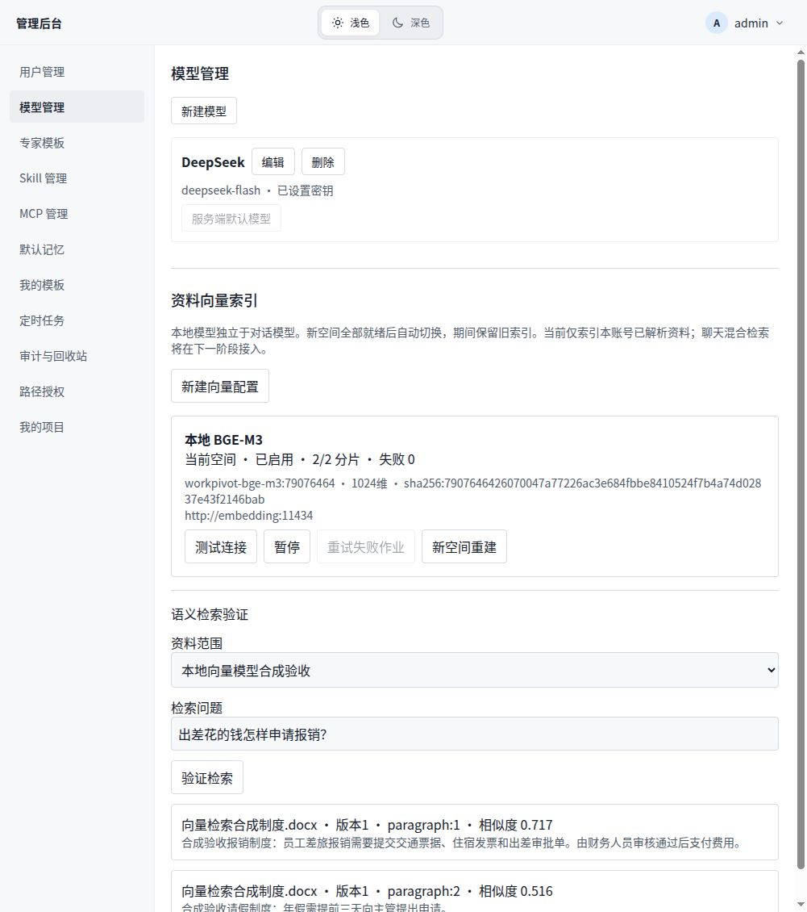

# SU-R2-01 本地向量索引交付记录

日期：2026-10-17。对应统一计划 SU-R2-01；已实现、验证并部署本机 Docker。SU-R2-02 混合检索与质量评测仍待开发。

## 已交付

- schema31：pgvector 扩展、不可变模型空间、持久分片作业，全部业务表强制 RLS。新空间完成全部当前有效分片后原子切换；新资料持续补建。暂用精确余弦距离查询，不使用近似索引。
- 管理后台 → 模型管理 → 资料向量索引：草稿配置、合成文本连接测试、明确确认启用、进度、暂停、恢复、失败重试、取消构建、新空间重建及旧空间删除。
- 支持 Ollama 原生和 OpenAI 兼容协议。密钥独立加密保存，不复制对话模型密钥。请求90秒超时、2MB响应上限、禁止重定向、向量维度/数量/有限数值校验。错误不回显模型服务原始响应。
- 同一账号最多一个在途索引作业，后台逐账号处理；作业2分钟租约、fence防止晚到发布，30秒延迟重试，最多3次后等待人工重试。暂停撤销在途租约；删除分片级联删除作业与向量。
- 按已认证任务推导项目范围，查询只使用最新已解析版本；其他账号不能读取配置和索引。配置与验证入口目前仅管理员使用，单用户版不共享私人索引。
- 备份包含向量表；恢复后全部向量空间暂停、连接测试失效，不自动向旧地址发送资料。

## 本机部署

应用：http://127.0.0.1:39986/admin，选择“模型管理”。原型39987不是实际功能页面。

- 应用镜像：`workpivot-server:local-embedding-20261017`，数据库schema31。
- 模型：`ollama/ollama:0.6.8`，镜像摘要 `sha256:50ab2378567a62b811a2967759dd91f254864c3495cbe50576bd8a85bc6edd56`。
- 独立服务 `embedding`，容器网络地址 `http://embedding:11434`，不向宿主机发布端口。限制2 CPU、4GB内存、单模型、单并发请求；模型卷 `workpivot-local_embedding_models`。
- BGE-M3文件约1.16GB，1024维。模型摘要 `7907646426070047a77226ac3e684fbbe8410524f7b4a74d02837e43f2146bab`，固定名称 `workpivot-bge-m3:79076464`。未来更新模型不要覆盖此名称，应创建新版本配置并重建。
- 从零部署：先 `docker compose --env-file local-runtime/.env.local -f releases/deploy/compose.local-current.yml up -d embedding`，再在模型容器执行 `ollama pull bge-m3`，检查摘要并建立对应固定名称。应用升级需先安装schema，运行账号不得自行创建扩展。
- 回退包：`local-runtime/backups/pre-embedding-1792202327170`，包括升级前schema30数据库、文件、配置和环境文件。仅验证转储目录可读，未执行破坏性的本机降级演练。不能直接把旧镜像接到schema31；需要配套恢复原数据库和文件。

## 验证结果

- 向量专项27项：真实pgvector + 合成HTTP服务，包括权限、项目隔离、删除零召回、重建切换、暂停晚到、自动/手动重试、响应维度、OpenAI输入顺序、取消构建、过期租约恢复。
- 数据库回归630/630通过。
- 真实PostgreSQL联合备份恢复36项通过，新增恢复后向量空间保留但暂停且要求重新测试。
- Server/Web TypeScript、相关ESLint、Web构建和差异空白检查通过。
- 本地真实BGE-M3：两条合成中文输入返回两组1024维向量，首次请求约2426ms；这是单次本机观测，不是吞吐性能承诺。
- 浏览器完成保存配置、测试、确认启用和语义检索；真实DOCX上传、后台解析、索引2/2完成且失败0。查询“出差花的钱怎样申请报销？”首先返回报销段落，余弦相似度约0.717，次为请假段落约0.516。
- 应用与模型容器重启后，2/2分片和配置仍保留，中文检索再次成功；应用与数据库健康检查通过。
- 保留合成任务“本地向量模型合成验收”和“向量检索合成制度.docx”供复核，未删除用户业务资料。

## 当前边界与下一步

目前只索引已有解析链路产出的DOCX、XLSX、PPTX、PDF文本。扫描PDF需OCR，普通TXT等格式的统一解析接入尚未在本项增加。模型版本标识由管理员维护，系统不自动识别远端同名模型权重被替换；本机使用固定名称减少误更新。

当前聊天工具仍使用原关键词检索；向量已可在管理页验证，但尚未与聊天检索融合。下一项SU-R2-02完成混合检索、稳定引用、固定评测集与删除/版本更新零召回评测。相似度不是答案正确率，本次合成结果不代表检索质量全面验收。
