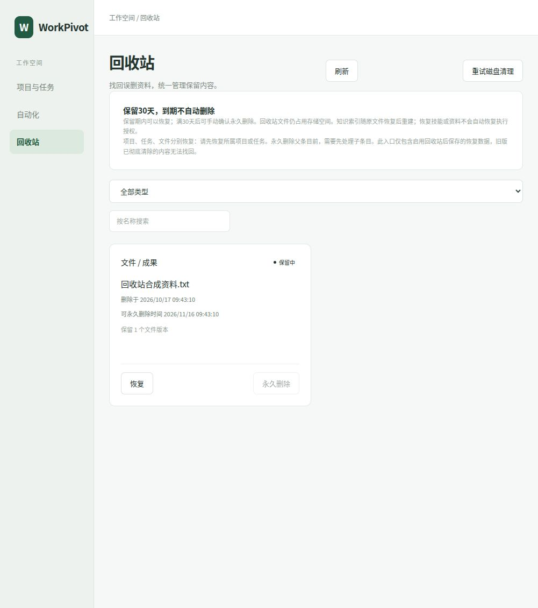
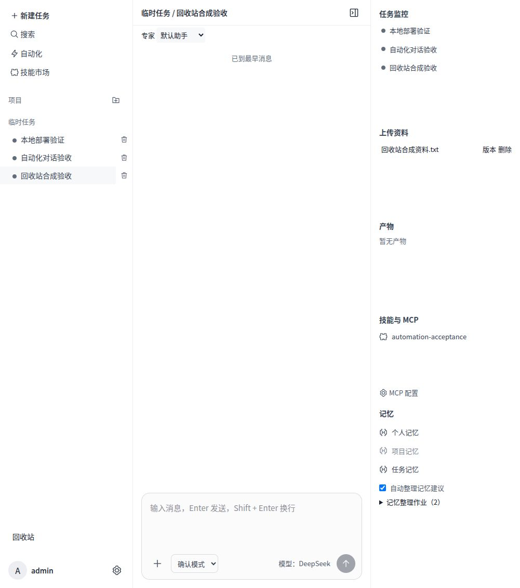

# 统一回收站交付记录（2026-10-17）

## 已确认范围与规则

继续统一计划 SU-R1-03。用户明确选择：删除后保留30天，满30天仍由用户确认永久删除，后台不自动清空。项目、任务、上传资料、成果、记忆、私人 Skill 进入统一回收站；知识分片属于原文件的派生数据，随文件删除失效、恢复后重新解析索引，不独立恢复过期分片。

## 实现

- v30 新增创建者 RLS 隔离的 trash_entries，保存恢复快照、文件版本引用、删除时间和修订令牌。快照与原在线删除同事务提交；快照失败则删除整体回滚。现有在线删除及来源失效逻辑继续执行，不让普通模型工具读取回收站正文。
- 文件所有版本按原 UUID/哈希保留于文件存储；垃圾清理同时检查在线引用与回收站引用。回收站原件计入100MB资料配额，避免重复删除上传绕过容量限制。永久删除后清理无引用原件；磁盘故障可在页面重试清理。
- 项目/任务保留原名称、聊天记录及父子关系，子文件和记忆分别列出。恢复顺序为项目→任务→子资料；永久删除父条目前先处理子条目，避免隐式级联删除。恢复聊天记录不恢复旧模型运行、工具授权、摘要或待确认建议。
- 记忆恢复历史正文并建立新修订，保留旧遗忘规则；原模型上下文继续失效。私人 Skill 保留现有软删除机制，统一入口恢复后保持停用，需重新验证与确认。旧版已删除但仍有完整包的私人 Skill 自动纳入回收站。
- 关联自动化在删除事务内阻止排期、取消排队并撤销在途运行；独立检查运行快照，避免修改计划后遗漏旧输入。关联运行的缓存日志与摘要清除。资料/技能恢复不重新启用旧计划。
- 文件删除保留已有知识、经验、记忆建议及模型上下文失效规则；知识原文下载和引用立即不可用。恢复原件后办公文件重新进入解析作业。
- 页面提供分类、名称搜索、删除时间、可永久删除时间、父条目提示、恢复确认和永久删除文字确认。工作区新增回收站入口；上传资料和成果均增加历史版本、下载和移入回收站操作；自动化成果使用同一文件操作组件。
- 备份清单核对回收站原件哈希；恢复保留清单同时记录回收站身份与修订。旧备份恢复不能复活后来永久删除的条目，也不会把清单回放删除的数据重新归档为可恢复快照。

## 边界

旧版已经物理清除的文件、记忆、对话无法由本次迁移找回。永久删除清除恢复快照和无引用原件；项目/任务/记忆中不含正文的删除身份记录可能保留，以维护外键和遗忘规则。已有离线备份不被在线删除修改，需继续按敏感备份保管。当前不增加专家经验的独立回收操作，原来源撤销仍会使其失效；不包含下一阶段向量检索或OCR。

回收站当前列表上限1000条；满30天只是允许手动永久删除，未操作的条目继续保留。文件按原版本恢复；技能、自动化授权及历史模型上下文不恢复。当前无按时自动清空作业。

## 验收

- 专项36项通过：两用户隔离、版本/字节恢复、引用失效、计划阻断、磁盘引用保护、30天规则、二次确认、项目/任务恢复依赖、记忆再次删除、Skill停用恢复及恢复清单。
- 原数据库630项通过；旧测试中“删除后立即清理磁盘”断言调整为“保留回收站原件”，旧下载/模型引用失效断言继续通过。
- 自动化49项通过，包含真实Docker执行。
- 真实PostgreSQL联合备份恢复35项通过：实际回收站文件可恢复；后来永久删除的条目不由旧备份复活。
- TypeScript、ESLint、前端正式构建通过。
- 本地Docker升级v30成功；浏览器确认恢复合成资料，原任务上传资料列表、历史版本与下载正常；核对保留期内永久删除按钮禁用，删除确认说明和取消操作正常。永久删除以隔离数据库验收，未在业务环境执行。

## 部署与回退

当前镜像 `workpivot-server:local-trash-20261017`；入口 `http://127.0.0.1:39986/#trash`。沿用账号、模型配置、数据库和文件卷。升级前已停应用并保存v29数据库转储、文件归档、原Compose与密钥，位于受保护的 `local-runtime/backups/pre-trash-1792201379519`；转储经过pg_restore --list检查。旧镜像 `workpivot-server:local-automation-20261017` 保留。回退须将配套备份恢复到独立空数据库和文件目录后切换，不能仅切旧镜像；此次未实际演练v30到v29回退。

代码尚未提交或推送。下一阶段为统一计划SU-R2-01（Embedding配置与持久生成作业）。

## 2026-10-19 界面一致性修复

回收站移除自动化原型样式依赖，使用工作区中性色主题变量、蓝色主操作、统一字体和边框；复用全局浅色／深色切换，选择与主界面保持一致。顶部增加明确的“返回主页”按钮，桌面与窄屏均显示，沿用原返回回调刷新项目及任务。窄屏隐藏辅助侧栏，保留返回、主题及列表操作。恢复、永久删除、30天保留期及审计接口行为未变。

本次检查：Web TypeScript、定向 ESLint、正式构建、差异检查通过；真实 Chromium 配合合成 API 数据验证1440px与390px的浅深主题、无横向溢出、恢复确认框取消、名称筛选和返回主工作区，截图已检查。未在业务环境执行恢复或永久删除。

本地发布镜像为 `workpivot-server:local-trash-ui-20261019`，在现有schema49镜像上仅替换前端构建，使用受保护发布流程保留数据库与文件备份。发布记录 `local-runtime/releases/r1792394485698`。本轮未提交或推送。
