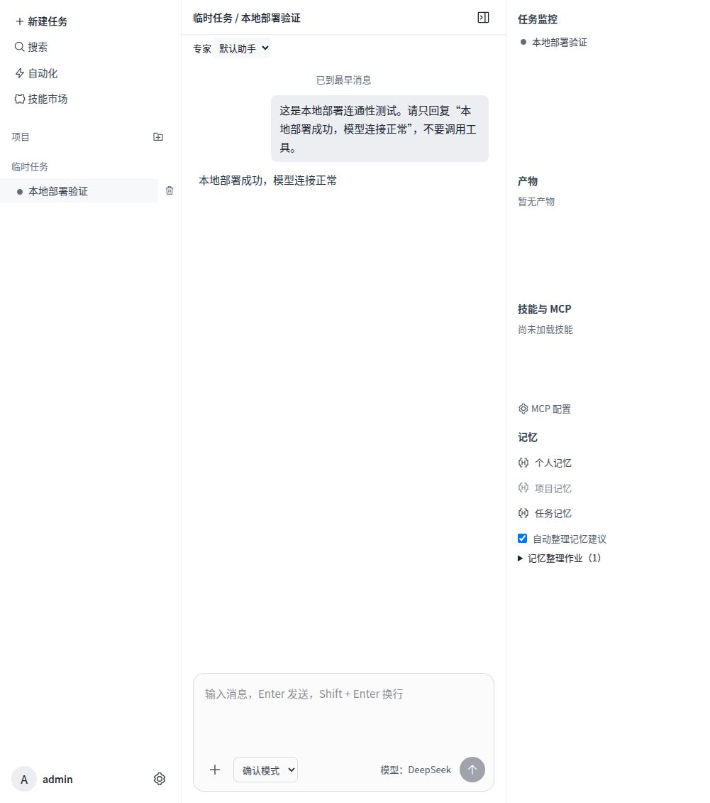

# 本地 Docker 部署（2026-10-17）

当前工作区已部署到本机，包含 SK-01—05，数据库 schema v28。未提交、推送或更改 158 服务。ST 基础定时任务仍待开发。应用健康接口沿用 `0.3.0-rc.1`，本次具体构建以镜像标签和本记录识别。

## 访问与登录

- 用户页面：http://127.0.0.1:39986/
- 管理页面：http://127.0.0.1:39986/admin
- 用户名：`admin`；随机生成的密码保存在仓库根目录 `local-runtime/login.txt`，权限 0600。文档不保存密码。
- 本地配置：`local-runtime/.env.local`、`local-runtime/worker.env.local`。目录权限 0700，已加入 Git 忽略。应随数据单独保护和备份，不能当作构建缓存删除。
- 已沿用本机既有 DeepSeek 密钥，模型 `deepseek-flash`，直接访问 `https://api.deepseek.com`。密钥加密存入数据库。

## 运行组成

- Compose：`releases/deploy/compose.local-current.yml`，项目名 `workpivot-local`。
- 镜像：`workpivot-server:local-skill-20261017`。
- 应用仅映射 `127.0.0.1:39986`，数据库不映射宿主端口。
- 独立持久卷：`workpivot-local_postgres`、`workpivot-local_files`。原有 agentforge 容器与卷未更改。
- 技能执行：宿主用户服务 `workpivot-local-worker.service`，监听 Docker 桥接地址 `172.17.0.1:39990`，需要专用令牌。使用 `workpivot-executor:closeout-20261016`，任务容器断网、限额、只读根目录，执行后清理。
- 应用容器无 Docker 套接字。宿主服务使用当前仓库的 `code/scripts/skill-worker.mjs`，移动仓库需调整服务路径。已启用用户服务驻留和自动启动；电脑/WSL 与 Docker 必须运行。
- 内置 Word、Excel、PowerPoint 技能已发布到市场，默认不替用户加载；已初始化通用研究员模板。

## 日常操作

在仓库根目录运行：

```bash
docker compose --env-file local-runtime/.env.local -f releases/deploy/compose.local-current.yml up -d
docker compose --env-file local-runtime/.env.local -f releases/deploy/compose.local-current.yml ps
docker compose --env-file local-runtime/.env.local -f releases/deploy/compose.local-current.yml logs --tail 80 server
systemctl --user status workpivot-local-worker.service
```

停止应用使用 Compose `stop`；保留数据库和文件卷。不要使用 `down -v`，这会删除本部署的数据卷。再次升级前使用已有联合备份流程同时保护数据库、文件和本地密钥；本次为独立新建部署，没有可回退的旧 WorkPivot 业务容器。

## 构建与验收

构建文件 `Dockerfile.local-current` 使用本机已缓存执行镜像。构建上下文 `tmp/local-deploy/build` 只含工作区根运行依赖、各包源码/清单/依赖链接、内置技能、脚本及新构建的前端产物，不包含本地密钥。该目录是可重新生成的构建缓存；实际运行不依赖它。

```bash
docker build -f releases/deploy/Dockerfile.local-current -t workpivot-server:local-skill-20261017 tmp/local-deploy/build
```

本次验证：前端构建通过；schema v28 初始化；应用/数据库 healthy；管理员 API 及浏览器登录；未登录私人 Skill 接口返回 401；真实 Docker 加载 Excel/Word 依赖并产出 JSON 合计 42；应用容器到执行服务健康检查；应用重启后登录和模型配置保留；浏览器真实 DeepSeek 对话成功。未重复执行整套 630 项开发回归，历史开发验收见 [Skill 收尾记录](../../docs/03-project/verification/skill-build-closeout-20261017.md)。



## 同日自动化升级

当前镜像已更新为 `workpivot-server:local-automation-20261017`，schema29。自动化入口 `http://127.0.0.1:39986/#automations`。原账号、DeepSeek配置、数据库和文件卷保留。升级前保存受保护的v28转储、文件归档、Compose与密钥，旧镜像保留；回退须恢复配套数据到独立目标，不能只切旧镜像。首次依赖链接打包错误在迁移前已修复。当前构建上下文 `tmp/local-deploy/automation-build-v2`，复制pnpm依赖时保留原始相对软链接。完整测试和回退边界见[自动化交付记录](../../docs/03-project/verification/automation-closeout-20261017.md)。本次未提交或推送代码。

## 同日统一回收站升级

当前镜像为 `workpivot-server:local-trash-20261017`，schema30；入口 `http://127.0.0.1:39986/#trash`。升级前v29回退包保存在 `local-runtime/backups/pre-trash-1792201379519`，旧自动化镜像保留。原账号、模型配置及卷保持。回收站30天保留，到期仍需手动确认，不执行自动清空。专项36、数据库630、自动化49、真实恢复35项通过，浏览器恢复与下载通过，见[交付记录](../../docs/03-project/verification/trash-closeout-20261017.md)。构建上下文为 `tmp/local-deploy/trash-build`。


## 本地向量模型升级（2026-10-17）

当前镜像为 `workpivot-server:local-embedding-20261017`，schema31。独立Ollama容器已部署BGE-M3并启用固定模型名称，限制2 CPU/4GB，无宿主机公开端口，模型在独立持久卷中。管理后台模型管理可查看2/2合成资料分片及中文查询结果。

升级前回退包为 `local-runtime/backups/pre-embedding-1792202327170`。该目录为升级前schema30数据与文件，旧应用镜像为`workpivot-server:local-trash-20261017`；回退必须配套恢复，不能只切换镜像。部署和验收细节见[向量索引交付记录](../../docs/03-project/verification/embedding-closeout-20261017.md)。


## 混合检索升级（2026-10-17）

当前应用镜像`workpivot-server:local-hybrid-20261017`，schema仍为31。真实聊天已接入混合检索、降级提示和原文引用窗口。升级前回退包`local-runtime/backups/pre-hybrid-1792203722087`，旧镜像`workpivot-server:local-embedding-20261017`。验收和限制见[混合检索交付](../../docs/03-project/verification/hybrid-retrieval-closeout-20261017.md)。


## 网页工具、共享浏览器及悬浮区升级（2026-10-17）

当前应用镜像为`workpivot-server:local-browser-ui-20261017`，独立浏览器镜像`workpivot-browser:local-shared-20261017`，schema仍为31。右上“动态与资料”可固定/隐藏，右侧真实浏览器与当前对话AI共享页面。升级前停写回退包为`local-runtime/backups/pre-web-1792225781000`；旧hybrid镜像保留。本次只部署网页/UI范围，工作区并行Office、用量等变更未纳入。配置、实际验收和回退见[本批上线记录](网页浏览器上线-20261017.md)。
