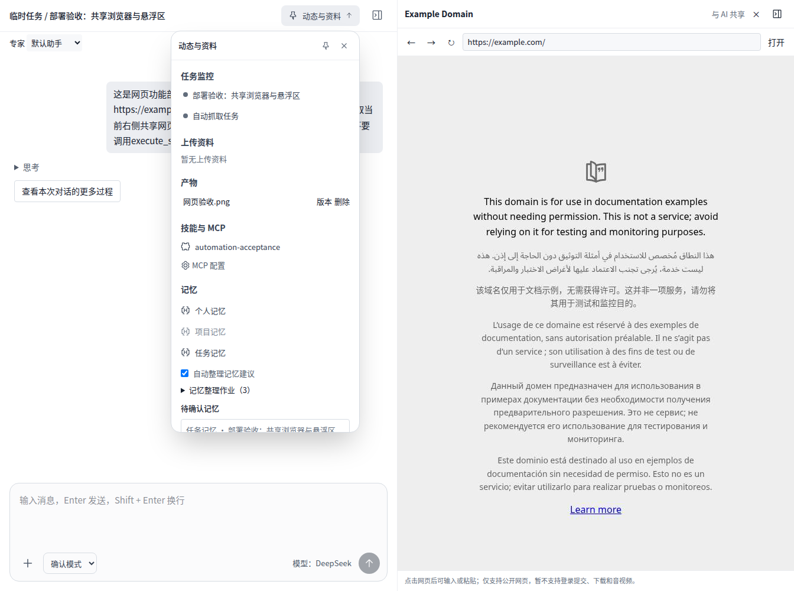

# 本机网页工具、共享浏览器与悬浮区上线

2026-10-17，用户授权部署到现有本机Docker服务，并确认右侧改真实浏览器、原右侧栏全部迁入可固定/隐藏悬浮区、用户和AI共享当前对话页面。

## 已部署

- 用户入口：http://127.0.0.1:39986/ ，管理员入口仍为 `/admin`，原账号与模型配置保留。
- 应用：`workpivot-server:local-browser-ui-20261017`，Compose为 `releases/deploy/compose.local-current.yml`。
- 浏览器：`workpivot-browser:local-shared-20261017`，Compose为 `releases/deploy/compose.browser-local.yml`，不公开宿主端口；API经独立Docker网络访问 `http://browser:39991`，浏览器不加入数据库网络、不挂载业务卷或Docker socket。
- 业务数据库仍为schema31；本批没有执行迁移。部署包从此前hybrid构建源码叠加本批网页文件及独立前端，明确排除工作区并行开发的Office解析、用量/计费等变更。
- 应用与浏览器使用受保护的 `local-runtime/browser.env.local`，权限0600，真实令牌不入库。旧数据卷 `workpivot-local_postgres`、`workpivot-local_files` 保留。

官方Playwright大镜像下载受网络影响，最终采用缓存Node 22 Debian镜像、已安装并验收的Google Chrome 155.0.8059.84、正式Debian运行库及Noto字体，Playwright为1.64.1。使用非root、只读根目录、临时目录、1.5GiB内存/2CPU/PID限制及Chromium沙箱；未使用 `--no-sandbox`。启动前修复Cairo运行库和中文字体缺失。宿主用户服务及精简运行库备选均未采用，宿主浏览器服务已禁用，等待中的大镜像下载已停止。

`browser-seccomp.json`基于Playwright官方固定版本配置，并补充允许Chromium在自身用户命名空间建立沙箱所需的chroot系统调用；容器仍cap_drop ALL，不授予宿主SYS_CHROOT，宿主权限继续由内核校验。许可证/来源保留。

## 界面与会话

对话右上角“动态与资料”包含任务监控、上传资料、产物、技能/MCP及三层记忆；支持固定、收起和隐藏，偏好按账号保存。任务和成果新内容优先展示，空列表不占固定大块空白。

右侧是真实服务端浏览器画面，提供地址栏、前进/后退/刷新、点击、滚动、键盘和粘贴，视口随面板大小调整，画面约1.5秒轮询刷新。每个账号/对话独立；AI browser_visit共享同页，可省略URL继续读取，用户与AI动作串行。刷新可重连，最多4个共享会话，10分钟无操作回收；关闭或服务重启不保留Cookie/登录态。

网页搜索、持久登录、非GET提交、文件上传下载、音视频、拖拽选择及验证码专用接管未纳入。自动化仍使用独立临时上下文和来源白名单，不借用人工页面。

## 网络

当前宿主及Docker DNS返回Fake-IP（198.18.0.0/15、ULA IPv6），会被公网地址防护正确拒绝。本部署显式配置 `WORKPIVOT_WEB_DOH_URL=https://cloudflare-dns.com/dns-query`，仅发送域名到管理员指定解析端点，不发送URL路径、正文或业务凭据。解析后仍逐地址公网检查并固定连接，未放宽私网/保留地址限制。端点协议依据 https://developers.cloudflare.com/1.1.1.1/encryption/dns-over-https/make-api-requests/dns-json/ 。非Fake-IP环境可删除该配置，恢复系统DNS。

## 备份与回退

切换前已停写备份到 `local-runtime/backups/pre-web-1792225781000`，包含schema31数据库dump、业务文件tar、旧Compose及受保护配置。pg_restore目录、文件归档可读性和SHA256检查已通过，校验文件为checksums.json；目录0700，dump/tar0600。旧镜像 `workpivot-server:local-hybrid-20261017` 保留。

本批无数据库迁移。回退前先停用带网页访问的自动化，停止当前应用，恢复备份中的旧Compose并启动旧应用即可回到原功能（保留升级后数据库/文件）；随后停止浏览器Compose。需要回到升级前完整数据时，应按联合恢复流程恢复到隔离目标，再切换，不直接覆盖生产卷。不使用 `down -v`。

## 本次实际验收

- 网页/真实Chromium专项17项通过：DNS/地址/重定向、正文编码和截断、授权、动态渲染、点击/滚动/截图、用户输入后AI同页读取、前后导航、任务隔离、画面抓取与操作互斥、关闭及取消释放。
- 临时PostgreSQL专项13项通过：账号/任务浏览器键隔离、跨用户拒绝、对话授权允许/拒绝、自动化来源白名单、真实文件发布、错误与停止后的迟到拒绝。
- 已部署API和真实界面验证：右侧公网导航、悬浮区所有原功能入口、固定/隐藏/恢复、后退及刷新重连通过。
- 已配置真实DeepSeek模型完成 `web_fetch` 和不传URL的共享 `browser_visit`，生成 `网页验收.png`，从真实文件下载接口校验PNG签名通过。保留验收对话“部署验收：共享浏览器与悬浮区”供查看。
- 补齐字体后再次验证实际界面和旧PNG下载；应用、数据库、浏览器healthy，schema仍31。
- 本批相关server/web类型检查、lint、依赖边界与独立前端构建通过。完整工作区类型检查仍有desktop Electron依赖缺失限制；本批未更改桌面代码或关闭检查。未将并行开发内容纳入部署。

部署构建缓存及无密钥验收结果位于 `tmp/local-deploy/web-*`，不入库；运行依赖是镜像与持久卷，不依赖构建缓存。本批代码与文档单独归档提交；未更改远端158服务。

## 提交前复验

从Git暂存区导出独立源码副本，排除并行未提交内容后，server/web类型检查、真实Chromium网页17项、一次性PostgreSQL网页13项再次通过。第三方seccomp许可证仅统一换行为LF，保留原文。提交差异检查和敏感令牌特征扫描通过。

## 实际界面

